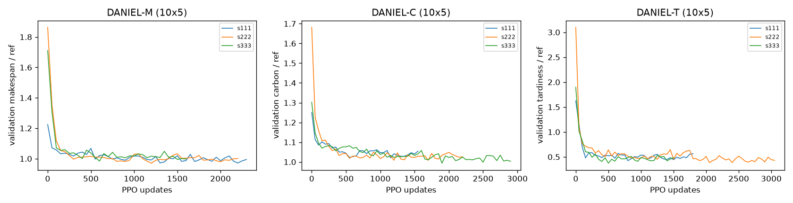
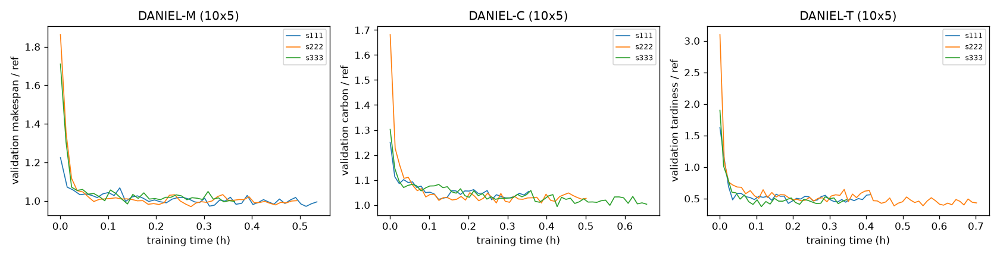
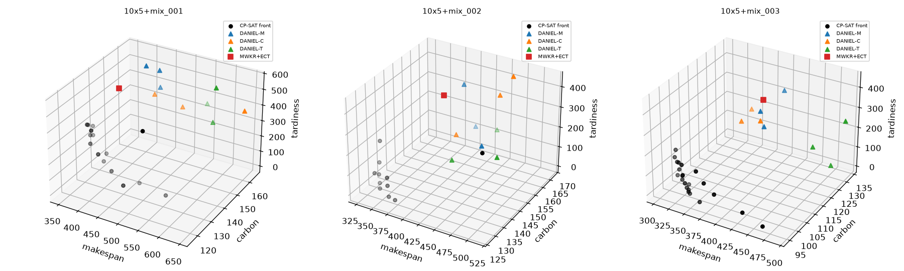
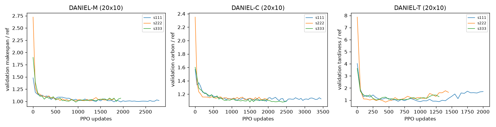
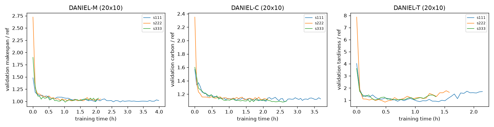
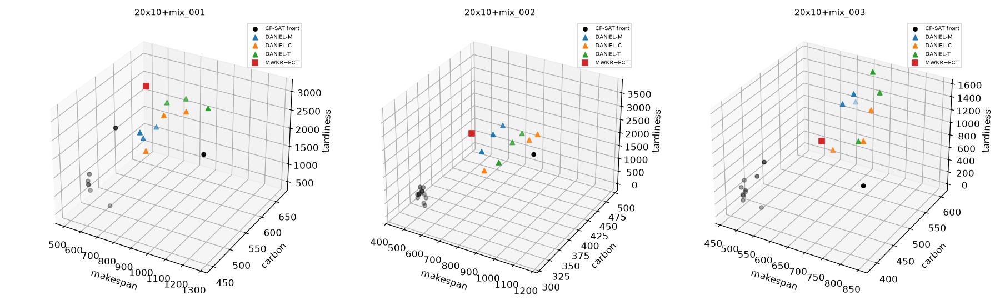

# Benchmark v3 baselines: single-objective specialists and CP-SAT reference bounds

Protocol: `docs/evaluation_protocol_v3.md` (pre-registered). Generated by `tools/analyze_baselines_v3.py` over the units completed so far. Evaluation split: `evaluation`; CP-SAT split: `evaluation`.

## Plain-English summary

_(placeholder: to be written after the runs complete)_

## Completion

* runs with an evaluation: 18; NOT CONVERGED (hit the cap): none; FAILED: none
* CP-SAT batches FAILED: none

## 10x5

### Main table, 10x5 (evaluation split, greedy; mean ± std over seeds; 100 instances)

| Model | Training objective | Makespan | Carbon (kg CO2e) | Tardiness | Tardy-job share | Training time (h) | Updates to convergence | Converged | Gap to bound on own objective |
|---|---|---|---|---|---|---|---|---|---|
| DANIEL-M | makespan | 408.5 ± 6.1 | 154.8 ± 2.2 | 414.5 ± 43.4 | 0.484 ± 0.023 | 0.46 ± 0.09 | 2033 ± 379 | Y (3/3) | 26.6% ± 1.8% [gap to bound] |
| DANIEL-C | carbon | 450.2 ± 6.5 | 153.5 ± 1.7 | 359.8 ± 51.7 | 0.400 ± 0.024 | 0.50 ± 0.15 | 2217 ± 675 | Y (3/3) | 30.3% ± 1.4% [gap to bound] |
| DANIEL-T | tardiness | 463.3 ± 11.8 | 160.2 ± 1.5 | 244.9 ± 9.5 | 0.429 ± 0.010 | 0.49 ± 0.19 | 2117 ± 822 | Y (3/3) | 40.9% of Tref ± 1.7% of Tref [gap to best-known (97/100 proven optimal)] |
| CP-SAT min makespan (B1, lexicographic) | mk | 323.7 | 135.5 | 216.0 | 0.360 | - | - | - | reference (100 instances) |
| CP-SAT min tardiness (B1, lexicographic) | tard | 440.0 | 128.6 | 17.0 | 0.090 | - | - | - | reference (100 instances) |
| CP-SAT min carbon (B1, analytic + lexicographic) | carbon | 577.5 | 118.8 | 528.9 | 0.404 | - | - | - | reference (100 instances) |
| MWKR + ECT (rule, context) | - | 410.2 | 149.7 | 570.1 | 0.604 | - | - | - | - |

Tardiness gaps are (model - best-known) / Tref (Tref = 557.4); makespan and carbon gaps are relative to the best-known CP-SAT value.

### Bootstrap 95% CIs over instances, 10x5 (seed-averaged per-instance values, 10,000 resamples)

| Model | Makespan | Carbon | Tardiness | Tardy-job share |
|---|---|---|---|---|
| DANIEL-M | 408.5 [401.2, 415.9] | 154.8 [149.4, 160.3] | 414.5 [374.6, 457.3] | 0.484 [0.456, 0.512] |
| DANIEL-C | 450.2 [439.0, 462.0] | 153.5 [148.4, 158.8] | 359.8 [323.4, 399.6] | 0.400 [0.374, 0.425] |
| DANIEL-T | 463.3 [453.1, 474.3] | 160.2 [154.8, 165.7] | 244.9 [209.8, 281.6] | 0.429 [0.390, 0.467] |

### Secondary: sampling (sample100, selected by own objective), 10x5

| Model | Makespan | Carbon | Tardiness | Tardy-job share |
|---|---|---|---|---|
| DANIEL-M | 361.7 ± 3.5 | 147.3 ± 1.2 | 327.8 ± 30.9 | 0.460 ± 0.015 |
| DANIEL-C | 437.6 ± 7.5 | 140.7 ± 1.4 | 280.9 ± 37.2 | 0.356 ± 0.018 |
| DANIEL-T | 444.2 ± 10.4 | 153.0 ± 2.0 | 108.1 ± 0.5 | 0.294 ± 0.007 |

### Time to reach 5% / 2% / 1% of the final validation value, 10x5 (mean ± std over seeds)

| Model | 5%: updates | 5%: hours | 2%: updates | 2%: hours | 1%: updates | 1%: hours | best checkpoint update |
|---|---|---|---|---|---|---|---|
| DANIEL-M | 317 ± 29 | 0.08 ± 0.01 | 700 ± 265 | 0.17 ± 0.07 | 1033 ± 379 | 0.24 ± 0.09 | 1333 ± 808 |
| DANIEL-C | 483 ± 318 | 0.11 ± 0.07 | 933 ± 664 | 0.21 ± 0.15 | 1150 ± 687 | 0.26 ± 0.15 | 1583 ± 388 |
| DANIEL-T | 1117 ± 822 | 0.26 ± 0.19 | 1117 ± 822 | 0.26 ± 0.19 | 1117 ± 822 | 0.26 ± 0.19 | 1117 ± 822 |

### CP-SAT B1 bounds, 10x5 (100/100 instances)

| Point | Primary status counts | Mean primary wall (s) | Makespan | Carbon | Tardiness | Tardy-job share |
|---|---|---|---|---|---|---|
| min makespan | OPTIMAL 100 | 2.6 | 323.7 | 135.5 | 216.0 | 0.360 |
| min tardiness | FEASIBLE 3, OPTIMAL 97 | 3.1 | 440.0 | 128.6 | 17.0 | 0.090 |
| min carbon (analytic) | OPTIMAL 100 | 0.0 | 577.5 | 118.8 | 528.9 | 0.404 |

Objectives at each extreme point are after the lexicographic stages (exact re-scoring).

### CP-SAT B2 reference front, 10x5 (20 instances)

* points on the front per instance: mean 13.6, min 6, max 22
* grid statuses: INFEASIBLE 87, OPTIMAL 413; share proven optimal 82.6%

## 20x10

### Main table, 20x10 (evaluation split, greedy; mean ± std over seeds; 100 instances)

| Model | Training objective | Makespan | Carbon (kg CO2e) | Tardiness | Tardy-job share | Training time (h) | Updates to convergence | Converged | Gap to bound on own objective |
|---|---|---|---|---|---|---|---|---|---|
| DANIEL-M | makespan | 609.3 ± 7.4 | 482.5 ± 4.3 | 1268.3 ± 66.6 | 0.763 ± 0.036 | 2.74 ± 1.08 | 2183 ± 539 | Y (3/3) | 29.9% ± 1.5% [gap to best-known (0/100 proven optimal)] |
| DANIEL-C | carbon | 699.7 ± 30.1 | 481.8 ± 9.0 | 1058.6 ± 111.8 | 0.536 ± 0.018 | 2.83 ± 0.78 | 2650 ± 737 | Y (3/3) | 47.3% ± 2.8% [gap to bound] |
| DANIEL-T | tardiness | 669.4 ± 16.2 | 500.1 ± 6.7 | 1206.9 ± 93.9 | 0.724 ± 0.039 | 1.69 ± 0.41 | 1583 ± 369 | Y (3/3) | 82.2% of Tref ± 6.9% of Tref [gap to best-known (48/100 proven optimal)] |
| CP-SAT min makespan (B1, lexicographic) | mk | 470.9 | 368.0 | 221.8 | 0.270 | - | - | - | reference (100 instances) |
| CP-SAT min tardiness (B1, lexicographic) | tard | 549.2 | 360.8 | 89.5 | 0.129 | - | - | - | reference (100 instances) |
| CP-SAT min carbon (B1, analytic + lexicographic) | carbon | 987.5 | 328.4 | 2614.6 | 0.464 | - | - | - | reference (100 instances) |
| MWKR + ECT (rule, context) | - | 595.1 | 438.7 | 1406.5 | 0.796 | - | - | - | - |

Tardiness gaps are (model - best-known) / Tref (Tref = 1361.9); makespan and carbon gaps are relative to the best-known CP-SAT value.

### Bootstrap 95% CIs over instances, 20x10 (seed-averaged per-instance values, 10,000 resamples)

| Model | Makespan | Carbon | Tardiness | Tardy-job share |
|---|---|---|---|---|
| DANIEL-M | 609.3 [601.0, 617.7] | 482.5 [469.9, 495.9] | 1268.3 [1179.0, 1358.9] | 0.763 [0.742, 0.784] |
| DANIEL-C | 699.7 [689.0, 710.5] | 481.8 [469.6, 494.7] | 1058.6 [994.7, 1125.8] | 0.535 [0.518, 0.554] |
| DANIEL-T | 669.4 [660.7, 678.9] | 500.1 [487.5, 513.3] | 1206.9 [1125.3, 1291.1] | 0.724 [0.703, 0.746] |

### Secondary: sampling (sample100, selected by own objective), 20x10

| Model | Makespan | Carbon | Tardiness | Tardy-job share |
|---|---|---|---|---|
| DANIEL-M | 555.1 ± 5.7 | 458.7 ± 2.1 | 957.8 ± 83.7 | 0.712 ± 0.032 |
| DANIEL-C | 672.9 ± 33.2 | 446.8 ± 6.5 | 722.1 ± 70.1 | 0.440 ± 0.030 |
| DANIEL-T | 662.8 ± 13.1 | 486.3 ± 6.3 | 1001.5 ± 129.3 | 0.710 ± 0.080 |

### Time to reach 5% / 2% / 1% of the final validation value, 20x10 (mean ± std over seeds)

| Model | 5%: updates | 5%: hours | 2%: updates | 2%: hours | 1%: updates | 1%: hours | best checkpoint update |
|---|---|---|---|---|---|---|---|
| DANIEL-M | 633 ± 231 | 0.84 ± 0.38 | 983 ± 401 | 1.29 ± 0.60 | 1050 ± 312 | 1.37 ± 0.54 | 1233 ± 625 |
| DANIEL-C | 517 ± 275 | 0.55 ± 0.29 | 983 ± 379 | 1.05 ± 0.41 | 1483 ± 475 | 1.59 ± 0.51 | 2233 ± 333 |
| DANIEL-T | 467 ± 176 | 0.50 ± 0.20 | 583 ± 369 | 0.62 ± 0.40 | 583 ± 369 | 0.62 ± 0.40 | 683 ± 539 |

### CP-SAT B1 bounds, 20x10 (100/100 instances)

| Point | Primary status counts | Mean primary wall (s) | Makespan | Carbon | Tardiness | Tardy-job share |
|---|---|---|---|---|---|---|
| min makespan | FEASIBLE 100 | 60.0 | 470.9 | 368.0 | 221.8 | 0.270 |
| min tardiness | FEASIBLE 52, OPTIMAL 48 | 44.1 | 549.2 | 360.8 | 89.5 | 0.129 |
| min carbon (analytic) | OPTIMAL 100 | 0.0 | 987.5 | 328.4 | 2614.6 | 0.464 |

Objectives at each extreme point are after the lexicographic stages (exact re-scoring).

### CP-SAT B2 best-known front, 20x10 (10 instances)

* points on the front per instance: mean 11.5, min 8, max 15
* grid statuses: FEASIBLE 122, INFEASIBLE 29, OPTIMAL 15, UNKNOWN 84; share proven optimal 6.0%

Normalisation points frozen: `results/baselines_v3/normalisation_points.json`.

