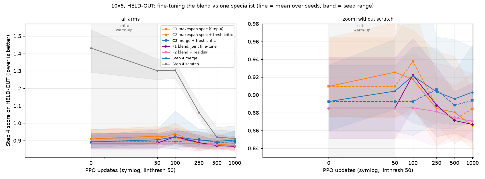

# Fine-tuning the three-specialist blend vs fine-tuning one specialist, at equal PPO updates

## Pre-registration

Written and committed BEFORE any training in this study (including smoke tests). Never edited afterwards;
changes go under "Deviations". This is a new experiment and does not overturn the zero-training verdict
(results/blend_zero_training.md, NOT MEANINGFUL).

### Question
Once fine-tuned under the same PPO budget, does recombining three specialists beat reusing one?

### Setup (identical to Step 4 except where an arm says otherwise)
* 10x5 only; seeds 111/222/333/444; each seed uses only its own specialists `m_s<seed>`, `c_s<seed>`,
  `t_k125s060_s<seed>` (and, for C3, its own Step 4 merge composition).
* Reward, preference and PPO exactly as Step 4 (`tools/run_arms_t.py`): goal `mct`, preference (1/3,1/3,1/3),
  carbon_reward_weight 0.002384, tardiness_reward_weight 5.815362; the `params.py` defaults Step 4 used (lr 3e-4,
  eps_clip 0.2, k_epochs 4, minibatch 1024, entloss_coef 0.01, vloss_coef 0.5, ploss_coef 1, gamma 1,
  gae_lambda 0.98, tau 0, num_envs 20, reset_env_timestep 20, validate_timestep 10); training instances sampled
  from the 10x5 train split as in Step 4; due dates from the frozen manifest k125s060; 1000 updates; budget
  snapshots at 0, 50, 100, 250, 500, 1000. No hyperparameter is tuned for any arm.
* Implementation: Step 4's own `train.Trainer` drives every run (instance sampling, environments, rollouts from
  `policy_old`, GAE, validation, snapshots). Only the policy module and the PPO update step are replaced; the
  update step is a copy of `PPO.update` plus the critic warm-up. `Trainer.train()` reseeds with the run's seed
  before any sampling, so any extra initialisation done beforehand does not change the random streams.
* Evaluation: the 50 HELD-OUT instances of blend_zero_training (same IDs, `results/blend_zero_training/split.json`)
  at every snapshot, with the Step 4 score (per-seed centroid reference over all 100 instances), greedy
  decoding, due dates from the manifest, batching only among instances sharing the same maximum processing time.
  Blend policies are decoded with the same arithmetic as blend_zero_training's B3 (weighted log-probabilities over
  valid actions, log_softmax, argmax); single networks as in the canonical evaluator.
* Required checks at update 0 (the study stops if any fails): F1@0 and F2@0 reproduce B3 exactly on HELD-OUT;
  C2@0 reproduces the makespan specialist; C3@0 reproduces the Step 4 merge at update 0.

### Fresh critic and warm-up (arms F1, F2, C2, C3)
* Critic architecture = DANIEL's critic: MLP with 3 layers, hidden size 64, tanh (`Critic(3, in, 64, 1)`), freshly
  initialised with a fixed per-seed seed.
* F1, F2: input = the concatenation of the three specialists' pooled state embeddings (3 x 16 = 48), with
  stop-gradient, so the value loss never reaches the specialists.
* C2, C3: input = the network's own pooled state embedding (16). DANIEL's critic module is re-initialised in
  place and keeps Step 4's gradient path into the shared feature extractor; the arm differs from its Step 4
  counterpart ONLY in the critic treatment (fresh weights + warm-up), as specified.
* Warm-up: updates 1-50 train ONLY the critic (value loss only; actor and feature extractors frozen), with an
  Adam optimiser over the critic parameters at lr 3e-4. From update 51 one Adam optimiser covers all trainable
  parameters of the arm, as Step 4 does. Warm-up updates count toward the 1000 and appear on the x-axis.

### Arms (1000 PPO updates each, 4 seeds)
* **F1 Blend, joint fine-tune.** log pi = sum_i alpha_i log p_i over valid actions, renormalised; alpha fixed at the
  seed's B3 weights (permille m/c/t: 111 100/100/800, 222 300/200/500, 333 600/100/300, 444 200/0/800). All three
  specialists' feature extractors and actor heads are trainable; gradients flow through the blend.
* **F2 Blend + residual.** The three specialists are frozen. Policy logits = the blend's weighted log-probabilities
  + r_theta(s, a). r_theta is an MLP on each candidate action's three specialist action embeddings (the 41-dim
  vector each specialist's actor scores; stop-gradient) plus the three log-probabilities of that action (126
  inputs), with 2 hidden layers of 64 and tanh; its last layer is zero-initialised, so update 0 is exactly the
  blend. The trainable parameter count is reported.
* **C1 Makespan specialist, Step 4 as-is.** The existing Step 4 snapshots; no new training.
* **C2 Makespan specialist + fresh critic + warm-up.**
* **C3 Merge + fresh critic + warm-up.** From the seed's Step 4 merge composition.
* Run order (priority if time is short): all seeds of F1, then F2, then C2, then C3.

### Metrics
* Step 4 score on HELD-OUT at every snapshot, per seed and pooled; raw makespan, carbon and tardiness at 1000.
* Paired comparisons (relative gain of X over Y = (mean Y - mean X)/mean Y over the 50 held-out instances,
  positive = X better; paired bootstrap 95% CI from 10,000 instance resamples, seed 20260927; pooled = the same
  resampled instances applied to all seeds):
  F1 and F2 at 1000 vs the BEST SINGLE-SPECIALIST CONTROL at 1000 (C1 or C2, whichever has the lower pooled
  score at 1000; stated); C3 at 1000 vs Step 4 merge at 1000.
* Updates-to-threshold: the first snapshot at which an arm's score is <= the best control's score at 1000,
  pooled and per seed (per seed, against that seed's control score).
* Wall-clock and GPU time per arm.

### Decision rule
A seed "counts" when the relative gain is >= 1% AND the lower end of its 95% CI is > 0.
* **WIN:** F1 or F2 beats the best single-specialist control at 1000 at >= 3 of 4 seeds; OR the arm's per-seed
  score reaches that seed's control score at 1000 by update 500 at >= 3 of 4 seeds.
* **LOSE:** the best single-specialist control beats BOTH F1 and F2 at 1000 (both at the same seed) at >= 3 of 4
  seeds.
* **TIE:** neither WIN nor LOSE.
* **Secondary (merge stall):** "critic caused the stall" if C3 beats Step 4 merge at 1000 at >= 3 of 4 seeds;
  otherwise "not supported".

## Step 4 critic audit (Step 0a, from the code)

Step 4 (`tools/run_arms_t.py` -> `daniel/train.py`) started every warm-start arm with `--init_from`, and
`Trainer.load_initial_checkpoint` loads the WHOLE checkpoint (`policy.load_state_dict`) into both `policy` and
`policy_old`: feature extractor, actor AND critic.
* **Makespan / carbon / tardiness specialist arms:** each kept the specialist's OWN critic, trained to predict
  that specialist's single-objective return, not the three-objective return it was now fine-tuned on.
* **Merge arm:** the WEIGHT-AVERAGED critic. `tools/merge_weight_soup.py` averages every tensor in the state
  dict, critic included, so the merge started with a weighted average of three critics trained on different
  rewards.
* **Scratch arm:** a freshly initialised DANIEL, critic included (random initialisation under the run's seed).
* **Warm-up:** none. From update 1, one Adam optimiser (lr 3e-4, fresh state) trained all parameters jointly on
  `vloss_coef * value loss + policy loss + entloss_coef * entropy loss`. The critic shares DANIEL's feature
  extractor, so value-loss gradients also move the policy's features.
* The results Step 4 reports are the fixed-update snapshots (`@u<N>`), not validation-selected checkpoints.

## Deviations

1. **F1's trainable-parameter count** is 94,823 as counted by the optimiser. That includes the three specialists'
   built-in DANIEL critic heads (3 x 5,313), which the blend never uses and which receive no gradient; the
   effective count is **78,884** (3 x 23,841 extractor + actor, plus the 7,361-parameter fresh critic). F2 trains
   **19,714** parameters: residual 12,353 + critic 7,361.
2. **Harness check and smoke runs** (after the pre-registration commit, before the real runs), under separate
   names so they could not touch real outputs or resume markers:
   * `S4CHECK`: the replaced update step in Step 4 mode (specialist's own critic, no warm-up), 50 updates on seed 111.
     Its update-50 snapshot is **bit-identical** to Step 4's makespan arm at update 50 (every tensor equal). So the
     harness is Step 4 exactly, apart from what each arm changes. Outputs: `raw/S4CHECK_s111.*`.
   * 20-update smoke runs of F1 and F2 (`raw_smoke/`), which confirmed timing and that F1@0 and F2@0 reproduce B3.
3. **The figure has a second, zoomed panel** without the scratch arm, because scratch's early values
   (1.3-1.4) compress the region where the other arms differ. The left panel is the requested full chart.
4. **Cost came in under the estimate.** The pre-run estimate was about 8 GPU-hours (F1 57 min, F2 30 min,
   C2/C3 16 min per seed); the actual total was **5.6 GPU-hours of training** plus about 8 minutes of evaluation.

**All pre-registered update-0 checks passed** at every seed: F1@0 and F2@0 reproduce B3 exactly on HELD-OUT, C2@0
reproduces the makespan specialist, and C3@0 reproduces the Step 4 merge at update 0.

## Results

### Step 4 score on HELD-OUT at every snapshot (lower is better): pooled mean over seeds (sd across seeds)

| arm | u0 | u50 | u100 | u250 | u500 | u1000 |
|---|---|---|---|---|---|---|
| C1 makespan spec (Step 4) | 0.9096 (0.042) | 0.9255 (0.046) | 0.9175 (0.040) | 0.8847 (0.047) | 0.8804 (0.042) | 0.8655 (0.029) |
| C2 makespan spec + fresh critic | 0.9096 (0.042) | 0.9096 (0.042) | 0.9377 (0.052) | 0.8879 (0.024) | 0.8720 (0.028) | 0.8845 (0.030) |
| C3 merge + fresh critic | 0.8926 (0.031) | 0.8926 (0.031) | 0.8926 (0.043) | 0.9059 (0.043) | 0.8884 (0.028) | 0.8937 (0.042) |
| F1 blend, joint fine-tune | 0.8853 (0.041) | 0.8853 (0.041) | 0.9224 (0.034) | 0.8884 (0.032) | 0.8712 (0.022) | 0.8668 (0.031) |
| F2 blend + residual | 0.8853 (0.041) | 0.8853 (0.041) | 0.8855 (0.044) | 0.8812 (0.040) | 0.8743 (0.038) | 0.8705 (0.036) |
| Step 4 merge | 0.8926 (0.031) | 0.9043 (0.039) | 0.9215 (0.099) | 0.9035 (0.044) | 0.8956 (0.046) | 0.9030 (0.036) |
| Step 4 scratch | 1.4309 (0.121) | 1.3013 (0.049) | 1.3031 (0.051) | 1.0619 (0.037) | 0.9198 (0.043) | 0.9121 (0.055) |

Per seed:

| arm | seed | u0 | u50 | u100 | u250 | u500 | u1000 |
|---|---|---|---|---|---|---|---|
| C1 makespan spec (Step 4) | 111 | 0.8756 | 0.9391 | 0.9222 | 0.8551 | 0.8554 | 0.8556 |
| C1 makespan spec (Step 4) | 222 | 0.8786 | 0.9075 | 0.8896 | 0.8918 | 0.8574 | 0.8395 |
| C1 makespan spec (Step 4) | 333 | 0.9198 | 0.8740 | 0.8856 | 0.8434 | 0.8655 | 0.8609 |
| C1 makespan spec (Step 4) | 444 | 0.9644 | 0.9814 | 0.9728 | 0.9486 | 0.9436 | 0.9060 |
| C2 makespan spec + fresh critic | 111 | 0.8756 | 0.8756 | 0.9530 | 0.8901 | 0.8447 | 0.8648 |
| C2 makespan spec + fresh critic | 222 | 0.8786 | 0.8786 | 0.9181 | 0.8663 | 0.8648 | 0.8603 |
| C2 makespan spec + fresh critic | 333 | 0.9198 | 0.9198 | 0.8791 | 0.8743 | 0.8682 | 0.8876 |
| C2 makespan spec + fresh critic | 444 | 0.9644 | 0.9644 | 1.0006 | 0.9211 | 0.9105 | 0.9255 |
| C3 merge + fresh critic | 111 | 0.8594 | 0.8594 | 0.8543 | 0.8689 | 0.8664 | 0.8697 |
| C3 merge + fresh critic | 222 | 0.8825 | 0.8825 | 0.8812 | 0.9324 | 0.8924 | 0.8821 |
| C3 merge + fresh critic | 333 | 0.8953 | 0.8953 | 0.8807 | 0.8695 | 0.8677 | 0.8671 |
| C3 merge + fresh critic | 444 | 0.9333 | 0.9333 | 0.9540 | 0.9530 | 0.9270 | 0.9558 |
| F1 blend, joint fine-tune | 111 | 0.8584 | 0.8584 | 0.9636 | 0.8530 | 0.8596 | 0.8485 |
| F1 blend, joint fine-tune | 222 | 0.8513 | 0.8513 | 0.8841 | 0.8801 | 0.8571 | 0.8567 |
| F1 blend, joint fine-tune | 333 | 0.8894 | 0.8894 | 0.9105 | 0.8897 | 0.8644 | 0.8488 |
| F1 blend, joint fine-tune | 444 | 0.9420 | 0.9420 | 0.9315 | 0.9309 | 0.9036 | 0.9134 |
| F2 blend + residual | 111 | 0.8584 | 0.8584 | 0.8560 | 0.8664 | 0.8568 | 0.8569 |
| F2 blend + residual | 222 | 0.8513 | 0.8513 | 0.8513 | 0.8417 | 0.8595 | 0.8465 |
| F2 blend + residual | 333 | 0.8894 | 0.8894 | 0.8888 | 0.8816 | 0.8494 | 0.8542 |
| F2 blend + residual | 444 | 0.9420 | 0.9420 | 0.9460 | 0.9353 | 0.9317 | 0.9243 |
| Step 4 merge | 111 | 0.8594 | 0.8866 | 0.8691 | 0.8619 | 0.8622 | 0.8907 |
| Step 4 merge | 222 | 0.8825 | 0.8840 | 0.8684 | 0.8929 | 0.8888 | 0.8703 |
| Step 4 merge | 333 | 0.8953 | 0.8839 | 0.8788 | 0.8941 | 0.8693 | 0.8972 |
| Step 4 merge | 444 | 0.9333 | 0.9625 | 1.0696 | 0.9650 | 0.9620 | 0.9538 |
| Step 4 scratch | 111 | 1.2920 | 1.2499 | 1.2578 | 1.0639 | 0.8869 | 0.8648 |
| Step 4 scratch | 222 | 1.5361 | 1.3681 | 1.2601 | 1.0413 | 0.9336 | 0.8737 |
| Step 4 scratch | 333 | 1.3675 | 1.2972 | 1.3488 | 1.0294 | 0.8834 | 0.9248 |
| Step 4 scratch | 444 | 1.5282 | 1.2901 | 1.3457 | 1.1129 | 0.9752 | 0.9853 |

### Raw objectives at update 1000 on HELD-OUT (mean over instances, then seeds)

| arm | makespan | carbon | tardiness | score |
|---|---|---|---|---|
| C1 makespan spec (Step 4) | 444.5 | 2403.1 | 327.1 | 0.8655 |
| C2 makespan spec + fresh critic | 451.1 | 2414.2 | 355.0 | 0.8845 |
| C3 merge + fresh critic | 453.1 | 2435.1 | 358.0 | 0.8937 |
| F1 blend, joint fine-tune | 435.1 | 2433.5 | 330.3 | 0.8668 |
| F2 blend + residual | 430.8 | 2432.4 | 343.4 | 0.8705 |
| Step 4 merge | 448.4 | 2486.1 | 366.0 | 0.9030 |
| Step 4 scratch | 453.0 | 2501.3 | 369.3 | 0.9121 |

### Paired comparisons at update 1000 on HELD-OUT

Best single-specialist control (lower pooled score at update 1000 among C1 and C2): **C1 makespan spec (Step 4)** (0.8655; C1 makespan spec (Step 4): 0.8655, C2 makespan spec + fresh critic: 0.8845).

Relative gain of X over Y = (mean Y - mean X)/mean Y, positive = X better; 95% CI from 10,000 held-out instance resamples. * = gain >= 1% with CI above 0; ! = gain <= -1% with CI below 0 (Y beats X).

| X vs Y | seed 111 | seed 222 | seed 333 | seed 444 | pooled | X beats Y | Y beats X |
|---|---|---|---|---|---|---|---|
| F1 blend, joint fine-tune vs C1 makespan spec (Step 4) | +0.82% [-1.61, +3.17] | -2.05% [-5.57, +1.46] | +1.41% [-1.14, +3.80] | -0.81% [-4.00, +2.31] | -0.16% [-1.80, +1.49] | 0/4 | 0/4 |
| F2 blend + residual vs C1 makespan spec (Step 4) | -0.16% [-2.48, +2.25] | -0.84% [-3.46, +1.86] | +0.78% [-2.05, +3.55] | -2.02% [-4.79, +0.79] | -0.58% [-1.95, +0.72] | 0/4 | 0/4 |
| C3 merge + fresh critic vs Step 4 merge | +2.35% [-0.32, +4.99] | -1.35% [-4.44, +1.55] | +3.35% [+0.84, +5.90] * | -0.21% [-3.78, +3.37] | +1.03% [-0.57, +2.63] | 1/4 | 0/4 |

### Updates-to-threshold: first snapshot at which the arm's score is <= C1 makespan spec (Step 4) at update 1000

| arm | pooled | seed 111 | seed 222 | seed 333 | seed 444 | seeds reaching it by update 500 |
|---|---|---|---|---|---|---|
| C1 makespan spec (Step 4) | 1000 | 250 | 1000 | 250 | 1000 | 2 |
| C2 makespan spec + fresh critic | never | 500 | never | never | never | 1 |
| C3 merge + fresh critic | never | 100 | never | never | never | 1 |
| F1 blend, joint fine-tune | never | 250 | never | 1000 | 500 | 2 |
| F2 blend + residual | never | never | never | 500 | never | 1 |
| Step 4 merge | never | never | never | never | never | 0 |
| Step 4 scratch | never | never | never | never | never | 0 |

### Cost (training wall-clock on one RTX 5060 Ti; GPU-bound, so wall-clock ~ GPU time)

| arm | trainable parameters | training min per seed (mean, range) | GPU-hours, all seeds | x single-network cost |
|---|---|---|---|---|
| F1 blend, joint fine-tune | 94,823 | 32.2 (31.1-32.7) | 2.14 | 2.5x |
| F2 blend + residual | 19,714 | 25.0 (24.9-25.1) | 1.67 | 1.9x |
| C2 makespan spec + fresh critic | 29,154 | 13.0 (12.9-13.1) | 0.87 | 1.0x |
| C3 merge + fresh critic | 29,154 | 13.2 (13.1-13.3) | 0.88 | 1.0x |
| C1 makespan spec (Step 4) | 29,154 | reused (Step 4 took 11.8-15 min per run) | 0 (reused) | 1.0x |

### Verdict inputs

* F1 blend, joint fine-tune: beats C1 makespan spec (Step 4) at update 1000 (gain >= 1%, CI > 0) at 0/4 seeds; reaches its update-1000 score by update 500 at 2/4 seeds (WIN needs 3 on either)
* F2 blend + residual: beats C1 makespan spec (Step 4) at update 1000 (gain >= 1%, CI > 0) at 0/4 seeds; reaches its update-1000 score by update 500 at 1/4 seeds (WIN needs 3 on either)
* C1 makespan spec (Step 4) beats BOTH F1 and F2 at the same seed at 0/4 seeds (LOSE needs 3)
* **Primary outcome: TIE**
* C3 beats Step 4 merge at update 1000 at 1/4 seeds (needs 3) -> **merge stall: not supported**

### Exploratory comparisons (NOT pre-registered; they do not change the verdicts)
* **The fresh critic hurt the single specialist.** C2 (makespan specialist + fresh critic + warm-up) ends 2.2% WORSE
  than C1 (Step 4, specialist's own critic): CI [-3.9, -0.6]. The specialist's own critic, trained for makespan
  alone, is still a useful value function for the three-objective reward, and replacing it costs performance.
* **Against the critic-matched control C2**, the blends look better: F1 is +2.0% pooled (CI [+0.2, +3.7]), but
  significant only at seed 333 individually; F2 is +1.6% pooled (CI [-0.2, +3.4]). The blend arms had no
  "own critic" to keep, so they carried the handicap that C2 shows. Whether a better critic for the blend would
  turn the TIE into a win is untested.
* **F2 is the most stable arm.** Its pooled curve never rises (0.885 -> 0.886 -> 0.881 -> 0.874 -> 0.871), while every
  arm that trains its feature extractors (C1, C2, F1, Step 4 merge) jumps up at update 100, just after the warm-up
  ends or early in training. At update 100 F2 is 0.886 against C1's 0.918.

## Verdicts

**Primary: TIE.**
* WIN not met. F1 beats the best single-specialist control (C1, the Step 4 makespan arm, 0.8655 at update 1000;
  C2 was worse at 0.8845) at **0/4** seeds (pooled -0.16%, CI [-1.80, +1.49]); F2 at **0/4** (pooled -0.58%, CI
  [-1.95, +0.72]). Reaching C1's update-1000 score by update 500: F1 at **2/4** seeds, F2 at **1/4** (need 3).
* LOSE not met. C1 beats both F1 and F2 at the same seed at **0/4** seeds (need 3).

**Secondary, merge stall: not supported.** C3 (merge + fresh critic + warm-up) beats Step 4's merge at update 1000
at **1/4** seeds (seed 333, +3.35%; pooled +1.03%, CI [-0.57, +2.63]). Re-initialising the averaged critic does not
reliably un-stall the merge: C3 is also flat (0.893 -> 0.894).

## Summary for a non-specialist

We asked whether a scheduling policy built by combining three specialist policies -- one each for finishing
quickly, low carbon and meeting due dates -- improves more with training than simply further training the single
best specialist. We trained two versions of the combination for the same 1,000 rounds as the single-specialist
baseline: one that retrains all three experts together (F1), and one that keeps the experts fixed and learns only a
small correction on top (F2). After 1,000 rounds, both combinations ended up statistically tied with the retrained
makespan specialist, within about half a percent, on every seed. The combinations were also 1.9 to 2.5 times more
expensive per round, because they run three networks instead of one. A side finding is that the fixed-experts
version improved smoothly without the temporary dip the other methods showed. Another is that swapping in a fresh
value estimator made the single specialist worse. This means the combinations may have been held back by the
estimator they had to use, but that is a hypothesis this study did not test. We also found that giving the old
weight-averaged model a fresh value estimator did not fix its failure to improve. In short, recombining the
specialists and fine-tuning is no better than fine-tuning the best one, and costs more.
