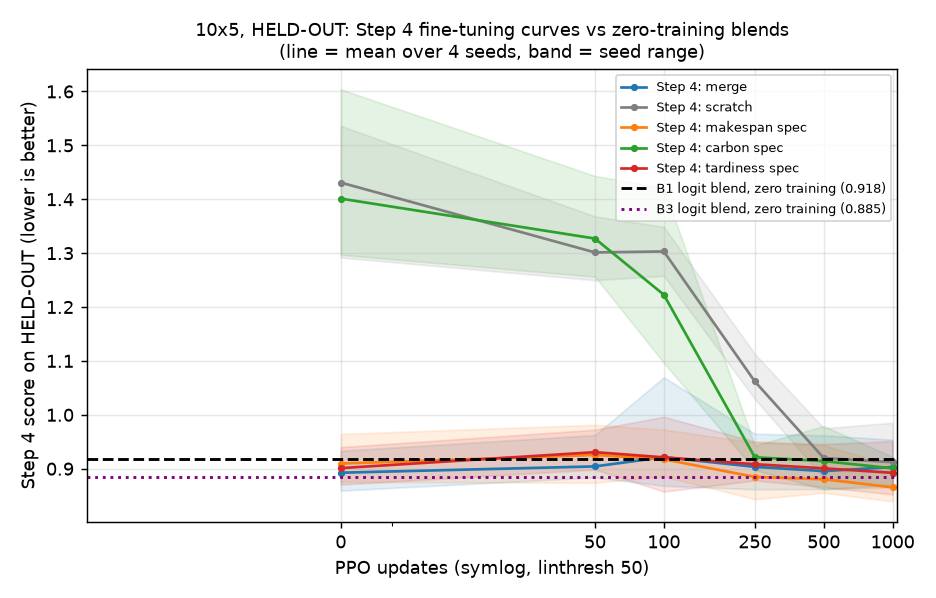

# Zero-training three-specialist blend, scored on the Step 4 metric

## Pre-registration

Written and committed BEFORE any evaluation in this study. Never edited afterwards; changes go under
"Deviations".

### Question
Does recombining the frozen specialists' decisions, with NO training, match or beat fine-tuning from a single
specialist (Step 4)?

### Setup (identical to Step 4, results/step4_and_20x10_sensitivity.md)
* 10x5 only; seeds 111/222/333/444; each seed uses ONLY its own specialists: makespan `m_s<seed>`, carbon
  `c_s<seed>`, tardiness `t_k125s060_s<seed>`.
* Instances: Step 4's evaluation pool, the 100 train_vali instances. Due dates from the frozen manifest
  (tag k125s060), read and hash-checked, never re-derived. The reserved final-test sets are never loaded.
* Score (Step 4's, unchanged): preference w = (1/3, 1/3, 1/3); per seed, makespan and carbon are divided by
  that instance's value under the seed's centroid composition `simplex_m333c333t334_k125s060_s<seed>`, and
  tardiness by the centroid's pool mean over all 100 instances; score = mean of the three ratios weighted by w,
  LOWER is better. The reference values are Step 4's, computed on all 100 instances; HELD-OUT scores are those
  per-instance scores restricted to HELD-OUT instances.
* Greedy deterministic decoding. Batching only among instances sharing the same maximum processing time.
* **Equivalence check before any comparison:** every single-checkpoint rollout here (the vertices in B4, and
  all of R) must reproduce the existing Step 4 evaluation files exactly on all 100 instances (makespan, carbon,
  tardiness). If any differs, the study stops.

### Split
The 100 instances are split 50/50 into FIT and HELD-OUT with RNG seed 20260927, stratified by maximum-
processing-time group (seeded shuffle within each group; odd groups give the extra instance to FIT). IDs in
`results/blend_zero_training/split.json`. All headline comparisons are on HELD-OUT.

### Arms (experts M, C, T; weights sum to 1)
* **B1** Logit mixture at the preference: log p = (1/3) log p_M + (1/3) log p_C + (1/3) log p_T over valid
  actions (invalid pairs -inf in every expert, set explicitly, never 0 x -inf), renormalised with log_softmax,
  argmax. No tuning.
* **B2** Probability mixture at the preference: p = (1/3)(p_M + p_C + p_T), argmax.
* **B3** Logit mixture, tuned alpha: alpha from the 66-point simplex grid (step 0.1), chosen per seed by the
  lowest mean score on FIT (ties -> first grid point in lexicographic (m, c, t) order), evaluated on HELD-OUT.
  The chosen alpha is reported.
* **B4** Each specialist alone (the three grid vertices), reference points.
* **R** Re-score the saved Step 4 checkpoints for all five arms (merge, scratch, makespan spec, carbon spec,
  tardiness spec) at update 0 and update 1000, on HELD-OUT, with this study's evaluator. A missing checkpoint
  is reported as missing, never substituted.

### Metrics (per seed and pooled)
* Step 4 score of every arm on HELD-OUT, and mean raw makespan, carbon and tardiness per arm.
* Paired comparisons on HELD-OUT, each as a relative gain of arm X over reference Y:
  gain = (mean score of Y - mean score of X) / mean score of Y over the 50 held-out instances (positive = X
  better), with a paired bootstrap 95% CI from 10,000 resamples of held-out INSTANCES (seed 20260927). Pooled:
  the same resampled instances are applied to all four seeds and the means taken over seeds and instances.
  Mean paired per-instance score differences are reported alongside.
  Comparisons: B1 vs R[makespan spec @1000], B1 vs R[merge @0], B1 vs R[scratch @1000], the same three for B3,
  and B1 vs B2.

### Confidence / compromise analysis (from the B1 rollouts only)
For every decision: each expert's top-1 action and entropy (bits, over valid actions), and the action B1 takes.
Categories: all three experts share the top-1 (unanimous); the blend takes a top-1 shared by exactly two
experts; the blend takes the top-1 of exactly one expert (M, C or T); compromise (none of the experts' top-1s).
Reported overall and by schedule fifth (decisions 1-10, ..., 41-50).
* Among decisions where the blend follows exactly one expert whose top-1 is unique: the share where that
  expert is the most confident (lowest entropy), against a permutation null that shuffles the three entropies
  across experts within each decision (200 shuffles; 95th percentile reported).
* Among decisions where the experts' top-1s are not unanimous: the share resolved by compromise.

### Decision rule (pre-registered; effect size required)
Each of B1 and B3 is assessed on its own; either one can meet a criterion. "Beats Y at a seed" means a relative
gain >= 1% with the lower end of its 95% CI > 0 at that seed.
* **STRONG:** B1 or B3 beats R[makespan spec @1000] at >= 3 of 4 seeds.
  -> Zero-training recombination matches or beats 1000 PPO updates of fine-tuning. Proceed to fine-tuning the
  blend.
* **MEANINGFUL:** not STRONG, but B1 or B3 beats BOTH R[merge @0] and R[scratch @1000] at >= 3 of 4 seeds
  (both comparisons met at the same seed).
  -> The blend is a better starting point than any Step 4 initialisation. Proceed to fine-tuning the blend.
* **NOT MEANINGFUL:** neither holds. -> Stop and report; do not propose fine-tuning.

### Cost
Estimated before starting from the measured rollout cost: about 7,800 environment-rollouts per seed at about
2 ms each (three policies per step), roughly 3 GPU-minutes per seed and 12 in total. Actual GPU-minutes are
recorded.

## Deviations

1. **The Step 4 figure is new.** No Step 4 score-vs-updates plot existed (Step 4 reported tables only), so the
   chart was drawn fresh in the requested style (symlog x-axis, linthresh 50). Its Step 4 curves are the
   existing Step 4 evaluations at all six budgets, scored on HELD-OUT with the Step 4 score. They come from the
   same canonical evaluator that this study reproduced exactly at updates 0 and 1000.
2. **The compromise analysis uses all 100 instances** (x 4 seeds = 20,000 decisions), not only HELD-OUT. The
   pre-registration specified "the B1 rollouts" without restricting the split; it is descriptive and enters no
   decision.

No other deviations. **Equivalence check passed at every seed:** the three specialists (grid vertices) and all
10 Step 4 checkpoints per seed (5 arms x updates 0 and 1000; none missing) reproduced the existing Step 4
evaluation files exactly on all 100 instances. **Cost:** 3.0 GPU-minutes in total (estimate: about 12).

## Results

### Step 4 score on HELD-OUT (lower is better), per seed and pooled

| arm | seed 111 | seed 222 | seed 333 | seed 444 | pooled |
|---|---|---|---|---|---|
| B1 logit, alpha = w | 0.8451 | 0.8838 | 0.9831 | 0.9616 | **0.9184** |
| B2 prob, alpha = w | 0.8703 | 0.8966 | 0.9173 | 0.9550 | **0.9098** |
| B3 logit, tuned alpha | 0.8584 | 0.8513 | 0.8894 | 0.9420 | **0.8853** |
| B4 makespan spec alone | 0.8756 | 0.8786 | 0.9198 | 0.9644 | **0.9096** |
| B4 carbon spec alone | 1.2970 | 1.3395 | 1.3641 | 1.6040 | **1.4012** |
| B4 tardiness spec alone | 0.8706 | 0.8863 | 0.9073 | 0.9401 | **0.9011** |
| R merge @0 | 0.8594 | 0.8825 | 0.8953 | 0.9333 | **0.8926** |
| R merge @1000 | 0.8907 | 0.8703 | 0.8972 | 0.9538 | **0.9030** |
| R scratch @0 | 1.2920 | 1.5361 | 1.3675 | 1.5282 | **1.4309** |
| R scratch @1000 | 0.8648 | 0.8737 | 0.9248 | 0.9853 | **0.9121** |
| R makespan spec @0 | 0.8756 | 0.8786 | 0.9198 | 0.9644 | **0.9096** |
| R makespan spec @1000 | 0.8556 | 0.8395 | 0.8609 | 0.9060 | **0.8655** |
| R carbon spec @0 | 1.2970 | 1.3395 | 1.3641 | 1.6040 | **1.4012** |
| R carbon spec @1000 | 0.8656 | 0.8974 | 0.9179 | 0.9220 | **0.9007** |
| R tardiness spec @0 | 0.8706 | 0.8863 | 0.9073 | 0.9401 | **0.9011** |
| R tardiness spec @1000 | 0.8761 | 0.8522 | 0.8899 | 0.9513 | **0.8924** |

B3's alpha chosen on FIT (permille m/c/t): seed 111: 100/100/800, seed 222: 300/200/500, seed 333: 600/100/300, seed 444: 200/0/800

### Raw objectives on HELD-OUT (mean over held-out instances, then over seeds)

| arm | makespan | carbon | tardiness |
|---|---|---|---|
| B1 logit, alpha = w | 446.2 | 2165.2 | 506.0 |
| B2 prob, alpha = w | 437.0 | 2341.5 | 445.5 |
| B3 logit, tuned alpha | 431.3 | 2430.3 | 375.9 |
| B4 makespan spec alone | 411.5 | 2500.5 | 424.1 |
| B4 carbon spec alone | 604.7 | 1887.7 | 1320.8 |
| B4 tardiness spec alone | 453.2 | 2514.4 | 348.7 |
| R merge @0 | 434.4 | 2441.2 | 385.1 |
| R merge @1000 | 448.4 | 2486.1 | 366.0 |
| R scratch @0 | 632.1 | 2527.1 | 1126.9 |
| R scratch @1000 | 453.0 | 2501.3 | 369.3 |
| R makespan spec @0 | 411.5 | 2500.5 | 424.1 |
| R makespan spec @1000 | 444.5 | 2403.1 | 327.1 |
| R carbon spec @0 | 604.7 | 1887.7 | 1320.8 |
| R carbon spec @1000 | 453.6 | 2444.8 | 368.4 |
| R tardiness spec @0 | 453.2 | 2514.4 | 348.7 |
| R tardiness spec @1000 | 446.8 | 2441.6 | 361.2 |

### Paired comparisons on HELD-OUT: relative gain of X over Y = (mean Y - mean X)/mean Y (positive = X better), 95% CI from 10,000 instance resamples

| X vs Y | seed 111 | seed 222 | seed 333 | seed 444 | pooled | seeds beating Y (gain >= 1%, CI > 0) |
|---|---|---|---|---|---|---|
| B1 logit vs R makespan spec @1000 | +1.22% [-1.49, +4.03] | -5.29% [-8.32, -2.42] | -14.20% [-18.89, -9.79] | -6.14% [-9.62, -2.68] | -6.12% [-8.48, -3.81] | 0/4 |
| B1 logit vs R merge @0 | +1.66% [-0.48, +3.76] | -0.15% [-3.49, +3.11] | -9.82% [-14.59, -5.38] | -3.04% [-6.69, +0.51] | -2.89% [-4.86, -0.98] | 0/4 |
| B1 logit vs R scratch @1000 | +2.27% [-0.75, +5.15] | -1.16% [-4.39, +2.05] | -6.31% [-11.11, -2.01] | +2.40% [-1.62, +6.43] | -0.69% [-3.50, +1.98] | 0/4 |
| B3 logit vs R makespan spec @1000 | -0.34% [-2.99, +2.33] | -1.41% [-4.66, +1.73] | -3.31% [-6.35, -0.20] | -3.98% [-7.71, -0.41] | -2.29% [-3.98, -0.63] | 0/4 |
| B3 logit vs R merge @0 | +0.11% [-2.07, +2.21] | +3.53% [+0.48, +6.34] * | +0.66% [-2.28, +3.55] | -0.94% [-3.69, +1.69] | +0.82% [-0.46, +2.05] | 1/4 |
| B3 logit vs R scratch @1000 | +0.73% [-2.17, +3.60] | +2.57% [-0.51, +5.44] | +3.83% [-0.51, +7.95] | +4.39% [+0.64, +7.85] * | +2.95% [+0.72, +5.04] | 1/4 |
| B1 logit vs B2 prob, alpha = w | +2.90% [+0.19, +5.45] * | +1.42% [-1.26, +3.95] | -7.18% [-11.19, -3.46] | -0.69% [-3.95, +2.55] | -0.95% [-2.48, +0.54] | 1/4 |

(* = gain >= 1% with the CI above 0 at that seed. Mean per-instance score differences Y - X are in summary.json.)

### Confidence / compromise analysis (B1 rollouts, all 100 instances x 4 seeds = 20,000 decisions)

| category | overall | fifth 1 | 2 | 3 | 4 | 5 |
|---|---|---|---|---|---|---|
| unanimous (all three top-1s equal, blend takes it) | 33.0% | 15.4% | 26.1% | 28.8% | 35.5% | 59.0% |
| majority (blend takes a top-1 shared by exactly two) | 38.2% | 34.4% | 45.1% | 43.8% | 40.1% | 27.7% |
| follows M only | 6.5% | 10.3% | 7.4% | 6.4% | 5.5% | 2.6% |
| follows C only | 12.8% | 16.9% | 13.6% | 12.7% | 12.6% | 8.3% |
| follows T only | 4.7% | 8.6% | 4.5% | 5.1% | 3.9% | 1.4% |
| compromise (none of the top-1s) | 4.8% | 14.3% | 3.3% | 3.2% | 2.4% | 1.0% |

* Decisions where the blend follows exactly one expert: 24.0%. Among them, the followed expert is the MOST CONFIDENT (lowest entropy) in **65.0%**; permutation null (entropies shuffled across experts within each decision, 200x): mean 33.3%, 95th percentile 34.4% -> the blend follows the most confident expert MORE than chance.
* Among decisions where the experts' top-1s are not unanimous (67.0% of all decisions), **7.2%** are resolved by compromise.
* Mean entropy (bits): M 0.32, C 0.29, T 0.49.

### Verdict inputs

* Seeds where the arm beats R[makespan spec @1000] (gain >= 1%, CI > 0): B1 0/4, B3 0/4 (STRONG needs 3)
* Seeds where the arm beats BOTH R[merge @0] and R[scratch @1000]: B1 0/4, B3 0/4 (MEANINGFUL needs 3)
* **Outcome: NOT MEANINGFUL**

## Verdict: NOT MEANINGFUL

Decided by the pre-registered rule, on HELD-OUT, per seed (a seed counts when the gain is >= 1% AND the 95% CI
lies above 0):
* **STRONG fails.** Against the best fine-tuned arm, R[makespan spec @1000] (pooled score 0.866): B1 beats it at
  **0/4** seeds (pooled -6.1%, CI [-8.5, -3.8]) and B3 at **0/4** (pooled -2.3%, CI [-4.0, -0.6]). Both are
  significantly WORSE than 1000 PPO updates from the makespan specialist.
* **MEANINGFUL fails.** B1 beats both R[merge @0] and R[scratch @1000] at **0/4** seeds (vs merge @0: pooled
  -2.9%, CI [-4.9, -1.0]; vs scratch @1000: -0.7%, CI [-3.5, +2.0]). B3 does so at **0/4** seeds: it beats
  merge @0 at one seed (222) and scratch @1000 at one different seed (444), never both at the same seed. Pooled,
  B3 is +0.8% over merge @0 (CI [-0.5, +2.1], not significant) and +3.0% over scratch @1000 (CI [+0.7, +5.0]).
* Per the rule: stop; fine-tuning the blend is not proposed.

**Also observed:**
* **The pre-specified blend B1 is on a different operating point.** Equal weights on the three log-probabilities
  pull hard toward carbon: carbon 2165 against about 2400-2500 for every fine-tuned arm, at the cost of much
  higher tardiness (506 against 327-390). The Step 4 score penalises that trade.
* **Tuning the weights (B3) helps** (0.918 -> 0.885). The FIT-chosen weights lean on tardiness (tardiness weight
  0.3-0.8 at every seed), but that still only reaches the level of the merge at update 0 (0.893) and of the
  tardiness specialist alone (0.901).
* **Logit vs probability mixing (B1 vs B2): no consistent winner** (pooled -1.0%, CI [-2.5, +0.5]; logit better at
  seed 111, clearly worse at seed 333).
* **The blend mostly follows the experts rather than inventing actions.** 33% of decisions are unanimous, 38% take a
  top-1 shared by two experts, and 24% follow a single expert. Only 4.8% are compromises (7.2% of non-unanimous
  decisions), concentrated in the first fifth (14.3%). When the blend follows a single expert, it is the most
  confident one 65% of the time, against a 33% permutation null (95th percentile 34.4%). So the logit mixture
  largely acts as a "follow the most confident expert" rule.

## Summary for a non-specialist

We have three frozen scheduling policies, each an expert in one goal: finishing quickly, using little carbon,
and meeting due dates. Earlier we had improved single starting points by training them further for 1,000
rounds. This test asked whether simply letting the three experts vote on every scheduling decision, with no
training at all, could do as well. It cannot. An equal-weight vote lands on a different compromise: much lower
carbon but many more late jobs. On the balanced score it is about 6% worse than the best trained policy, and
also worse than the best untrained starting point. Tuning the voting weights on half the problems narrows the
gap, but it still falls about 2% short of the best trained policy and never clearly beats both reference points
on any single seed. Looking inside the vote, the blend mostly just follows whichever expert is most confident,
and rarely finds a genuinely new compromise move. Under the rule we fixed in advance, this means stopping:
recombining the experts' decisions without training is not a better starting point to fine-tune from, and we
are not proposing to build on it.
