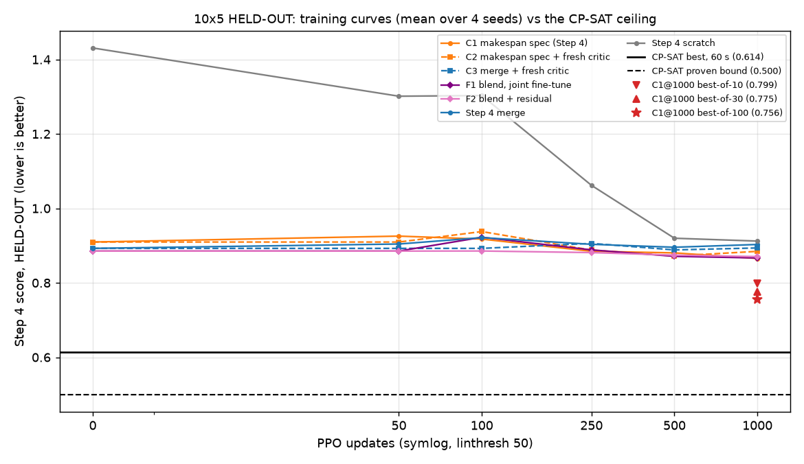

# Performance ceiling on 10x5: how far is the ~0.87 plateau from the best achievable?

## Pre-registration

Written and committed BEFORE Part A (CP-SAT on HELD-OUT) and Part B (sampling) were run. Never edited afterwards;
changes go under "Deviations". No training of any kind. Reserved final-test sets (10x5, 20x10) are never loaded.

### Question
Every arm so far ends between 0.866 and 0.90 (Step 4 score, HELD-OUT, update 1000; best C1 = Step 4 makespan
specialist fine-tune, 0.8655). Is that near the best achievable on these instances (Part A, exact solver), and can
the C1 policy itself reach better schedules than its greedy choice (Part B, best-of-N sampling)?

### Fixed inputs (identical to Step 4 / blend_finetune)
* Instances: the HELD-OUT instances of blend_zero_training (`results/blend_zero_training/split.json`, same IDs).
  NOTE: that file lists **49** held-out instances (pool of 100 split per maximum-processing-time group into fit
  1+1+7+42 = 51 and held-out 49); earlier reports called it "the 50 HELD-OUT instances". Same IDs, n = 49.
* Score: Step 4, preference (1/3, 1/3, 1/3); per seed, makespan and carbon relative to that seed's centroid
  composition `simplex_m333c333t334_k125s060_s<seed>` per instance, tardiness relative to the centroid's mean over
  all 100 pool instances. Due dates: frozen manifest k125s060 (hash-checked). Carbon: the instance files' per
  operation-machine carbon values. Raw time units (no processing-time scaling enters any reported objective).
* Policy: C1@1000 = `s4t_spec_m_k125s060_s<seed>@u1000`, seeds 111/222/333/444.

### Step 0 (done before this pre-registration; must pass, else stop)
`tools/ceiling_scorer.py` re-computes makespan, carbon, tardiness and the Step 4 score from a complete schedule
(machine + start per operation) with its own .fjs parser, verifying feasibility (eligibility, precedence, machine
no-overlap). On C1@1000's greedy schedules (all 49 HELD-OUT x 4 seeds) it must match the evaluator's score to
< 1e-9 for every instance. Result: PASS, max |difference| = 2.2e-16 (details below). The greedy rollout also
reproduced the Step 4 result files bit-for-bit.

### Design probe (done before this pre-registration, FIT instances only, no hint)
CP-SAT at 60 s / 8 workers on 3 FIT instances (pool 1, 6, 8; seed 111 objective): all FEASIBLE, none proven
optimal, scores 0.574 / 0.650 / 0.577, proven bounds 0.487 / 0.498 / 0.470. This sets the 600 s check's size.

### Part A: exact solver (CPU), `tools/ceiling_cpsat.py`
* Model: FJSP with job precedence, exactly one eligible machine per operation (optional intervals), NoOverlap per
  machine; makespan = max of job completions; tardiness_j >= Q*C_j - ceil(Q*d_j), >= 0, Q = 1000; carbon = sum
  over chosen operation-machine pairs. Objective = the Step 4 score with integer coefficients
  floor(S * w / normaliser), S = 1e12. Coefficients rounded down and due dates rounded up, so the integer
  objective never exceeds S x the exact score: the proven bound / S is a valid lower bound on the exact score.
* The score normalisers are seed-specific, so the objective is solved **per (seed, instance)**: 4 x 49 = 196 solves,
  60 s each, 8 workers, fixed random_seed 20260928, warm-started with that seed's C1@1000 greedy schedule as a
  complete hint. Recorded: best solution, proven bound, status (OPTIMAL / FEASIBLE), wall time.
* Every solution is re-scored with the Step 0 scorer; that exact score is reported (not the integer objective).
* Hint check: the re-scored solution must never be worse than the hint's score (tolerance 1e-6, the coefficient
  rounding); every violation is reported.
* 600 s check: 10 HELD-OUT instances drawn with numpy default_rng(20260928).choice(held, 10, replace=False),
  instance k of the draw paired with seed [111, 222, 333, 444][k mod 4] (CPU cost ~100 min instead of ~6.7 h for
  all seeds); same model, hint and parameters, 600 s. Reported: change in best score and in proven bound vs 60 s.
  The reference "best CP-SAT score" for the gap metrics is the 60 s solution for every (seed, instance), so all
  pairs are treated alike; the 600 s movement is reported alongside.
* Reachability check (secondary): each CP-SAT schedule is replayed through DANIEL's append rule (operations in
  order of CP-SAT start time; start = max(job ready, machine free)). All objectives are regular, so the replayed
  score must be <= the CP-SAT score, i.e. the ceiling lies inside DANIEL's action space. Reported.

### Part B: best-of-N sampling (GPU), `tools/ceiling_sampling.py`
* C1@1000 per seed: 100 stochastic rollouts per HELD-OUT instance, sampling from the policy's own softmax (no
  temperature change), torch generator seeded 20260928 + seed. Best schedule per instance by the Step 4 score
  (re-scored with the Step 0 scorer; scorer vs environment must agree). Best-of-10 and best-of-30 = the first 10 / 30
  of the same samples.

### Metrics (per seed and pooled over the 196 seed x instance pairs)
* Gap to the solver = (policy score - CP-SAT 60 s score) / CP-SAT 60 s score, per pair, for C1@1000 greedy and
  best-of-10/30/100. Pooled mean, median, and a 95% bootstrap CI (10,000 resamples of the 49 instances, each
  resampled instance carrying its 4 seeds; generator seed 20260928).
* Solver gap = (CP-SAT best - proven bound) / CP-SAT best per pair; share of pairs with status OPTIMAL.
* Raw objectives (makespan, carbon, tardiness): CP-SAT best vs C1@1000 greedy (and best-of-100), pooled means.

### Decision rule (applied to the pooled greedy and best-of-100 gaps)
* **SATURATED**: greedy pooled mean gap <= 2% AND its CI upper end <= 3% -> 10x5 cannot separate methods; further
  method comparisons need harder instances.
* **DECODING-LIMITED**: greedy gap > 2% but best-of-100 within 2% (pooled mean gap <= 2%, CI upper <= 3%) -> the
  policy can reach near-optimal schedules but its greedy choice misses them.
* **POLICY-OR-BUDGET-LIMITED**: greedy and best-of-100 gaps both > 2% -> the limit is the DANIEL policy class or the
  1,000-update training budget; separating the two needs the longer-training run, which is not part of this task.
* (Cases not listed above, e.g. greedy mean <= 2% but CI upper > 3%, are reported as "not decided" with the numbers.)
* If fewer than 80% of pairs are OPTIMAL, the ceiling is a best-known solution, not a proven optimum; the
  proven-bound gap is reported alongside every solver gap.

## Step 0: score-equivalence check (result)

**PASS.** On C1@1000's greedy schedules (49 HELD-OUT instances x 4 seeds = 196), the independent scorer
(`tools/ceiling_scorer.py --check`, own .fjs parser, feasibility verified) reproduces the evaluator's Step 4 score
with max |difference| **2.2e-16** (makespan and carbon exactly 0; tardiness <= 1.1e-13, floating-point summation
order). The greedy rollout itself reproduced the Step 4 result files bit-for-bit at every seed. Pooled C1@1000
score 0.8655 (seeds 0.8556 / 0.8395 / 0.8609 / 0.9060), as in blend_finetune. Details: `ceiling_check/step0_check.json`.
The scorer also re-scored all 19,600 sampled schedules of Part B; it agrees with the environment to 2.3e-13.

## Deviations

* **First Part A launch failed before any solve** (argparse error: `daniel/params.py` parses `sys.argv` on import
  via the scorer's loaders). Fixed by resetting `sys.argv` after parsing in `ceiling_cpsat.py`; relaunched. No
  result existed or was affected.
* **Analysis dry run.** `tools/analyze_ceiling.py` got a `CEIL_SEEDS` environment override so it could be tested on
  seed 111 while the other seeds were still solving; the reported tables use all 4 seeds (default).
* **Extra rows beyond the pre-registered metrics** (additive, not used by the decision rule): gap of every method to
  the proven bound, share of the greedy-to-CP-SAT difference closed by sampling, and the weighted score terms per
  objective.
* Cost: Part A 196 x 60 s + 10 x 600 s = about 5 h CPU wall-clock (8 workers); Part B 35 s GPU. Solves ran strictly
  one at a time; nothing else ran on the machine during Part A.
* 8-worker CP-SAT with a time limit is not bit-reproducible run to run (thread timing), even with a fixed seed.
  Every solution and bound is stored in `ceiling_check/raw/cpsat_t60/` and `cpsat_t600/`.

## Results

### Gap to CP-SAT (60 s best solution), HELD-OUT, 4 seeds x 49 instances

Gap = (policy score - CP-SAT score) / CP-SAT score per (seed, instance); pooled mean, median, 95% bootstrap CI over instances (each carrying its seeds). Mean scores are pooled means over seeds and instances.

| method | mean score | gap mean | gap median | 95% CI | seed 111 | seed 222 | seed 333 | seed 444 |
|---|---|---|---|---|---|---|---|---|
| CP-SAT 60 s best | 0.6140 | - | - | - | 0.6144 | 0.6077 | 0.6088 | 0.6252 |
| CP-SAT proven bound | 0.5001 | - | - | - | 0.5021 | 0.4965 | 0.4951 | 0.5065 |
| C1@1000 greedy | 0.8655 | +40.99% | +40.00% | [+39.01, +43.01] | +39.42% | +38.00% | +41.42% | +45.13% |
| C1@1000 best-of-10 | 0.7986 | +30.07% | +29.29% | [+28.63, +31.59] | +29.05% | +27.67% | +31.27% | +32.27% |
| C1@1000 best-of-30 | 0.7754 | +26.31% | +25.47% | [+24.91, +27.81] | +25.01% | +24.30% | +27.65% | +28.29% |
| C1@1000 best-of-100 | 0.7563 | +23.23% | +22.78% | [+21.90, +24.63] | +22.25% | +21.47% | +24.17% | +25.01% |

Same methods against the PROVEN BOUND (upper limit on the gap to the true optimum): (policy - bound) / bound

| method | gap-to-bound mean | 95% CI |
|---|---|---|
| CP-SAT 60 s best | +22.96% | [+19.98, +26.05] |
| C1@1000 greedy | +73.37% | [+68.46, +78.42] |
| C1@1000 best-of-10 | +59.97% | [+55.64, +64.43] |
| C1@1000 best-of-30 | +55.34% | [+51.12, +59.67] |
| C1@1000 best-of-100 | +51.50% | [+47.55, +55.58] |

Share of the greedy-to-CP-SAT score difference closed by best-of-N: best-of-10 27%, best-of-30 36%, best-of-100 43%.

### CP-SAT status (60 s, 8 workers, warm-started with C1@1000 greedy)

* OPTIMAL: **5 / 196** pairs (3%); the rest FEASIBLE ({'FEASIBLE': 191, 'OPTIMAL': 5}).
* Solver gap (best - bound) / best: mean 18.0%, median 17.5%, range [0.0%, 41.0%]; per seed 17.8%, 17.9%, 18.2%, 18.3%.
* Hint check: solution worse than the C1 hint in **0** pairs (tolerance 1e-6); equal to the hint in 0. Mean wall time 58.9 s.
* Reachability: replaying every CP-SAT schedule through DANIEL's append rule gives a score worse than CP-SAT's in **0** pairs (strictly better in 0; mean 0.6140). The CP-SAT schedules lie inside DANIEL's action space.

### 60 s vs 600 s (10 pre-registered pairs)

| seed | instance | status 60 / 600 | score 60 | score 600 | change | bound 60 | bound 600 | change | solver gap 60 / 600 |
|---|---|---|---|---|---|---|---|---|---|
| 111 | 35 | FEASIBLE / FEASIBLE | 0.5736 | 0.5736 | +0.00% | 0.4554 | 0.5042 | +10.71% | 20.6% / 12.1% |
| 111 | 75 | FEASIBLE / FEASIBLE | 0.5768 | 0.5768 | +0.00% | 0.4914 | 0.5450 | +10.89% | 14.8% / 5.5% |
| 111 | 84 | FEASIBLE / FEASIBLE | 0.7983 | 0.7992 | +0.11% | 0.5463 | 0.5477 | +0.27% | 31.6% / 31.5% |
| 222 | 3 | FEASIBLE / FEASIBLE | 0.5637 | 0.5637 | +0.00% | 0.4929 | 0.5288 | +7.28% | 12.6% / 6.2% |
| 222 | 41 | FEASIBLE / FEASIBLE | 0.5550 | 0.5550 | +0.00% | 0.4714 | 0.5194 | +10.17% | 15.1% / 6.4% |
| 222 | 53 | FEASIBLE / FEASIBLE | 0.6237 | 0.6223 | -0.22% | 0.4755 | 0.5218 | +9.72% | 23.8% / 16.2% |
| 333 | 12 | FEASIBLE / FEASIBLE | 0.5834 | 0.5834 | +0.00% | 0.5246 | 0.5543 | +5.66% | 10.1% / 5.0% |
| 333 | 29 | FEASIBLE / FEASIBLE | 0.7728 | 0.7362 | -4.72% | 0.4931 | 0.5369 | +8.90% | 36.2% / 27.1% |
| 444 | 39 | FEASIBLE / FEASIBLE | 0.6296 | 0.6192 | -1.66% | 0.4792 | 0.5285 | +10.29% | 23.9% / 14.6% |
| 444 | 74 | FEASIBLE / FEASIBLE | 0.7595 | 0.7418 | -2.33% | 0.5144 | 0.5490 | +6.72% | 32.3% / 26.0% |

Mean change 60 -> 600 s: best score -0.88% (largest improvement -4.72%), proven bound +8.06% (largest rise +10.89%).

### Raw objectives, HELD-OUT (mean over instances, then seeds)

| schedule | makespan | carbon | tardiness | score |
|---|---|---|---|---|
| CP-SAT 60 s best | 376.8 | 2023.3 | 50.6 | 0.6140 |
| C1@1000 greedy | 444.5 | 2403.1 | 327.1 | 0.8655 |
| C1@1000 best-of-100 | 403.8 | 2326.7 | 194.7 | 0.7563 |

Weighted score terms (w x objective / normaliser; they sum to the score):

| schedule | makespan term | carbon term | tardiness term |
|---|---|---|---|
| CP-SAT 60 s best | 0.2597 | 0.3287 | 0.0256 |
| C1@1000 greedy | 0.3065 | 0.3923 | 0.1668 |
| C1@1000 best-of-100 | 0.2783 | 0.3791 | 0.0989 |

Greedy minus CP-SAT, per term: makespan +0.0467, carbon +0.0636, tardiness +0.1412 (share of the total difference: 19%, 25%, 56%).

### Verdict: **POLICY-OR-BUDGET-LIMITED** (greedy gap +40.99% [+39.01, +43.01], best-of-100 gap +23.23% [+21.90, +24.63]; best-known solution, NOT a proven optimum).

*Held-out training curves from Step 4 and blend_finetune (mean over 4 seeds; symlog x-axis, linthresh 50), with the
CP-SAT 60 s best (solid) and its proven bound (dashed), pooled means. Red markers: C1@1000 best-of-10/30/100.*

## Verdict

**POLICY-OR-BUDGET-LIMITED.** C1@1000 greedy is **+41.0%** above the CP-SAT best-known solutions (95% CI
[+39.0, +43.0]; every seed +38% to +45%); best-of-100 sampling is still **+23.2%** above (CI [+21.9, +24.6]). Both are
far beyond the 2% threshold. CP-SAT proved optimality in only 5/196 pairs (3%, < 80%), so the ceiling is a
**best-known solution, not a proven optimum**: the true optimum is at or below the CP-SAT score, which makes 41% a
lower limit on the greedy policy's true gap; against the proven bound the gap is at most +73.4%. The 600 s check
moves solutions by -0.9% on average (up to -4.7%) and bounds by +8.1%; both movements only widen or confirm the gap,
so 60 s is not converged but is sufficient for the verdict. Whether the limit is the DANIEL policy class or the
1,000-update training budget cannot be separated here: that needs the longer-training run (C1 and scratch to 3,000
updates), which is deliberately not part of this task.

Supporting facts: every CP-SAT schedule is reproducible through DANIEL's own append rule (0/196 replays worse), so the
better schedules lie inside the policy's action space; CP-SAT is better on all three objectives at once (makespan
377 vs 445, carbon 2023 vs 2403, tardiness 51 vs 327), and tardiness accounts for 56% of the score difference.

## Plain-English summary

Every learning method we have tried on the 10-job, 5-machine problems stops improving at a score of about 0.87, and
we wanted to know whether that is simply as good as it gets. It is not. An exact optimisation solver (CP-SAT), given
one minute per problem, finds schedules scoring about 0.61 on average, which is about 41% better than our best trained
policy. It does so by being better at everything at once: shorter schedules, less carbon and far less lateness.
Lateness is the biggest part of the difference. Even when we let the trained policy try 100 random variations of its
own choices and keep the best one, it only closes 43% of the difference and stays about 23% worse than the solver.
The solver's schedules could be produced by the policy's own decision steps, so the policy is not being blocked by how
it builds schedules. Its choices are simply not good enough yet. The limit is therefore the policy itself or how
long it was trained, not the test problems, so 10x5 instances still have plenty of room to separate methods. A
separate longer-training run is needed to tell those two causes apart.
