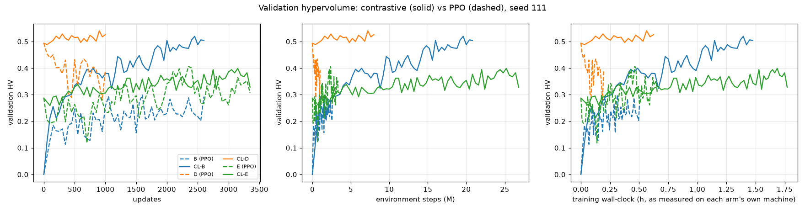
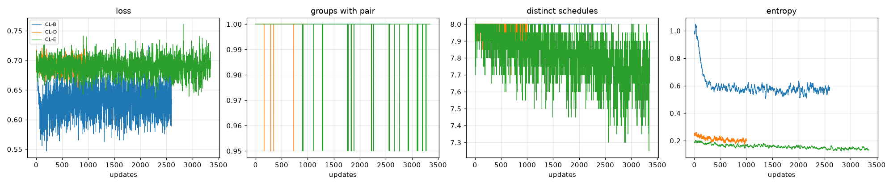

# Contrastive fine-tuning on benchmark v3: results

Generated by `tools/analyze_contrastive_v3.py`. Each contrastive (CL) arm replaces only PPO's update with a DPO-style pairwise-ranking objective; model, environment, non-delay mask, preference sampling, training instances, training normalisation, validation, checkpoint selection and evaluation are those of the PPO arms (docs/contrastive_protocol_v3.md). PPO counterparts: results/warmstart_v3, seed 111.

**Single seed (111): numbers only, no significance claims.** Higher HV is better; lower IGD+ and regret are better. Evaluation split: `evaluation`.

Hardware: NVIDIA GeForce RTX 5060 Ti, 16311 MiB, 610.88, 12 logical CPUs, --jobs 3; calibration factor (this machine / local DANIEL-M) 0.94.

E0 (zero-training merge front) is not part of this study: it is a family of networks θ(λ) = Σ λ_x θ_x, one unconditioned network per preference, not a single network that could be fine-tuned.

## Did fine-tuning raise or lower validation HV relative to update 0?

- **CL-B**: update 0 HV 0.000; fine-tuning raised it to a best of 0.520 at update 2450 (+0.520); final HV at update 2600 is 0.504 (+0.504 vs update 0, raised).
- **B (PPO)**: update 0 HV 0.000; fine-tuning raised it to a best of 0.299 at update 1600 (+0.299); final HV at update 2600 is 0.293 (+0.293 vs update 0, raised).
- **CL-D**: update 0 HV 0.494; fine-tuning raised it to a best of 0.540 at update 900 (+0.047); final HV at update 1000 is 0.526 (+0.032 vs update 0, raised).
- **D (PPO)**: update 0 HV 0.494; fine-tuning never raised it (best checkpoint = update 0); final HV at update 1000 is 0.393 (-0.101 vs update 0, lowered).
- **CL-E**: update 0 HV 0.287; fine-tuning raised it to a best of 0.399 at update 3150 (+0.112); final HV at update 3350 is 0.328 (+0.041 vs update 0, raised).
- **E (PPO)**: update 0 HV 0.287; fine-tuning raised it to a best of 0.407 at update 2350 (+0.119); final HV at update 3350 is 0.306 (+0.019 vs update 0, raised).

Reproduction check: CL-D's update-0 validation HV 0.4937 vs PPO D's 0.4944 (the D student was regenerated with the same seed on this machine).

## Training (validation split, 15 preferences)

PPO counterparts ran on NVIDIA L4, 23034 MiB, 595.91.07 (--jobs 2); the CL arms on NVIDIA GeForce RTX 5060 Ti, 16311 MiB, 610.88 (--jobs 3). PPO wall-clock is shown as measured and converted to this machine with the calibration factors (0.71 there, 0.94 here); the conversion is approximate (parallel load differs). Updates and environment steps are exact.

| Arm | Budget (updates) | HV at update 0 | Best HV | Update of best | Wall-clock to best (h) | Final HV | Training (h) | s / update | Env steps (total) |
|---|---|---|---|---|---|---|---|---|---|
| B (PPO, scratch) | 2600 | 0.000 | 0.299 | 1600 | 0.31 there ≈ 0.42 here | 0.293 | 0.51 there ≈ 0.67 here | 0.70 | 2.60 M |
| CL-B (contrastive, scratch) | 2600 | 0.000 | 0.520 | 2450 | 1.39 | 0.504 | 1.48 | 2.04 | 20.80 M |
| D (PPO from the distilled student) | 1000 | 0.494 | 0.494 | 0 | 0.00 there ≈ 0.00 here | 0.393 | 0.20 there ≈ 0.26 here | 0.70 | 1.00 M |
| CL-D (contrastive from D's update-0 network) | 1000 | 0.494 | 0.540 | 900 | 0.56 | 0.526 | 0.62 | 2.25 | 8.00 M |
| E (PPO from the naive merge) | 3350 | 0.287 | 0.407 | 2350 | 0.46 there ≈ 0.61 here | 0.306 | 0.66 there ≈ 0.87 here | 0.70 | 3.35 M |
| CL-E (contrastive from the naive merge) | 3350 | 0.287 | 0.399 | 3150 | 1.69 | 0.328 | 1.77 | 1.90 | 26.80 M |

### Validation HV at equal updates

| Arm | u = 0 | u = 250 | u = 500 | u = 1000 | u = 2000 |
|---|---|---|---|---|---|
| B (PPO) | 0.000 | 0.162 | 0.246 | 0.258 | 0.229 |
| CL-B | 0.000 | 0.234 | 0.334 | 0.380 | 0.504 |
| D (PPO) | 0.494 | 0.402 | 0.432 | 0.393 | - |
| CL-D | 0.494 | 0.511 | 0.515 | 0.526 | - |
| E (PPO) | 0.287 | 0.261 | 0.264 | 0.235 | 0.342 |
| CL-E | 0.287 | 0.262 | 0.329 | 0.306 | 0.360 |

### Validation HV at equal environment steps

CL takes 8× PPO's environment steps per update (same instances), so CL at update u is compared with PPO at update 8u. '-' = the run did not reach that many steps.

| Arm | 0.25 M steps | 0.5 M steps | 1 M steps | 2 M steps | 4 M steps | 8 M steps |
|---|---|---|---|---|---|---|
| B (PPO) | 0.162 | 0.246 | 0.258 | 0.229 | - | - |
| CL-B | 0.000 | 0.120 | 0.213 | 0.234 | 0.334 | 0.380 |
| D (PPO) | 0.402 | 0.432 | 0.393 | - | - | - |
| CL-D | 0.494 | 0.489 | 0.496 | 0.511 | 0.515 | 0.526 |
| E (PPO) | 0.261 | 0.264 | 0.235 | 0.342 | - | - |
| CL-E | 0.287 | 0.273 | 0.259 | 0.262 | 0.329 | 0.306 |

## Evaluation (evaluation split, greedy, 66 preferences, 100 instances; IGD+ on the 20-instance CP-SAT B2 subset)

| Arm | HV | HV on the B2 subset | IGD+ | Unique non-dominated | Mean regret | Best-of-16 sampling HV |
|---|---|---|---|---|---|---|
| B (PPO, scratch) | 0.293 | 0.357 | 0.540 | 1.4 | 0.352 | 0.656 |
| CL-B (contrastive, scratch) | 0.548 | 0.617 | 0.327 | 3.7 | 0.297 | 0.701 |
| D (PPO from the distilled student) | 0.576 | 0.604 | 0.340 | 6.8 | 0.336 | 0.732 |
| CL-D (contrastive from D's update-0 network) | 0.609 | 0.645 | 0.309 | 6.5 | 0.314 | 0.745 |
| E (PPO from the naive merge) | 0.368 | 0.416 | 0.475 | 1.7 | 0.331 | 0.690 |
| CL-E (contrastive from the naive merge) | 0.345 | 0.428 | 0.464 | 1.6 | 0.331 | 0.644 |
| CP-SAT B2 reference front (subset only) | - | 1.205 | 0 | - | - | - |

Regret is computed against every point of the arms in this table, the specialists, the rules and CP-SAT B1/B2 (the warm-start study's definition over a smaller set of arms, so values are not comparable with results/warmstart_v3.md).

### Objectives at the corner and equal-weight preferences

| Arm | MK at w=(1,0,0) | C at w=(0,1,0) | T at w=(0,0,1) | MK / C / T at w=(1/3,1/3,1/3) |
|---|---|---|---|---|
| B (PPO) | 421.1 | 156.8 | 269.3 | 421.7 / 155.7 / 278.9 |
| CL-B | 404.0 | 150.6 | 247.3 | 416.9 / 149.9 / 268.0 |
| D (PPO) | 403.8 | 155.8 | 239.3 | 421.4 / 153.3 / 292.6 |
| CL-D | 402.6 | 153.8 | 228.7 | 410.0 / 153.7 / 324.9 |
| E (PPO) | 412.7 | 153.0 | 307.8 | 416.2 / 153.2 / 304.0 |
| CL-E | 412.3 | 151.9 | 329.8 | 416.8 / 152.0 / 335.5 |

## Contrastive diagnostics (per update; mean over the first and the last 100 updates)

| Arm | Loss | Groups with ≥ 1 pair | Pairs per update (dominance / Tchebycheff) | Distinct schedules per group (of K) | Policy entropy | Grad norm (pre-clip) | Skipped updates | s / update (rollout + step) |
|---|---|---|---|---|---|---|---|---|
| CL-B | 0.6440 → 0.6339 | 1.00 → 1.00 | 536 (329 / 207) → 506 (284 / 222) | 8.00 → 8.00 | 0.955 → 0.573 | 0.106 → 0.192 | 0 | 2.02 |
| CL-D | 0.6925 → 0.6943 | 1.00 → 1.00 | 485 (282 / 203) → 473 (268 / 205) | 7.99 → 7.96 | 0.240 → 0.201 | 0.426 → 0.497 | 0 | 2.21 |
| CL-E | 0.6909 → 0.6945 | 1.00 → 1.00 | 486 (278 / 208) → 463 (265 / 199) | 7.96 → 7.69 | 0.192 → 0.138 | 0.304 → 0.351 | 0 | 1.88 |





## Design choices (fixed before any run)

1. Groups: each of the 20 training instances of an update gets one preference w (the PPO arms' preference stream, `pref_rng`), shared by its K = 8 sampled schedules; instances are the PPO arms' generator stream (resampled every 20 updates), each repeated K times (160 environments).
2. Objectives are scored exactly by the environment (makespan, carbon, total tardiness), as in validation.
3. Normalisation for the Tchebycheff score: f̂ = (MK/mk_ref, C/cb_ref, T/T_ref), the per-instance training references of the PPO reward (generator references and the frozen T_ref); ideal point 0. No validation, evaluation or test references are used in training.
4. Pairs: (a) Pareto dominance on the raw objectives (≤ on all three, < on at least one; tolerance 1e-9), any w; (b) Tchebycheff g(x|w) = max_k w_k f̂_k, pair when g(worse) − g(better) > 0.01. Union, a pair counted once; identical objective vectors never form a pair.
5. Loss: mean over all pairs of the update (every pair weighted equally, not per group) of −log σ(β[(ℓ_i − ℓ_i^ref) − (ℓ_j − ℓ_j^ref)]), β = 0.1, ℓ = Σ_t log π(a_t|s_t) over the full schedule.
6. Reference: the starting network, frozen (CL-B: the seed-111 random initialisation; CL-D: the distilled student, i.e. D's update-0 network; CL-E: the uniform merge with zero preference columns).
7. Optimisation: one gradient step per update (on-policy; no epochs, no importance ratios), PPO's Adam optimiser at lr 3e-4, gradient-norm clipping at 1.0. Exact gradient in two passes (trajectory log-probabilities, then per-state log-probabilities in minibatches of 1,024 weighted by dL/dℓ). An update without any pair takes no step (logged).
8. Negatives are the policy's own samples only.
9. Budget: the PPO counterpart's final update count (frozen in configs/contrastive_v3.json); no early stopping (status FINISHED). Validation at update 0 and every 50 updates; best-validation-HV checkpoint, as for PPO.
10. Distinct schedules per group = distinct action sequences among the K samples.
11. Evaluation uses daniel/evaluate_mo_v3.py (the multi-objective evaluator of the PPO arms; the brief's `evaluate_v3.py` is the single-objective specialist evaluator).
12. Environment steps: CL = 160 environments × operations per update; PPO = 20 × operations. Both see the same instances at the same update, so PPO's steps at update u are CL's steps at u divided by K.
13. No hyperparameter was tuned; every constant was fixed in configs/contrastive_v3.json before any run.

## Known limitation

DANIEL's action mask only admits non-delay schedules (results/diagnose_v3.md, Test 2), kept as published for every arm; part of every gap to CP-SAT is a gap of the action space.

## Frozen inputs

```json
{
 "size": "10x5",
 "seed": 111,
 "arms": {
  "CLB": {
   "counterpart": "B",
   "counterpart_run": "10x5+mix+bv3_ws_B_s111",
   "updates": 2600,
   "counterpart_status": "CONVERGED",
   "source": "results/warmstart_v3/runs/10x5+mix+bv3_ws_B_s111/status.json",
   "source_sha256": "27a35c79d4ad48d351f1ad5d57d60e56a309767644cebe65e119fc5f86287fdc"
  },
  "CLD": {
   "counterpart": "D",
   "counterpart_run": "10x5+mix+bv3_ws_D_s111",
   "updates": 1000,
   "counterpart_status": "CONVERGED",
   "source": "results/warmstart_v3/runs/10x5+mix+bv3_ws_D_s111/status.json",
   "source_sha256": "3114b750421a1974d86ec52a6b960a9031f6b6858a0fed62af4f0c34438c8b00"
  },
  "CLE": {
   "counterpart": "E",
   "counterpart_run": "10x5+mix+bv3_ws_E_s111",
   "updates": 3350,
   "counterpart_status": "CONVERGED",
   "source": "results/warmstart_v3/runs/10x5+mix+bv3_ws_E_s111/status.json",
   "source_sha256": "14238d9e64d2860cb4d8d98ceb4319c3da716e09df6a0df98eda15b0c8faf68b"
  }
 },
 "budget_rule": "updates = final update of the PPO counterpart run (seed 111); no early stopping",
 "validation_norm": {
  "path": "results/warmstart_v3/norm/validation_normalisation_points_10x5.json",
  "sha256": "76b55f740e23c839d7d1209e5e29cc6d8b90e6647f75aacc2579ad0240975521"
 },
 "constants": {
  "cl_k": 8,
  "cl_beta": 0.1,
  "cl_margin": 0.01,
  "cl_grad_clip": 1.0,
  "lr": 0.0003,
  "minibatch_size": 1024,
  "validate_timestep": 50,
  "converge_window": 0,
  "mo_val_grid_step": 0.25,
  "pref_dirichlet": 1.0,
  "num_envs": 20,
  "reset_env_timestep": 20
 },
 "frozen": "2026-11-07"
}
```

