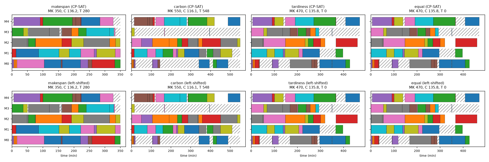
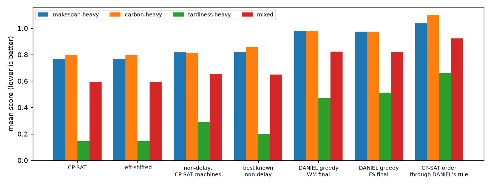
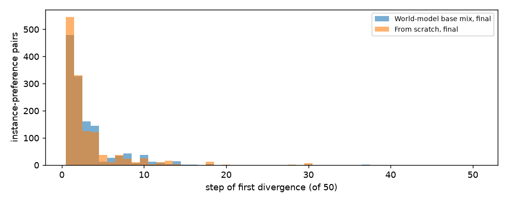

# Why CP-SAT schedules better than DANIEL: CP-SAT analysis, benchmark v3 (10x5)

CP-SAT evaluation and analysis only. No model was trained, and DANIEL, the benchmark and the CP-SAT results are unchanged. Data: the 20 evaluation-split 10x5 instances that have a CP-SAT reference front (B2), with the 66 evaluation preferences (simplex grid, step 0.1). The reserved final-test sets were not used. Single seed: numbers only, no significance claims. Computed by `tools/cpsat_gap_v3.py` (definitions in `tools/cpsat_gap_v3_analysis.py`); every number below is in `results/cpsat_gap_v3/analysis.json.gz`.

Earlier results reused, not redone:
- `results/diagnose_v3.md`, Test 2: DANIEL's action mask only allows pairs that start at the earliest possible start time, so every schedule DANIEL can make is **non-delay**: no machine is ever idle while an operation it can process is ready. None of 160 CP-SAT and rule target schedules was non-delay.
- `results/tardiness_diagnosis_v3.md`, section 4: for tardiness alone at 10x5, the best schedule found without waiting (a search over DANIEL-reachable schedules) averages 50.5 against CP-SAT's 16.1. CP-SAT's own job order forced through the no-waiting rule gives 375.1. That search is re-run here with its fixed seed, only to recover its schedules for the pool in Part 4.

## Summary

| Set of schedules (mean over 20 instances) | Hypervolume |
|---|---|
| CP-SAT reference front | 1.205 |
| The same schedules, left-shifted (same machines, same order on every machine, no unnecessary idle time) | 1.206 |
| The same machines, but no machine waits for an operation assigned to it (non-delay with CP-SAT's machine choices) | 1.129 |
| CP-SAT's machine choices and order, forced through DANIEL's no-waiting rule | 0.454 |
| Best known non-delay schedules (pool of every existing DANIEL checkpoint, the rules and the earlier search) | 0.913 |
| DANIEL greedy: World-model base mix, final | 0.656 |
| DANIEL greedy: From scratch, final | 0.666 |

Hypervolume uses the frozen evaluation normalisation (`results/baselines_v3/normalisation_points.json`, reference point 1.1), as every evaluation does; higher is better.

- **CP-SAT is allowed to wait, and its schedules do leave machines idle while work is ready** (272 of 272 front schedules). But this is not where its advantage comes from in those schedules: left-shifting them (removing every idle period that the machine choices and order do not force) never makes them worse and the hypervolume is unchanged (1.205 to 1.206).
- **Left-shifting does not make them non-delay.** None of the 272 left-shifted schedules pass the non-delay test (0 are reproduced by DANIEL's own decision rule). The waiting that remains is forced by CP-SAT's machine choices and machine order. Most of it (84%) is a machine idling while an operation it could process is ready, because CP-SAT runs that operation on another machine. The rest is a machine holding back for one of its own operations that is not ready yet. DANIEL's rule would have to start the ready operation on the idle machine.
- **Keeping CP-SAT's machine choices but forbidding a machine to wait for its own operations** costs 0.076 hypervolume (1.206 to 1.129). Such a schedule can still hold a machine idle for an operation assigned elsewhere; 0 of 272 pass DANIEL's stricter non-delay rule.
- **The best non-delay schedules known** reach 0.913. That is below the fixed-assignment schedules (1.129), which DANIEL's rule cannot produce because they still let a machine idle while an operation assigned elsewhere is ready. It is well above DANIEL greedy (0.656 / 0.666).
- Part 4 compares DANIEL greedy with the best known non-delay schedule for each instance and preference.

These steps describe what is lost when each restriction is added, for these particular constructions. They are not a causal decomposition, and a different construction order could split the gap differently.

## 1. The CP-SAT implementation (`tools/cpsat_baselines_v3.py`)

| Question | Answer | Where |
|---|---|---|
| Can CP-SAT leave a machine idle on purpose? | **Yes.** Start times are free integers in [0, H]; the only constraints are one eligible machine per operation, job precedence and no overlap on a machine. Nothing ties a start time to the moment the job and machine become free, and idle time is not penalised. All three objectives are regular (never better when an operation finishes later), so idle time never helps CP-SAT by itself; it only appears where the chosen machines and order force it, or where a start time does not affect the objective. | lines 73-86 |
| Are CP-SAT's and DANIEL's objectives the same? | **Yes:** makespan = latest job completion; carbon = sum of carbon[o, m] over the chosen pairs; total tardiness = sum of max(0, C_j - d_j). CP-SAT works in integer units (carbon rounded to 1e-4 kg; due dates rounded up to 1e-3 time units), and every returned schedule is re-scored exactly by `benchmark_v3.schedule_objectives`, the same independent scorer DANIEL's evaluation uses. | lines 52-53, 87-93; `daniel/benchmark_v3.py:131` |
| Same processing times, eligibility, precedence, due dates and carbon? | **Yes.** Both read the same frozen benchmark through `benchmark_v3.load_split` (hash-checked manifest). Eligibility is processing time > 0 in both; jobs are chains of operations in both; due dates are read from the manifest; carbon = 0.540 x machine power x processing time / 60 for the chosen pair, so **carbon depends only on the machine assignment, not on timing.** All jobs are released at time 0 in both. | lines 44-53, 78-84; `daniel/benchmark_v3.py:88, 231`; `daniel/fjsp_env_same_op_nums.py:538` |
| Proven optimal, feasible, or time-limited? | **B2 front (the reference front):** 413 of 500 epsilon solves proven optimal; 87 budget pairs infeasible; none stopped by the time limit (settings: limit, grid, workers = [[30.0, 5, 8]]). Each point is the proven minimum makespan under its carbon and tardiness budgets, in the integer-scaled model. **B1 (single objective, all 20 instances):** carbon primary OPTIMAL 20, carbon stage OPTIMAL 40, mk primary OPTIMAL 20, mk stage OPTIMAL 40, tard primary FEASIBLE 1, tard primary OPTIMAL 19, tard stage OPTIMAL 40 (limits {'primary': 60.0, 'lex': 20.0} s). | results/baselines_v3/cpsat |
| How is the reference front built? | Per instance: the three B1 points (each objective minimised, then the others lexicographically), then a 5 x 5 grid of carbon and tardiness budgets between the B1 ideal and nadir; for each budget pair, minimise makespan. The front is the non-dominated set of all feasible points: 272 schedules over 20 instances (6-22 per instance; B1 tardiness 12, B2 epsilon-constraint 260). Each point is optimal for its budgets, but a 5 x 5 grid is a **sample of the Pareto front, not all of it**, and a point's carbon and tardiness are only bounded, not minimised. | lines 186-212 |

Checks: all front objectives equal the independent scorer's re-score of the stored schedules. The CP-SAT front's hypervolume here (1.205) matches the plateau diagnosis (1.205).

## 2. CP-SAT's scheduling decisions

**Definitions.**
- **Idle period:** on a machine, before its first operation, between consecutive operations, or after its last operation up to the makespan.
- **Deliberate waiting:** the part of an idle period during which some operation that the machine could process is ready (its job's previous operation has finished) and has not started yet.
  - **Same machine:** that operation later runs on this machine.
  - **Other machine only:** the only ready operations run on another machine.
- **Unavoidable waiting:** the rest of the idle period, when nothing the machine could process is ready.

A schedule with no deliberate waiting is exactly a non-delay schedule. Every pool schedule (all made by DANIEL's rule) passes this test, and so do the left-shifted schedules that DANIEL's rule reproduces. Idle time alone was not taken as evidence of waiting.

**Per preference.** For each instance and preference, the CP-SAT front schedule with the best score at that preference: 20 instances x 66 preferences. Times are in the benchmark's minutes; means per schedule.

| Preferences | Idle before the last operation, per machine total | Deliberate waiting (all idle periods) | of which a same-machine operation was ready | Deliberate waiting before the last operation | Deliberate periods | Periods where an operation would have fitted | Periods ending when the machine's next operation becomes ready |
|---|---|---|---|---|---|---|---|
| Makespan-heavy (w_m >= 0.8, 6 preferences) | 41.0 | 42.0 | 16.2 | 37.1 | 7.1 | 7% | 59% |
| Carbon-heavy (w_c >= 0.8, 6) | 386.3 | 386.0 | 81.5 | 318.7 | 12.7 | 38% | 64% |
| Tardiness-heavy (w_t >= 0.8, 6) | 224.2 | 178.1 | 57.5 | 158.3 | 11.0 | 23% | 68% |
| Mixed (the other 48) | 150.2 | 124.1 | 42.9 | 111.9 | 9.8 | 18% | 64% |
| All 66 | 168.4 | 145.4 | 45.3 | 128.2 | 9.9 | 20% | 64% |

Over all 272 distinct front schedules: 272 contain deliberate waiting. Deliberate periods last a median 9 minutes (quartiles 3-25; total 237.5 per schedule against 399.2 total idle).

**By how the front point was made** (distinct schedules):

| Kind | Schedules | Proven optimal | Deliberate waiting per schedule | of which same machine | Left shift changes makespan or tardiness |
|---|---|---|---|---|---|
| B1 tardiness | 12 | 12 | 323.8 | 95.2 | 0 |
| B2 epsilon-constraint | 260 | 260 | 233.5 | 59.9 | 65 |

B1 points report the status of their first (primary) solve; their later stages were proven optimal under their bounds (Part 1).

**Is deliberate waiting associated with better outcomes?** Across the 1,320 instance-preference pairs:
- **CP-SAT's advantage** is the best known non-delay score minus CP-SAT's score (positive means CP-SAT is better).
  - Mean advantage: 0.054.
  - CP-SAT is better in 1312 pairs, equal in 8 and worse in 0.
  - CP-SAT could in principle be worse, because its front is a 5 x 5 sample of the Pareto front.
- **Rank correlation** (Spearman) between the advantage and CP-SAT's deliberate waiting:
  - as stored: 0.16;
  - after left shift: 0.15.
  - makespan-heavy: 0.31 after left shift
  - carbon-heavy: 0.53 after left shift
  - tardiness-heavy: -0.18 after left shift
  - mixed: 0.17 after left shift
  - within an instance, across its 66 preferences (removes differences between instances): mean 0.08 over 20 instances (range -0.44 to 0.77)

A correlation across instances and preferences is not evidence that waiting causes the advantage. Bigger or tighter instances can have both more waiting and larger gaps.

**Example: instance 1.** CP-SAT's best schedule for each corner preference and for equal weights. Hatched areas are deliberate waiting; white gaps are unavoidable waiting. The second row is the same schedules left-shifted. Full machine sequences, start and completion times and job completions are under `examples` in `results/cpsat_gap_v3/analysis.json.gz`.

| Preference | Front point | Makespan | Carbon | Tardiness | Deliberate waiting | of which same machine | Left-shifted: makespan / tardiness | Left-shifted: deliberate waiting |
|---|---|---|---|---|---|---|---|---|
| makespan | b2 q=(1.00,0.75) | 350 | 136.2 | 279.8 | 26 | 2 | 350 / 279.8 | 25 |
| carbon | b2 q=(0.00,1.00) | 550 | 116.1 | 547.6 | 701 | 28 | 550 / 547.6 | 701 |
| tardiness | b2 q=(1.00,0.00) | 470 | 135.8 | 0.0 | 295 | 11 | 470 / 0.0 | 295 |
| equal | b2 q=(1.00,0.00) | 470 | 135.8 | 0.0 | 295 | 11 | 470 / 0.0 | 295 |

## 3. Does waiting explain CP-SAT's advantage?

**Left shift.** Every operation keeps CP-SAT's machine and its place in the machine's order, and starts as early as job precedence and the machine allow.

| | Distinct front schedules |
|---|---|
| Schedules whose makespan or tardiness improves | 65 of 272 |
| Makespan changes | 0 schedules (CP-SAT minimised makespan in every solve) |
| Mean change in tardiness | -1.84 (largest improvement 68.0; tardiness was only bounded in the B2 solves) |
| Schedules with any operation moved earlier | 233 of 272; mean total shift 58.1 min |
| Idle before each machine's last operation (per schedule) | 237.4 -> 227.2 |
| Idle periods before each machine's last operation (per schedule) | 10.8 -> 8.9 |
| Deliberate waiting, all periods | 237.5 -> 227.5 |
| Deliberate waiting, same-machine operation ready | 61.5 -> 37.4 |
| Deliberate waiting, only other-machine operations ready | 176.0 -> 190.1 |
| Left-shifted schedules that are non-delay | 0 of 272 |
| ... that DANIEL's own decision rule reproduces exactly | 0 of 272 |

Total idle time cannot change while the makespan stays the same: it always equals machines x makespan minus processing time. A left shift moves idle time to the end of each machine's schedule, so the table also reports idle time before each machine's last operation.

**Building it up step by step.** Mean scores per preference group: the preference-weighted normalised benchmark score, lower is better. This is the score best-of-16 selects on.

| Preferences | CP-SAT | Left-shifted | Non-delay, CP-SAT's machines | CP-SAT order through DANIEL's rule | Best known non-delay | DANIEL greedy, WM final | DANIEL greedy, FS final |
|---|---|---|---|---|---|---|---|
| Makespan-heavy (w_m >= 0.8, 6 preferences) | 0.768 | 0.768 | 0.818 | 1.037 | 0.817 | 0.979 | 0.974 |
| Carbon-heavy (w_c >= 0.8, 6) | 0.798 | 0.797 | 0.814 | 1.103 | 0.858 | 0.981 | 0.974 |
| Tardiness-heavy (w_t >= 0.8, 6) | 0.144 | 0.144 | 0.290 | 0.661 | 0.202 | 0.471 | 0.511 |
| Mixed (the other 48) | 0.596 | 0.596 | 0.656 | 0.922 | 0.650 | 0.824 | 0.819 |
| All 66 | 0.589 | 0.589 | 0.652 | 0.925 | 0.644 | 0.820 | 0.819 |

Mean objectives per preference group, in raw units:

| Preferences | Schedule | Makespan | Carbon | Tardiness |
|---|---|---|---|---|
| makespan-heavy | CP-SAT | 324.8 | 137.6 | 167.3 |
| makespan-heavy | Left-shifted | 324.8 | 137.6 | 166.9 |
| makespan-heavy | Non-delay, CP-SAT's machines | 345.2 | 137.6 | 207.5 |
| makespan-heavy | Through DANIEL's rule | 426.9 | 166.3 | 411.2 |
| makespan-heavy | Best known non-delay | 344.3 | 143.5 | 197.5 |
| makespan-heavy | DANIEL greedy, WM final | 402.6 | 156.6 | 376.1 |
| makespan-heavy | DANIEL greedy, FS final | 398.2 | 156.8 | 421.3 |
| carbon-heavy | CP-SAT | 438.6 | 127.1 | 198.7 |
| carbon-heavy | Left-shifted | 438.6 | 127.1 | 197.2 |
| carbon-heavy | Non-delay, CP-SAT's machines | 449.2 | 127.1 | 285.3 |
| carbon-heavy | Through DANIEL's rule | 449.2 | 170.2 | 419.0 |
| carbon-heavy | Best known non-delay | 392.8 | 136.6 | 142.1 |
| carbon-heavy | DANIEL greedy, WM final | 453.9 | 152.0 | 275.9 |
| carbon-heavy | DANIEL greedy, FS final | 422.8 | 152.7 | 243.9 |
| tardiness-heavy | CP-SAT | 397.3 | 133.8 | 16.1 |
| tardiness-heavy | Left-shifted | 397.3 | 133.8 | 16.1 |
| tardiness-heavy | Non-delay, CP-SAT's machines | 407.0 | 133.8 | 107.6 |
| tardiness-heavy | Through DANIEL's rule | 447.8 | 167.7 | 328.9 |
| tardiness-heavy | Best known non-delay | 412.2 | 145.2 | 46.5 |
| tardiness-heavy | DANIEL greedy, WM final | 452.7 | 159.0 | 210.0 |
| tardiness-heavy | DANIEL greedy, FS final | 453.8 | 157.1 | 238.2 |
| mixed | CP-SAT | 364.2 | 134.4 | 58.4 |
| mixed | Left-shifted | 364.2 | 134.4 | 58.1 |
| mixed | Non-delay, CP-SAT's machines | 377.5 | 134.4 | 130.7 |
| mixed | Through DANIEL's rule | 438.7 | 165.9 | 345.7 |
| mixed | Best known non-delay | 377.6 | 141.0 | 94.8 |
| mixed | DANIEL greedy, WM final | 424.1 | 153.7 | 258.3 |
| mixed | DANIEL greedy, FS final | 411.3 | 154.2 | 271.8 |

**Assignment against sequencing.**
- **Carbon** depends only on the machine assignment, so any carbon gap is an assignment gap.
  - In the carbon-heavy preferences, CP-SAT's carbon is 127.1 against 136.6 for the best known non-delay schedule.
  - This repeats `results/diagnose_v3.md`: the lowest-carbon machine is usually masked, because the no-waiting rule forbids waiting for it.
- **Same machine:** the best known non-delay schedule puts on average 83% of operations on the same machine as CP-SAT's schedule for that preference.
- **Forcing CP-SAT's choices through DANIEL's rule** keeps 79% of its machine choices. 0 of 272 schedules come out unchanged.
- **Fixed-assignment non-delay construction:**
  - It keeps every machine choice and removes all waiting for a machine's own operations.
  - Its score moves from 0.589 to 0.652.
  - It is still not DANIEL-reachable when an operation that runs elsewhere is ready while the machine is idle.
  - Deliberate waiting left after this construction: 275.6 per schedule, all of it of the other-machine kind.

## 4. DANIEL's own gap: greedy against the best known non-delay schedule

**Best known non-delay schedule.** For each instance and preference, this is the lowest-score schedule in a pool of schedules DANIEL's rule can produce:
- greedy and best-of-16 schedules of 48 existing multi-objective checkpoints. These were regenerated with the evaluation's own settings; every one reproduces the committed objectives exactly (counts below).
- greedy and best-of-100 schedules of 32 committed single-objective specialists, read from their committed files;
- the three no-waiting rules, CP-SAT's tardiness order without waiting, and the earlier no-waiting search (re-run, 20 of 20 instances reproduce the committed values).

Distinct schedules per instance: 2626 on average. All pass the non-delay test.
Not included: 27 evaluated runs whose checkpoints are no longer on disk (ws_B, ws_BBC, ws_BBM, ws_BBT, ws_CC, ws_CM, ws_CT, ws_D, ws_E), and zero-training merges with no checkpoint file.
Reproduction: 48 of 48 checkpoints reproduce every greedy and best-of-16 schedule's objectives exactly.

Where the best known schedule comes from (1,320 instance-preference pairs): best-of-16 (multi-objective checkpoints) 1134; no-waiting search (tardiness) 139; single-objective specialists 31; greedy (multi-objective checkpoints) 16.

**Method.** DANIEL's greedy trajectory is followed step by step.
- **Divergence:** the first step at which DANIEL's chosen operation, machine or start time differs from the best known schedule.
  - **Assignment difference:** DANIEL puts the operation on a different machine from the target.
  - **Sequencing difference:** same machine, but the target starts that operation at another time, so it schedules something else first.
- **Target action at the divergence step:**
  - **Rank:** its position in DANIEL's ranking of the allowed actions (1 = DANIEL's own choice).
  - **Probability:** the probability DANIEL gives it.
  - When several allowed actions agree with the target, the best-ranked one is used.
- **Phases:** early = steps 1-17 of 50, middle = 18-34, late = 35-50.

### World-model base mix, final

- **Already best:** DANIEL greedy is the best known schedule in 0 of 1320 pairs. Mean score gap to the best known: 0.176 (median 0.152).
- **When the paths split:** at step 2 (median; quartiles 1-4).
  - Early 1313 (99%), middle 5 (0%), late 2 (0%).
- **Kind:** assignment 442 (33%), sequencing 878 (67%).
- **The better schedule's action:**
  - Rank: 2 in 68%, 3 in 21%, 4 or worse in 10%, of 19 allowed actions (median).
  - DANIEL's probability for it: median 0.168, quartiles 0.123-0.244.
  - DANIEL's own choice there: median 0.370.
  - Divergences where DANIEL rates the better action within 0.1 of its own choice: 38%.
- **Closest better schedule.** The best known schedule is one target among many. A second measure uses, of all pool schedules better than DANIEL's (median 3367 per pair), the one DANIEL's greedy path follows longest. The split from it is the step after which no better known schedule is still reachable.
  - Step: median 32 (quartiles 26-38).
  - Phase: early 8%, middle 52%, late 41%.
  - Kind: assignment 47%, sequencing 53%.
  - Better action's rank: 2 in 94%, 3 in 5%, 4 or worse in 0%.
  - DANIEL's probability for it: median 0.337.
  - Mean score gap to that schedule: 0.039.

**Where divergences happen.** The table shows the state at each step DANIEL takes while still on the target's path.
- **Rate:** divergences / steps on the path.
- **Best known:** the target is the best known schedule. Most of these splits come at steps 1-2, when several operations can start at time 0.
- **Closest better:** the target is the closest better schedule.

| State at the step | Best known: steps | Best known: divergences (rate) | Closest better: steps | Closest better: divergences (rate) |
|---|---|---|---|---|
| Phase: early | 4075 | 1313 (32%) | 22020 | 102 (0%) |
| Phase: middle | 51 | 5 (10%) | 16461 | 681 (4%) |
| Phase: late | 6 | 2 (33%) | 3537 | 537 (15%) |
| Ready jobs with an allowed pair: 1 | 49 | 0 (0%) | 2998 | 52 (2%) |
| Ready jobs with an allowed pair: 2 | 69 | 5 (7%) | 6028 | 260 (4%) |
| Ready jobs with an allowed pair: 3-4 | 840 | 186 (22%) | 21466 | 764 (4%) |
| Ready jobs with an allowed pair: 5+ | 3174 | 1129 (36%) | 11526 | 244 (2%) |
| Allowed actions: 1 | 49 | 0 (0%) | 2875 | 0 (0%) |
| Allowed actions: 2-3 | 365 | 58 (16%) | 16795 | 715 (4%) |
| Allowed actions: 4-6 | 709 | 188 (27%) | 16511 | 580 (4%) |
| Allowed actions: 7+ | 3009 | 1074 (36%) | 5837 | 25 (0%) |
| Machines busy at that time: 0 | 1320 | 480 (36%) | 1360 | 26 (2%) |
| Machines busy at that time: 1 | 841 | 327 (39%) | 1374 | 17 (1%) |
| Machines busy at that time: 2 | 514 | 161 (31%) | 1487 | 26 (2%) |
| Machines busy at that time: 3 | 426 | 153 (36%) | 4093 | 178 (4%) |
| Machines busy at that time: 4-5 | 1031 | 199 (19%) | 33704 | 1073 (3%) |
| Jobs already behind their due date (slack < 0): 0 | 3928 | 1262 (32%) | 29260 | 489 (2%) |
| Jobs already behind their due date (slack < 0): 1-2 | 204 | 58 (28%) | 10283 | 565 (5%) |
| Jobs already behind their due date (slack < 0): 3+ | 0 | 0 (n/a) | 2475 | 266 (11%) |
| DANIEL's top probability: < 0.5 | 2380 | 940 (39%) | 5197 | 173 (3%) |
| DANIEL's top probability: 0.5-0.9 | 1113 | 317 (28%) | 16956 | 1033 (6%) |
| DANIEL's top probability: >= 0.9 | 639 | 63 (10%) | 19865 | 114 (1%) |

By preference group: makespan-heavy 120/120 diverge, mean gap 0.162; carbon-heavy 120/120 diverge, mean gap 0.123; tardiness-heavy 120/120 diverge, mean gap 0.269; mixed 960/960 diverge, mean gap 0.173.

### From scratch, final

- **Already best:** DANIEL greedy is the best known schedule in 1 of 1320 pairs. Mean score gap to the best known: 0.176 (median 0.144).
- **When the paths split:** at step 2 (median; quartiles 1-3).
  - Early 1298 (98%), middle 21 (2%), late 0 (0%).
- **Kind:** assignment 447 (34%), sequencing 872 (66%).
- **The better schedule's action:**
  - Rank: 2 in 66%, 3 in 26%, 4 or worse in 8%, of 22 allowed actions (median).
  - DANIEL's probability for it: median 0.149, quartiles 0.119-0.193.
  - DANIEL's own choice there: median 0.230.
  - Divergences where DANIEL rates the better action within 0.1 of its own choice: 64%.
- **Closest better schedule.** The best known schedule is one target among many. A second measure uses, of all pool schedules better than DANIEL's (median 2951 per pair), the one DANIEL's greedy path follows longest. The split from it is the step after which no better known schedule is still reachable.
  - Step: median 25 (quartiles 19-34).
  - Phase: early 21%, middle 55%, late 24%.
  - Kind: assignment 34%, sequencing 66%.
  - Better action's rank: 2 in 89%, 3 in 9%, 4 or worse in 2%.
  - DANIEL's probability for it: median 0.365.
  - Mean score gap to that schedule: 0.047.

**Where divergences happen.** The table shows the state at each step DANIEL takes while still on the target's path.
- **Rate:** divergences / steps on the path.
- **Best known:** the target is the best known schedule. Most of these splits come at steps 1-2, when several operations can start at time 0.
- **Closest better:** the target is the closest better schedule.

| State at the step | Best known: steps | Best known: divergences (rate) | Closest better: steps | Closest better: divergences (rate) |
|---|---|---|---|---|
| Phase: early | 3880 | 1298 (33%) | 21340 | 276 (1%) |
| Phase: middle | 134 | 21 (16%) | 11566 | 727 (6%) |
| Phase: late | 16 | 0 (0%) | 1905 | 316 (17%) |
| Ready jobs with an allowed pair: 1 | 41 | 0 (0%) | 2189 | 3 (0%) |
| Ready jobs with an allowed pair: 2 | 98 | 7 (7%) | 4956 | 175 (4%) |
| Ready jobs with an allowed pair: 3-4 | 866 | 166 (19%) | 17525 | 824 (5%) |
| Ready jobs with an allowed pair: 5+ | 3025 | 1146 (38%) | 10141 | 317 (3%) |
| Allowed actions: 1 | 37 | 0 (0%) | 2157 | 0 (0%) |
| Allowed actions: 2-3 | 438 | 59 (13%) | 13679 | 569 (4%) |
| Allowed actions: 4-6 | 694 | 147 (21%) | 13403 | 721 (5%) |
| Allowed actions: 7+ | 2861 | 1113 (39%) | 5572 | 29 (1%) |
| Machines busy at that time: 0 | 1321 | 546 (41%) | 1323 | 1 (0%) |
| Machines busy at that time: 1 | 784 | 330 (42%) | 1339 | 6 (0%) |
| Machines busy at that time: 2 | 452 | 125 (28%) | 1399 | 10 (1%) |
| Machines busy at that time: 3 | 419 | 154 (37%) | 3272 | 140 (4%) |
| Machines busy at that time: 4-5 | 1054 | 164 (16%) | 27478 | 1162 (4%) |
| Jobs already behind their due date (slack < 0): 0 | 3893 | 1250 (32%) | 24534 | 626 (3%) |
| Jobs already behind their due date (slack < 0): 1-2 | 137 | 69 (50%) | 8678 | 504 (6%) |
| Jobs already behind their due date (slack < 0): 3+ | 0 | 0 (n/a) | 1599 | 189 (12%) |
| DANIEL's top probability: < 0.5 | 2934 | 1147 (39%) | 8700 | 447 (5%) |
| DANIEL's top probability: 0.5-0.9 | 794 | 172 (22%) | 17239 | 841 (5%) |
| DANIEL's top probability: >= 0.9 | 302 | 0 (0%) | 8872 | 31 (0%) |

By preference group: makespan-heavy 120/120 diverge, mean gap 0.157; carbon-heavy 119/120 diverge, mean gap 0.116; tardiness-heavy 120/120 diverge, mean gap 0.310; mixed 960/960 diverge, mean gap 0.169.

These are descriptions. A divergence is where DANIEL's path leaves one particular better schedule; it is not evidence that this decision causes the gap, and other good schedules may branch elsewhere.

## What this says

1. **CP-SAT is solving the same problem.** Its implementation is sound: same data, same objectives (scored by the same independent scorer), and proven-optimal epsilon-constraint solves. Its front is a 5 x 5 sample of the Pareto front.
2. **The idle time in CP-SAT's schedules is not, in itself, its advantage.** Left-shifting every schedule with the same machines and order loses nothing (hypervolume 1.205 to 1.206).
3. **What DANIEL cannot copy is the combination of machine choices and order that needs machines to wait.** None of the 272 CP-SAT schedules is non-delay after left-shifting.
   - Removing the waiting while keeping CP-SAT's machine choices costs hypervolume 1.206 to 1.129.
   - The best non-delay schedules known reach 0.913.
   - So waiting matters, but it cannot be separated from the assignment and sequence it serves.
   - The carbon gap is an assignment gap by definition.
4. **Within DANIEL's own rules there is room left.** Greedy hypervolume is 0.656 / 0.666 against 0.913 for the best known non-delay schedules (Part 4).
   - World-model base mix, final:
     - It leaves the best known schedule at a median step 2.
     - It leaves the last better known schedule at a median step 32 of 50.
     - At that last split, the better action is DANIEL's second choice in 94% of cases.
   - From scratch, final:
     - It leaves the best known schedule at a median step 2.
     - It leaves the last better known schedule at a median step 25 of 50.
     - At that last split, the better action is DANIEL's second choice in 89% of cases.

## Files

- `tools/cpsat_gap_v3.py`: the pool (GPU inference only) and the stages; `tools/cpsat_gap_v3_analysis.py`: the analysis and its definitions; `tools/analyze_cpsat_gap_v3.py`: this report.
- `results/cpsat_gap_v3/analysis.json.gz`: every number, per instance and preference, with input hashes.
- `results/cpsat_gap_v3/pool/`: the pool schedules: machine and start of every schedule, plus DANIEL's greedy trajectories with action probabilities for the two traced checkpoints.
