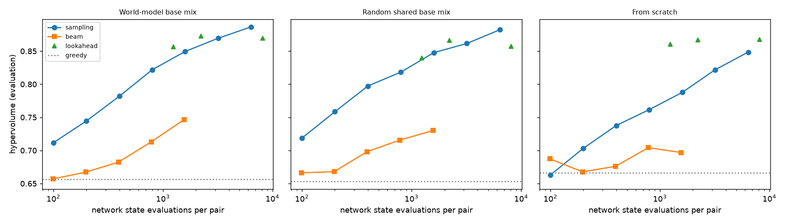
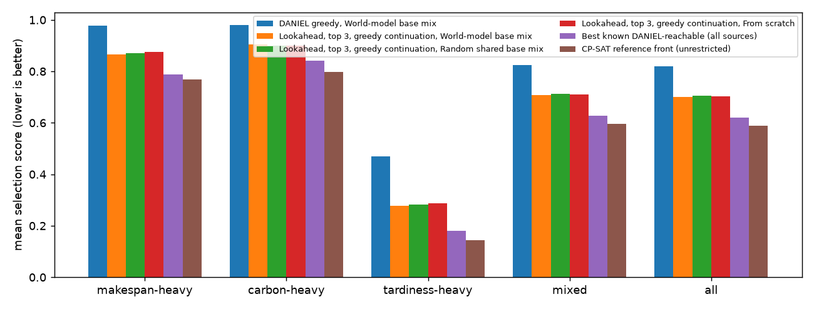

# Decoding strategies and the non-delay ceiling, benchmark v3 (10x5)

Inference and CP-SAT only. No training; network weights, input features, the action mask and the simulator are unchanged. Protocol, fixed before the runs and amended once after the validation pilot: `docs/decoding_ceiling_protocol_v3.md`.

- **Settings chosen on:** the 18 validation instances. **Reported on:** the 20 evaluation instances with a CP-SAT reference front, as in the CP-SAT audit.
- **Preferences:** the 66 grid preferences.
- **Checkpoints (final):** World-model base mix (`pd_wm_u2250`), Random shared base mix (`pd_ctrl_u3650`), From scratch (`pd_fs_u4550`).
- **Selection score:** every schedule is ranked by the benchmark's preference-weighted normalised score, using the simulator's exact objectives.
- **Measurement:** single seed, numbers only. The reserved final-test sets were not used.

## Summary

| World-model base mix, evaluation (20 instances x 66 preferences) | Hypervolume | Network state evaluations per pair |
|---|---|---|
| Greedy | 0.656 | 50 |
| Best-of-16 sampling | 0.822 | 800 |
| **Selected on validation: Lookahead, top 3, greedy continuation** | **0.873** | 2223 |
| Best within the best-of-16 budget on validation: Best-of-16 sampling | 0.822 | 800 |
| Best known DANIEL-reachable (non-delay) schedules: CP-SAT audit pool + every decoder here + new search | 1.018 | - |
| CP-SAT reference front (unrestricted) | 1.205 | - |

- **Question A (better decoding):**
  - The decoder chosen on validation raises the World-model base mix from 0.656 to 0.873, against 0.822 for best-of-16.
  - That recovers 60% of the gap between greedy and the best known DANIEL-reachable schedules (0.656 to 1.018).
  - Budget-matched comparisons are in Part A.
- **Question B (the non-delay ceiling):**
  - Best known DANIEL-reachable hypervolume: 0.913 before this study, 1.018 now.
  - No hypervolume ceiling could be proven: the exact restricted model is too hard to solve.
  - **Proven subset** (200 instance-preference pairs, 10 preferences): the best known DANIEL score is 0.040 worse than the best unrestricted schedule on average.
  - CP-SAT's own bounds prove that at least 0.005 of that gap (13%) is caused by the non-delay rule. The cost is proven in 63 of 200 pairs, mostly carbon-heavy and makespan-heavy preferences.
  - The other 87% is unresolved: it could be more cost of the rule, or better DANIEL schedules not yet found.
  - Search alone is incomplete: the 60 s restricted solves still found 108 better DANIEL-reachable schedules than any other method.

## Part A: decoding the existing policies

**Methods:**
- **Greedy:** the argmax action.
- **Best-of-K sampling:** the best of K sampled schedules. K = 2-16 are the first K of the committed best-of-16 stream (seed 50), so best-of-16 reproduces the committed evaluation. K = 32-128 come from a separate stream (seed 51).
- **Beam search:** partial schedules are kept by accumulated log-probability, and identical partial schedules are merged. Finished schedules are ranked by the selection score.
- **Lookahead:** at each step, DANIEL's top-k legal actions are each completed by the frozen policy, and the best by the selection score is executed.
- Starred methods (*) are budget-matched extensions beyond the requested settings.

**Cost columns**, per instance-preference pair:
- **State evals:** network evaluations of a simulator state.
- **Schedules:** completed schedules evaluated.
- **Batched s/pair:** wall-clock time with all pairs batched on the GPU.
- **Latency:** one pair at a time, mean and worst over 20 fixed evaluation pairs (RTX 5060 Ti).

Regret: mean preference-weighted regret in normalised space, against every schedule found for the instance (and the CP-SAT front on evaluation).

### Validation split

**World-model base mix**

| Method | HV | Unique non-dominated | Regret | State evals | Schedules | Batched s/pair |
|---|---|---|---|---|---|---|
| Greedy | 0.609 | 8.1 | 0.2347 | 50 | 1.0 | 0.0022 |
| Best-of-2 sampling | 0.673 | 10.1 | 0.2257 | 100 | 2.0 | 0.0039 |
| Best-of-4 sampling | 0.718 | 10.3 | 0.1864 | 200 | 4.0 | 0.0079 |
| Best-of-8 sampling | 0.763 | 12.2 | 0.1579 | 400 | 8.0 | 0.0158 |
| Best-of-16 sampling | 0.785 | 12.7 | 0.1349 | 800 | 16.0 | 0.0316 |
| Best-of-32 sampling* | 0.803 | 13.7 | 0.1147 | 1600 | 32.0 | 0.0627 |
| Best-of-64 sampling* | 0.823 | 15.7 | 0.0986 | 3200 | 64.0 | 0.1253 |
| Best-of-128 sampling* | 0.845 | 16.6 | 0.0853 | 6400 | 128.0 | 0.2506 |
| Beam search, width 2 | 0.623 | 7.6 | 0.2124 | 99 | 2.0 | 0.0054 |
| Beam search, width 4 | 0.654 | 7.8 | 0.1862 | 197 | 4.0 | 0.0108 |
| Beam search, width 8 | 0.675 | 9.3 | 0.1644 | 393 | 8.0 | 0.0233 |
| Beam search, width 16* | 0.694 | 9.6 | 0.1445 | 785 | 16.0 | 0.0452 |
| Beam search, width 32* | 0.713 | 11.1 | 0.1244 | 1566 | 32.0 | 0.0900 |
| Lookahead, top 2, greedy continuation | 0.843 | 12.7 | 0.1042 | 1235 | 44.0 | 0.0606 |
| Lookahead, top 3, greedy continuation | 0.848 | 13.3 | 0.0986 | 2192 | 77.5 | 0.1001 |
| Lookahead, top 2, greedy + 3 sampled continuations | 0.830 | 13.8 | 0.1209 | 8049 | 302.5 | 0.3531 |

**Random shared base mix**

| Method | HV | Unique non-dominated | Regret | State evals | Schedules | Batched s/pair |
|---|---|---|---|---|---|---|
| Greedy | 0.611 | 6.1 | 0.2292 | 50 | 1.0 | 0.0023 |
| Best-of-2 sampling | 0.705 | 9.0 | 0.2181 | 100 | 2.0 | 0.0048 |
| Best-of-4 sampling | 0.728 | 10.8 | 0.1829 | 200 | 4.0 | 0.0096 |
| Best-of-8 sampling | 0.765 | 11.8 | 0.1540 | 400 | 8.0 | 0.0192 |
| Best-of-16 sampling | 0.782 | 12.6 | 0.1314 | 800 | 16.0 | 0.0383 |
| Best-of-32 sampling* | 0.794 | 13.1 | 0.1134 | 1600 | 32.0 | 0.0719 |
| Best-of-64 sampling* | 0.820 | 15.7 | 0.0975 | 3200 | 64.0 | 0.1437 |
| Best-of-128 sampling* | 0.833 | 16.6 | 0.0841 | 6400 | 128.0 | 0.2874 |
| Beam search, width 2 | 0.613 | 7.6 | 0.2067 | 99 | 2.0 | 0.0051 |
| Beam search, width 4 | 0.645 | 7.1 | 0.1810 | 197 | 4.0 | 0.0102 |
| Beam search, width 8 | 0.659 | 8.4 | 0.1595 | 393 | 8.0 | 0.0206 |
| Beam search, width 16* | 0.679 | 9.0 | 0.1395 | 785 | 16.0 | 0.0427 |
| Beam search, width 32* | 0.700 | 10.4 | 0.1225 | 1566 | 31.9 | 0.0827 |
| Lookahead, top 2, greedy continuation | 0.800 | 13.9 | 0.1048 | 1233 | 43.9 | 0.0568 |
| Lookahead, top 3, greedy continuation | 0.829 | 13.7 | 0.0978 | 2179 | 77.3 | 0.0912 |
| Lookahead, top 2, greedy + 3 sampled continuations | 0.821 | 12.9 | 0.1191 | 8040 | 302.4 | 0.3334 |

**From scratch**

| Method | HV | Unique non-dominated | Regret | State evals | Schedules | Batched s/pair |
|---|---|---|---|---|---|---|
| Greedy | 0.585 | 5.4 | 0.2489 | 50 | 1.0 | 0.0020 |
| Best-of-2 sampling | 0.574 | 7.2 | 0.2782 | 100 | 2.0 | 0.0041 |
| Best-of-4 sampling | 0.610 | 8.3 | 0.2382 | 200 | 4.0 | 0.0081 |
| Best-of-8 sampling | 0.664 | 9.1 | 0.2037 | 400 | 8.0 | 0.0162 |
| Best-of-16 sampling | 0.716 | 11.2 | 0.1736 | 800 | 16.0 | 0.0325 |
| Best-of-32 sampling* | 0.741 | 12.7 | 0.1492 | 1600 | 32.0 | 0.0659 |
| Best-of-64 sampling* | 0.756 | 14.1 | 0.1326 | 3200 | 64.0 | 0.1318 |
| Best-of-128 sampling* | 0.789 | 14.8 | 0.1152 | 6400 | 128.0 | 0.2636 |
| Beam search, width 2 | 0.592 | 6.2 | 0.2365 | 99 | 2.0 | 0.0045 |
| Beam search, width 4 | 0.589 | 6.9 | 0.2195 | 197 | 4.0 | 0.0091 |
| Beam search, width 8 | 0.616 | 6.7 | 0.1967 | 393 | 8.0 | 0.0192 |
| Beam search, width 16* | 0.617 | 8.3 | 0.1736 | 785 | 15.9 | 0.0394 |
| Beam search, width 32* | 0.644 | 8.0 | 0.1554 | 1566 | 31.9 | 0.0819 |
| Lookahead, top 2, greedy continuation | 0.814 | 12.0 | 0.1123 | 1229 | 43.9 | 0.0484 |
| Lookahead, top 3, greedy continuation | 0.833 | 12.4 | 0.1005 | 2182 | 77.3 | 0.0822 |
| Lookahead, top 2, greedy + 3 sampled continuations | 0.809 | 11.5 | 0.1271 | 8013 | 301.8 | 0.3229 |

### Evaluation split

**World-model base mix**

| Method | HV | IGD+ | Unique non-dominated | Regret | State evals | Schedules | Batched s/pair | Latency mean / worst (s) |
|---|---|---|---|---|---|---|---|---|
| Greedy | 0.656 | 0.298 | 6.5 | 0.3023 | 50 | 1.0 | 0.0028 | 0.63 / 1.36 |
| Best-of-2 sampling | 0.712 | 0.272 | 7.5 | 0.2882 | 100 | 2.0 | 0.0046 | - |
| Best-of-4 sampling | 0.744 | 0.255 | 9.2 | 0.2503 | 200 | 4.0 | 0.0092 | - |
| Best-of-8 sampling | 0.782 | 0.232 | 10.9 | 0.2225 | 400 | 8.0 | 0.0185 | - |
| Best-of-16 sampling | 0.822 | 0.210 | 12.3 | 0.2008 | 800 | 16.0 | 0.0370 | 0.71 / 1.56 |
| Best-of-32 sampling* | 0.850 | 0.196 | 12.6 | 0.1798 | 1600 | 32.0 | 0.0595 | - |
| Best-of-64 sampling* | 0.869 | 0.182 | 14.0 | 0.1652 | 3200 | 64.0 | 0.1191 | - |
| Best-of-128 sampling* | 0.887 | 0.175 | 15.0 | 0.1526 | 6400 | 128.0 | 0.2382 | 0.99 / 1.78 |
| Beam search, width 2 | 0.657 | 0.308 | 6.8 | 0.2853 | 99 | 2.0 | 0.0041 | 0.57 / 1.02 |
| Beam search, width 4 | 0.667 | 0.304 | 6.6 | 0.2597 | 197 | 4.0 | 0.0080 | 0.63 / 1.28 |
| Beam search, width 8 | 0.682 | 0.290 | 7.7 | 0.2389 | 393 | 8.0 | 0.0172 | 0.95 / 2.37 |
| Beam search, width 16* | 0.713 | 0.271 | 9.1 | 0.2185 | 785 | 16.0 | 0.0344 | 0.73 / 1.65 |
| Beam search, width 32* | 0.747 | 0.252 | 9.3 | 0.2023 | 1566 | 32.0 | 0.0690 | 0.70 / 1.67 |
| Lookahead, top 2, greedy continuation | 0.857 | 0.182 | 12.5 | 0.1742 | 1248 | 44.5 | 0.0477 | 15.56 / 19.86 |
| Lookahead, top 3, greedy continuation | 0.873 | 0.180 | 11.7 | 0.1687 | 2223 | 78.6 | 0.0736 | 14.91 / 17.89 |
| Lookahead, top 2, greedy + 3 sampled continuations | 0.870 | 0.182 | 12.9 | 0.1884 | 8160 | 306.6 | 0.2946 | 17.32 / 21.16 |

**Random shared base mix**

| Method | HV | IGD+ | Unique non-dominated | Regret | State evals | Schedules | Batched s/pair | Latency mean / worst (s) |
|---|---|---|---|---|---|---|---|---|
| Greedy | 0.653 | 0.302 | 5.5 | 0.3109 | 50 | 1.0 | 0.0018 | 0.69 / 1.56 |
| Best-of-2 sampling | 0.719 | 0.272 | 9.8 | 0.2833 | 100 | 2.0 | 0.0039 | - |
| Best-of-4 sampling | 0.758 | 0.248 | 10.2 | 0.2460 | 200 | 4.0 | 0.0077 | - |
| Best-of-8 sampling | 0.797 | 0.222 | 10.8 | 0.2183 | 400 | 8.0 | 0.0154 | - |
| Best-of-16 sampling | 0.818 | 0.208 | 11.8 | 0.1953 | 800 | 16.0 | 0.0308 | 0.47 / 0.98 |
| Best-of-32 sampling* | 0.848 | 0.194 | 12.6 | 0.1787 | 1600 | 32.0 | 0.0578 | - |
| Best-of-64 sampling* | 0.862 | 0.185 | 13.1 | 0.1642 | 3200 | 64.0 | 0.1156 | - |
| Best-of-128 sampling* | 0.882 | 0.174 | 15.1 | 0.1501 | 6400 | 128.0 | 0.2313 | 1.28 / 1.91 |
| Beam search, width 2 | 0.666 | 0.297 | 5.7 | 0.2883 | 99 | 2.0 | 0.0041 | 0.64 / 1.47 |
| Beam search, width 4 | 0.668 | 0.294 | 5.7 | 0.2607 | 197 | 4.0 | 0.0079 | 0.74 / 1.92 |
| Beam search, width 8 | 0.698 | 0.275 | 6.7 | 0.2359 | 393 | 8.0 | 0.0171 | 0.54 / 0.99 |
| Beam search, width 16* | 0.716 | 0.263 | 7.6 | 0.2160 | 785 | 16.0 | 0.0342 | 0.60 / 0.96 |
| Beam search, width 32* | 0.730 | 0.256 | 8.3 | 0.2000 | 1566 | 32.0 | 0.0686 | 0.84 / 2.11 |
| Lookahead, top 2, greedy continuation | 0.840 | 0.192 | 12.2 | 0.1791 | 1244 | 44.5 | 0.0455 | 15.03 / 18.24 |
| Lookahead, top 3, greedy continuation | 0.867 | 0.181 | 12.2 | 0.1706 | 2212 | 78.6 | 0.0742 | 14.55 / 17.54 |
| Lookahead, top 2, greedy + 3 sampled continuations | 0.857 | 0.187 | 10.0 | 0.1935 | 8126 | 306.1 | 0.2883 | 15.53 / 20.48 |

**From scratch**

| Method | HV | IGD+ | Unique non-dominated | Regret | State evals | Schedules | Batched s/pair | Latency mean / worst (s) |
|---|---|---|---|---|---|---|---|---|
| Greedy | 0.666 | 0.294 | 5.1 | 0.2947 | 50 | 1.0 | 0.0015 | 0.56 / 1.18 |
| Best-of-2 sampling | 0.663 | 0.299 | 7.8 | 0.3400 | 100 | 2.0 | 0.0035 | - |
| Best-of-4 sampling | 0.703 | 0.273 | 8.6 | 0.2948 | 200 | 4.0 | 0.0070 | - |
| Best-of-8 sampling | 0.738 | 0.258 | 9.8 | 0.2582 | 400 | 8.0 | 0.0139 | - |
| Best-of-16 sampling | 0.762 | 0.243 | 11.7 | 0.2303 | 800 | 16.0 | 0.0278 | 0.63 / 1.24 |
| Best-of-32 sampling* | 0.788 | 0.231 | 11.8 | 0.2088 | 1600 | 32.0 | 0.0547 | - |
| Best-of-64 sampling* | 0.822 | 0.210 | 13.3 | 0.1896 | 3200 | 64.0 | 0.1095 | - |
| Best-of-128 sampling* | 0.848 | 0.194 | 14.1 | 0.1737 | 6400 | 128.0 | 0.2190 | 0.90 / 1.06 |
| Beam search, width 2 | 0.687 | 0.282 | 6.0 | 0.2793 | 99 | 2.0 | 0.0038 | 0.52 / 0.58 |
| Beam search, width 4 | 0.668 | 0.291 | 6.0 | 0.2645 | 197 | 4.0 | 0.0077 | 0.57 / 0.67 |
| Beam search, width 8 | 0.676 | 0.293 | 6.8 | 0.2460 | 393 | 8.0 | 0.0165 | 0.58 / 0.77 |
| Beam search, width 16* | 0.704 | 0.267 | 6.3 | 0.2325 | 785 | 16.0 | 0.0328 | 0.59 / 1.09 |
| Beam search, width 32* | 0.697 | 0.275 | 6.8 | 0.2144 | 1566 | 32.0 | 0.0662 | 0.71 / 0.87 |
| Lookahead, top 2, greedy continuation | 0.860 | 0.186 | 10.8 | 0.1699 | 1250 | 44.7 | 0.0408 | 11.83 / 13.23 |
| Lookahead, top 3, greedy continuation | 0.867 | 0.182 | 11.8 | 0.1664 | 2218 | 79.1 | 0.0696 | 11.86 / 12.82 |
| Lookahead, top 2, greedy + 3 sampled continuations | 0.867 | 0.180 | 10.6 | 0.1830 | 8161 | 307.7 | 0.2798 | 13.51 / 14.70 |

Latency was measured for greedy, best-of-16, best-of-128, every beam width and every lookahead variant.

### Settings chosen on validation

| Method | Validation HV (mean of 3 checkpoints) | State evals per pair |
|---|---|---|
| Greedy | 0.602 | 50 |
| Best-of-2 sampling | 0.651 | 100 |
| Best-of-4 sampling | 0.686 | 200 |
| Best-of-8 sampling | 0.731 | 400 |
| Best-of-16 sampling | 0.761 | 800 |
| Best-of-32 sampling* | 0.779 | 1600 |
| Best-of-64 sampling* | 0.800 | 3200 |
| Best-of-128 sampling* | 0.822 | 6400 |
| Beam search, width 2 | 0.609 | 99 |
| Beam search, width 4 | 0.629 | 197 |
| Beam search, width 8 | 0.650 | 393 |
| Beam search, width 16* | 0.663 | 785 |
| Beam search, width 32* | 0.686 | 1566 |
| Lookahead, top 2, greedy continuation | 0.819 | 1232 |
| Lookahead, top 3, greedy continuation | 0.837 | 2185 |
| Lookahead, top 2, greedy + 3 sampled continuations | 0.820 | 8034 |

- **Selected (highest validation HV within 6,400 state evaluations per pair):** Lookahead, top 3, greedy continuation.
- **Best within the best-of-16 budget (800):** Best-of-16 sampling.

### At similar budgets (evaluation)

For each beam and lookahead setting, the best-of-K sampling run with the nearest budget at or above it is used. Values are the HV difference (method minus sampling).

| Method | Its budget | Sampling compared | World-model base mix | Random shared base mix | From scratch |
|---|---|---|---|---|---|
| Beam search, width 2 | 99 | best-of-2 (100) | -0.055 | -0.052 | +0.024 |
| Beam search, width 4 | 197 | best-of-4 (200) | -0.077 | -0.091 | -0.036 |
| Beam search, width 8 | 393 | best-of-8 (400) | -0.100 | -0.099 | -0.062 |
| Beam search, width 16 | 785 | best-of-16 (800) | -0.109 | -0.103 | -0.057 |
| Beam search, width 32 | 1566 | best-of-32 (1600) | -0.103 | -0.118 | -0.091 |
| Lookahead, top 2, greedy continuation | 1248 | best-of-32 (1600) | +0.007 | -0.008 | +0.073 |
| Lookahead, top 3, greedy continuation | 2223 | best-of-64 (3200) | +0.004 | +0.005 | +0.045 |
| Lookahead, top 2, greedy + 3 sampled continuations | 8160 | best-of-128 (6400) | -0.017 | -0.025 | +0.019 |

## Part B: the non-delay ceiling

### B1. DANIEL's exact action space

From `daniel/fjsp_env_same_op_nums.py`.
- **Allowed actions.** At each step, the actions are pairs (job j's next unscheduled operation, machine m) with m eligible for that operation (processing time > 0).
- **Pair start time.** A pair can start at max(job ready time, machine free time) (`pair_free_time`).
- **The rule.** A pair is allowed only if that start equals the step's `next_schedule_time`, the minimum over all eligible pairs (lines 584-591 and 638-642). Every other logit is set to minus infinity (`model/main_model.py:192`). The chosen operation then starts at exactly that time.
- **Definitions from the literature:**
  - **Non-delay schedule:** no machine is ever idle while an operation it can process is ready. Every schedule the rule produces is non-delay (`results/diagnose_v3.md`).
  - **Converse.** Every non-delay schedule can be produced, in exact arithmetic. Take the unscheduled operation that the target schedule starts first, at time s. If the earliest start t* over all eligible pairs were below s, some machine would be idle in the target from t* to s while an operation it could process is ready, which contradicts non-delay. So the earliest start equals s, and that operation's pair is allowed.
  - **Active schedules** (Giffler-Thompson: an operation may start whenever no other operation could finish before it starts) and **semi-active schedules** (any start time that cannot be moved earlier without changing the order) are wider classes. DANIEL cannot produce them.
- **A floating-point detail.** The environment compares start times in scaled floating point (raw time / 99). Against the same rule in exact integer arithmetic, at every step of 62,000 states (random decodings and every CP-SAT audit pool schedule):
  - the float rule masks 3,374 pairs that tie exactly for the earliest start, in 871 states (1%);
  - it allows 0 pairs that the exact rule forbids.
  - So **DANIEL's action space is the non-delay rule with some exact ties lost**. Its schedules are a subset of the non-delay schedules, and any bound on non-delay schedules is also a bound for DANIEL.

### B2. CP-SAT restricted to DANIEL's rule

**Model.** The B1/B2 CP-SAT model (`tools/cpsat_baselines_v3.py`) with additional constraints:
- a circuit of consecutive operations per machine;
- for every machine m, every operation o eligible on m and every idle gap of m (before its first operation, between consecutive operations, after its last operation), the gap may not overlap the interval [r_o, s_o) during which o is ready and waiting.

The code is `tools/nondelay_cpsat_v3.py`.

**Checked equivalent before use:**
- Pool schedules, all made by DANIEL's rule, are feasible when fixed in the model: OPTIMAL 120.
- Left-shifted CP-SAT schedules, which are not non-delay, are infeasible when fixed: INFEASIBLE (non-delay by the checker: False) 120.

**Pilot** (validation instances 0-1, 5 preferences, up to 60 s, no hint):
- no solve was proven optimal;
- schedules were often worse than DANIEL's;
- bounds were weak.

Solving all 1,320 evaluation pairs exactly was out of reach, so the protocol was amended, before any evaluation solve, to two parts (below).

**1. Proven bounds on a subset.** 200 pairs: 20 instances x 10 preferences (the three corners, the three edge midpoints, and four interior points). Each pair is solved twice, for 60 s with 6 workers:
- **restricted:** non-delay, hinted with the best known DANIEL schedule;
- **unrestricted:** the plain model, hinted with CP-SAT's best front point.

- Restricted solve status: FEASIBLE 148, OPTIMAL 52.
- Unrestricted solve status: FEASIBLE 29, OPTIMAL 171.
- Restricted solves that found a better schedule than the best known: 145.
  - Of these, DANIEL's rule reproduces 108; only those count as DANIEL-reachable.

All values are mean selection scores (lower is better).
- **Best known DANIEL** includes the restricted solves.
- **Proven DANIEL lower bound** is a valid lower bound on the score of any schedule DANIEL can produce.
- **Proven cost of the rule:** the restricted bound minus the best unrestricted schedule found, where positive. The unrestricted optimum is at most that schedule's score.

| Preferences | Pairs | Unrestricted best (proven optimal) | Best known DANIEL | Proven DANIEL lower bound | Total gap (DANIEL - unrestricted) | Proven cost of the rule | Pairs with a proven cost | Unresolved |
|---|---|---|---|---|---|---|---|---|
| makespan-heavy | 20 | 0.794 (20) | 0.811 | 0.716 | 0.017 | 0.006 (38%) | 12 | 0.010 (62%) |
| carbon-heavy | 20 | 0.813 (20) | 0.877 | 0.839 | 0.064 | 0.026 (41%) | 19 | 0.038 (59%) |
| tardiness-heavy | 20 | 0.029 (19) | 0.062 | 0.001 | 0.033 | 0.000 (1%) | 2 | 0.033 (99%) |
| mixed | 140 | 0.595 (112) | 0.636 | 0.527 | 0.041 | 0.003 (6%) | 30 | 0.039 (94%) |
| All 10 | 200 | 0.580 (171) | 0.620 | 0.524 | 0.040 | 0.005 (13%) | 63 | 0.035 (87%) |

Reading the table:
- **Proven cost** is a minimum: the restricted bound is a lower bound, so the true cost of the rule is at least this.
- **Unresolved** is the part of the gap that the bounds cannot assign. It is either more cost of the rule, or better DANIEL schedules that no method has found yet.

**2. Search inside DANIEL's rule** (all 66 preferences).
- **Method:** random-key genetic search decoded by DANIEL's own rule (population 100, 300 generations, seeded with the 20 best known schedules per pair).
- **Result:** it improved the best known schedule in 435 of 1320 pairs; the mean score went from 0.6346 to 0.6321.
- Every result was replayed through the environment and re-scored.

### B3. The remaining gap (evaluation, identical normalisation)

| Schedules | HV | Mean score: makespan-heavy | carbon-heavy | tardiness-heavy | mixed | all 66 |
|---|---|---|---|---|---|---|
| DANIEL greedy, World-model base mix | 0.656 | 0.979 | 0.981 | 0.471 | 0.824 | 0.820 |
| Lookahead, top 3, greedy continuation, World-model base mix | 0.873 | 0.866 | 0.904 | 0.279 | 0.708 | 0.701 |
| Lookahead, top 3, greedy continuation, Random shared base mix | 0.867 | 0.871 | 0.901 | 0.283 | 0.711 | 0.704 |
| Lookahead, top 3, greedy continuation, From scratch | 0.867 | 0.877 | 0.901 | 0.288 | 0.710 | 0.704 |
| Best known DANIEL-reachable (all sources) | 1.018 | 0.788 | 0.841 | 0.181 | 0.627 | 0.621 |
| CP-SAT reference front (unrestricted) | 1.205 | 0.768 | 0.798 | 0.144 | 0.596 | 0.589 |

For the two set rows (best known DANIEL-reachable, CP-SAT), each preference uses the set's best point for it.

**Gap shares:**
- Greedy to best known DANIEL-reachable (0.656 to 1.018): the selected decoder recovers 60% for the World-model base mix. The best decoder on any checkpoint recovers 64%.
- The search and the restricted solves raise the best known DANIEL front from 0.913 to 1.018.
- Best known DANIEL-reachable to CP-SAT (1.018 to 1.205): see the proven-subset table. No hypervolume-level ceiling is proven.

## Files

- `tools/decoding_v3.py`: decoders and Part A runs. `tools/nondelay_cpsat_v3.py`: restricted CP-SAT, checks, subset bounds and search. `tools/analyze_decoding_ceiling_v3.py`: this report.
- `results/decoding_ceiling_v3/<split>/<checkpoint>__<method>.npz`: every schedule (machine, start, objectives) and its cost.
- `results/decoding_ceiling_v3/nondelay_cpsat/`: checks and subset solves (every solve's schedule, bound and status).
- `results/decoding_ceiling_v3/search/evaluation.npz`: search results.
- `results/decoding_ceiling_v3/latency.json`, `summary.json`.
- `tests/test_decoding_ceiling_v3.py`, `tests/test_nondelay_cpsat_v3.py`.
