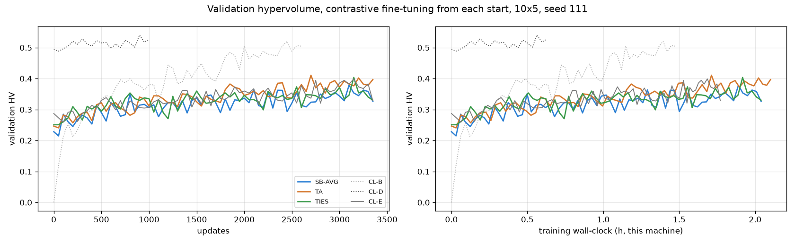

# Merge categories on benchmark v3: shared-base average, Task Arithmetic and TIES, with contrastive fine-tuning

Generated by `tools/analyze_merge_categories_v3.py` (docs/merge_categories_protocol_v3.md). Three merges of the same three specialists, all fine-tuned from one shared base, each evaluated with zero training and after contrastive fine-tuning (no PPO fine-tuning in this study). Compared with the seed-111 contrastive arms of results/contrastive_v3.md.

**Single seed (111): numbers only, no significance claims.** Higher HV is better; lower IGD+ and regret are better. Evaluation split: `evaluation`.

Hardware: NVIDIA GeForce RTX 5060 Ti, 16311 MiB, 610.88, 12 logical CPUs, --jobs 3 (the CL arms ran on the same machine with --jobs 3).

## Shared base and specialists (PPO specialist training; not arms)

| Network | Init | Objective | Updates | Best validation value (lower is better) | Update of best | Training (h) |
|---|---|---|---|---|---|---|
| base | random (seed 111) | mct (equal weights) | 500 | 0.8956 | 300 | 0.11 |
| ft_m | base | makespan | 1000 | 0.9881 | 750 | 0.22 |
| ft_c | base | carbon | 1000 | 1.0154 | 350 | 0.22 |
| ft_t | base | tardiness | 1000 | 0.3512 | 950 | 0.22 |

Shared-base preparation cost: 0.77 h of PPO training in total (shared by SB-AVG, TA and TIES).

## λ selection (validation split only)

| Merge | λ = 0.3 | λ = 0.5 | λ = 0.7 | λ = 1 | Selected |
|---|---|---|---|---|---|
| TA | 0.245 | 0.245 | 0.247 | 0.230 | λ = 0.7 |
| TIES | 0.251 | 0.209 | 0.238 | 0.195 | λ = 0.3 |

Update-0 validation HV (15 preferences); rule: highest update-0 validation HV (15-preference grid, frozen validation points); tie -> smaller lambda; evaluation data never used. TIES keeps 20% of each task vector.

## Did contrastive fine-tuning raise or lower validation HV relative to update 0?

- **SB-AVG** (start: shared-base average): update 0 HV 0.228; fine-tuning raised it to a best of 0.378 at update 3100 (+0.150); final HV at update 3350 is 0.327 (+0.098, raised).
- **TA** (start: Task Arithmetic merge): update 0 HV 0.247; fine-tuning raised it to a best of 0.411 at update 2700 (+0.164); final HV at update 3350 is 0.397 (+0.150, raised).
- **TIES** (start: TIES merge): update 0 HV 0.251; fine-tuning raised it to a best of 0.403 at update 3150 (+0.153); final HV at update 3350 is 0.330 (+0.079, raised).
- **CL-E** (start: naive merge (independent specialists)): update 0 HV 0.287; fine-tuning raised it to a best of 0.399 at update 3150 (+0.112); final HV at update 3350 is 0.328 (+0.041, raised).

Check, update-0 validation HV of each fine-tuning run vs its zero-training probe (same network): SB-AVG 0.2283 vs probe 0.2283; TA 0.2465 vs probe 0.2465; TIES 0.2508 vs probe 0.2508; CL-E 0.2871 vs probe 0.2871.

## Training (validation split, 15 preferences; same machine for every arm)

| Arm | Start | Updates | HV at update 0 | Best HV | Update of best | Env steps to best (M) | Wall-clock to best (h) | Final HV | Training (h) |
|---|---|---|---|---|---|---|---|---|---|
| SB-AVG | shared-base average | 3350 | 0.228 | 0.378 | 3100 | 24.80 | 1.89 | 0.327 | 2.04 |
| TA | Task Arithmetic merge | 3350 | 0.247 | 0.411 | 2700 | 21.60 | 1.71 | 0.397 | 2.10 |
| TIES | TIES merge | 3350 | 0.251 | 0.403 | 3150 | 25.20 | 1.92 | 0.330 | 2.04 |
| CL-B | random initialisation | 2600 | 0.000 | 0.520 | 2450 | 19.60 | 1.39 | 0.504 | 1.48 |
| CL-D | distilled student | 1000 | 0.494 | 0.540 | 900 | 7.20 | 0.56 | 0.526 | 0.62 |
| CL-E | naive merge (independent specialists) | 3350 | 0.287 | 0.399 | 3150 | 25.20 | 1.69 | 0.328 | 1.77 |

Wall-clock excludes the shared-base preparation above (SB-AVG, TA, TIES) and the distillation (CL-D).

## Evaluation (evaluation split, greedy, 66 preferences, 100 instances; IGD+ on the 20-instance CP-SAT B2 subset)

| Arm | HV | HV on the B2 subset | IGD+ | Unique non-dominated | Mean regret | Best-of-16 sampling HV |
|---|---|---|---|---|---|---|
| E merge (zero training) | 0.240 | 0.241 | 0.654 | 1.0 | 0.374 | 0.635 |
| CL-E (contrastive from E's naive merge) | 0.345 | 0.428 | 0.464 | 1.6 | 0.331 | 0.644 |
| SB-AVG merge (zero training) | 0.270 | 0.273 | 0.622 | 1.0 | 0.340 | 0.668 |
| SB-AVG + contrastive | 0.384 | 0.423 | 0.467 | 1.8 | 0.321 | 0.687 |
| TA merge (zero training) | 0.244 | 0.269 | 0.662 | 1.0 | 0.372 | 0.658 |
| TA + contrastive | 0.348 | 0.360 | 0.526 | 1.7 | 0.346 | 0.656 |
| TIES merge (zero training) | 0.222 | 0.297 | 0.598 | 1.0 | 0.368 | 0.659 |
| TIES + contrastive | 0.361 | 0.413 | 0.476 | 1.8 | 0.337 | 0.684 |
| CL-B (contrastive, scratch) | 0.548 | 0.617 | 0.327 | 3.7 | 0.297 | 0.701 |
| CL-D (contrastive from the distilled student) | 0.609 | 0.645 | 0.309 | 6.5 | 0.314 | 0.745 |
| CP-SAT B2 reference front (subset only) | - | 1.205 | 0 | - | - | - |

A zero-training merge ignores the preference (its preference columns are zero), so its 66 greedy schedules per instance are identical and its unique non-dominated count is 1. Regret is computed against every point of the arms in this table, the specialists, the rules and CP-SAT B1/B2 (so values are not comparable with the other reports).

## Contrastive diagnostics (mean over the first and the last 100 updates)

| Arm | Loss | Groups with ≥ 1 pair | Distinct schedules per group (of K) | Policy entropy | Grad norm (pre-clip) | Skipped updates | s / update |
|---|---|---|---|---|---|---|---|
| SB-AVG | 0.6923 → 0.6906 | 1.00 → 1.00 | 7.97 → 7.89 | 0.219 → 0.172 | 0.286 → 0.312 | 0 | 2.16 |
| TA | 0.6915 → 0.6928 | 1.00 → 1.00 | 7.94 → 7.83 | 0.195 → 0.154 | 0.417 → 0.453 | 0 | 2.23 |
| TIES | 0.6902 → 0.6881 | 1.00 → 1.00 | 7.99 → 7.92 | 0.248 → 0.185 | 0.221 → 0.267 | 0 | 2.16 |
| CL-E | 0.6909 → 0.6945 | 1.00 → 1.00 | 7.96 → 7.69 | 0.192 → 0.138 | 0.304 → 0.351 | 0 | 1.88 |



## Design choices (fixed before any run)

1. Shared base: the pre-registered E-shared path (`tools/ec2_runner.py: u_shared_base`, unchanged): an unconditioned DANIEL (the specialists' architecture and schema) trained with PPO on the equal-weight `mct` objective for 500 updates; its best-validation checkpoint is the base. Chosen because it has exactly the specialists' architecture and sits at the equal-weight middle of the three objectives, so each task vector points from the middle toward one corner; a random-initialisation base would make the task vectors whole networks.
2. Specialists: M, C and T fine-tuned from that base with the specialist training settings (PPO, configs benchmark_v3/{m,c,t}.json, seed 111, generator stream) for a fixed 1,000 updates each (the E-shared budget); best-validation checkpoints. They are new specialists, not the committed checkpoints/specialists_v3 (which were trained independently from random initialisations and stopped by the convergence rule).
3. SB-AVG = (θ_M + θ_C + θ_T) / 3 (`merge_specialists_v3.py --shared_base`); it equals TA with λ = 1/3.
4. TA = θ_base + λ Σ_x τ_x with τ_x = θ_x − θ_base.
5. TIES: each τ_x is trimmed to its top 20% entries by |value| over the whole flattened vector (all tensors together, as in the official implementation), the rest set to 0; per entry the elected sign is the sign of the sum of the trimmed values; the merged value is the mean over the tasks whose kept value is non-zero and has the elected sign (0 if none); result θ_base + λ τ_TIES.
6. λ ∈ {0.3, 0.5, 0.7, 1.0} for TA and TIES separately, chosen by update-0 validation HV (the CL arms' 15-preference validation grid and frozen validation normalisation points); tie → smaller λ. Evaluation data never used.
7. Preference input and critic as arm E: every tensor (extractor, actor, critic) is merged by the same rule into an unconditioned v3 bundle; `--init_mode full` copies it into the preference-conditioned network with the three preference columns of the first actor and critic layers set to zero, so the update-0 network ignores w. The contrastive objective never uses or trains the critic.
8. Fine-tuning: the existing contrastive option unchanged (configs/contrastive_v3.json constants: K 8, β 0.1, margin 0.01, gradient clip 1.0, lr 3e-4); reference = the start network, frozen; 3,350 updates (E's final update, seed 111), no early stopping; validation at update 0 and every 50 updates; best-validation-HV checkpoint.
9. Zero-training value: a 0-update contrastive run from the merge (validation at update 0, network saved) evaluated like the fine-tuned arms; for E the merge is regenerated from the committed seed-111 specialists (check: its update-0 validation HV equals CL-E's).
10. Every constant was fixed in configs/merge_categories_v3.json before any run; no hyperparameter was tuned.

## Known limitation

DANIEL's action mask only admits non-delay schedules (results/diagnose_v3.md, Test 2), kept as published for every arm; part of every gap to CP-SAT is a gap of the action space.

## Frozen inputs

```json
{
 "size": "10x5",
 "seed": 111,
 "budget": {
  "updates": 3350,
  "rule": "arm E's final update (seed 111); no early stopping",
  "source": "results/warmstart_v3/runs/10x5+mix+bv3_ws_E_s111/status.json",
  "source_sha256": "14238d9e64d2860cb4d8d98ceb4319c3da716e09df6a0df98eda15b0c8faf68b"
 },
 "contrastive": {
  "source": "configs/contrastive_v3.json",
  "source_sha256": "df851486354f209ee3b147518460c1ada4986706a41bdfa0be4432ca4282720b",
  "constants": {
   "cl_k": 8,
   "cl_beta": 0.1,
   "cl_margin": 0.01,
   "cl_grad_clip": 1.0,
   "lr": 0.0003,
   "minibatch_size": 1024,
   "validate_timestep": 50,
   "converge_window": 0,
   "mo_val_grid_step": 0.25,
   "pref_dirichlet": 1.0,
   "num_envs": 20,
   "reset_env_timestep": 20
  }
 },
 "validation_norm": {
  "path": "results/warmstart_v3/norm/validation_normalisation_points_10x5.json",
  "sha256": "76b55f740e23c839d7d1209e5e29cc6d8b90e6647f75aacc2579ad0240975521"
 },
 "method": {
  "lambda_grid": [
   0.3,
   0.5,
   0.7,
   1.0
  ],
  "ties_keep": 0.2,
  "lambda_rule": "highest update-0 validation HV (15-preference grid, frozen validation points); tie -> smaller lambda; evaluation data never used",
  "shared_base": {
   "base_goal": "mct",
   "base_updates": 500,
   "ft_updates": 1000,
   "source": "tools/ec2_runner.py u_shared_base (pre-registered E-shared path)"
  }
 },
 "frozen": "2026-11-07"
}
```

## Committed networks

Starting networks and best checkpoints: `checkpoints/merge_categories_v3/` (SHA-256 in `SHA256SUMS.json`). Selected starts:

```json
{
 "SBAVG": "848c0a64c96da7afc81df29d46ed7c9c74a69dbfab3c825dbc82a68cb6656214",
 "TA": "6dc82ee3dc866b3fe277f6712fcec586375eb06c4f7053ec699a0d42debf3289",
 "TIES": "07b562ce89c56b01a0de685224a7778775b2666f648e5962f1c9e67f30141aae"
}
```

