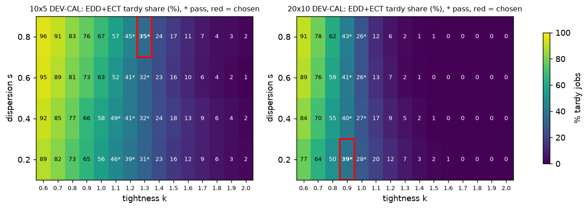
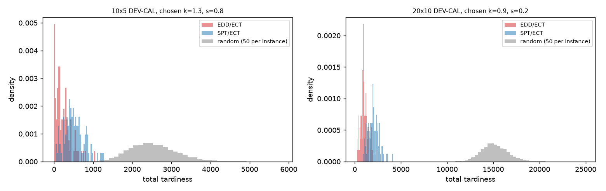
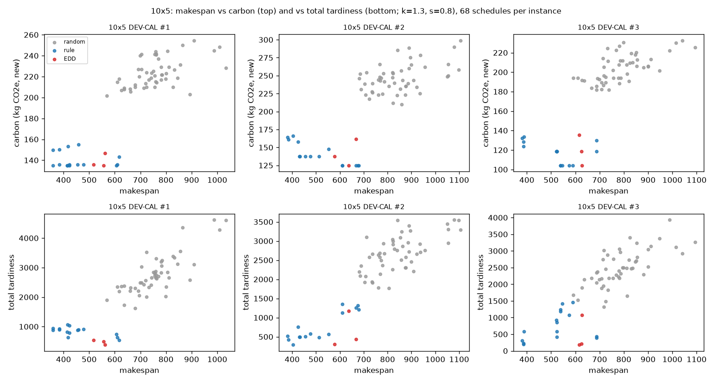
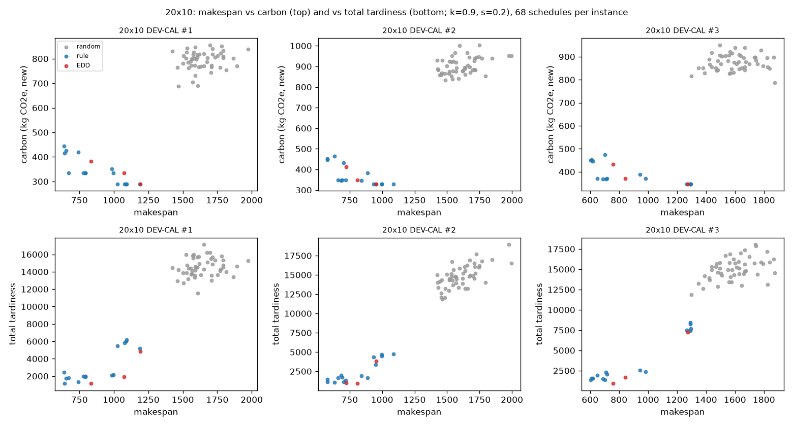

# Objective-generation validation: carbon and due dates for SD2 10x5 and 20x10 (Step 1)

## Pre-registration

Written and committed BEFORE any instance is generated or any diagnostic computed. Never edited afterwards; later
changes go under "Deviations". No DANIEL training. No existing training/environment/evaluation code path is changed.
The reserved final-test sets are never loaded; the 49 HELD-OUT instances are never used (they are only hashed, for
the disjointness check). New code: `tools/objective_validation/`. Proposed spec: `configs/problem_spec_v3_PROPOSED.yaml`.

### Development instances
* Generator: the existing `daniel/data_utils.SD2_instance_generator` (op_per_job = n_m, processing times U{1..99},
  eligible machines per operation U{1..n_m}, data_suffix "mix"), driven exactly like `generate_data_to_files`:
  `np.random.seed(seed)` once, then instances generated in sequence, written with `matrix_to_text` to
  `daniel/data/objective_dev/{cal,check}/SD2/<size>+mix/`.
* Seeds (dedicated, not used by any existing split; existing generator seeds are 100, 200, 400):
  DEV-CAL 10x5 = 20261013 (100 instances), DEV-CAL 20x10 = 20261014 (100), DEV-CHECK 10x5 = 20261015 (50),
  DEV-CHECK 20x10 = 20261016 (50). DEV-CAL is used for calibration; DEV-CHECK only for the final confirmation.
* Disjointness: structural SHA-256 (jobs, eligibility, processing times; `daniel/data_manifest.structural_fjsp_sha256`
  semantics, computed in memory) of every DEV instance vs every instance file in `daniel/data/{data_train,
  data_validation, data_train_vali, data_development, SD2}` (both sizes, mix and carbon+priority variants; the
  HELD-OUT instances are hashed only) and vs the hashes recorded in `daniel/data/manifests/`; DEV-CAL vs DEV-CHECK.
  `data_final_test` is never opened: its disjointness is argued from its generator seed (400) and recorded in the
  report as such.
* Per-instance random parameters use `numpy.random.default_rng(int(sha256("<instance key>|<purpose>")[:16], 16))`
  so they do not depend on generation order: purpose "power" (P_m), "kdraw" (v_j), "oldcarbon" (old i.i.d.
  carbon, comparison only), "random_schedules". All are stored in a manifest with each instance's SHA-256.

### Objectives (as decided)
* Time unit assumption: **1 SD2 time unit = 1 minute** (SD2 processing times are unitless). Carbon scales linearly with
  this choice; every comparison and ranking below is invariant to it.
* Carbon (processing energy only): P_m ~ U(4, 15) kW per machine (continuous, seeded, stored);
  E_om = P_m x p_om / 60 kWh; C = 0.540 x sum of E over the chosen (operation, machine) assignments, kg CO2e
  (gamma = 0.540 kg CO2e/kWh, CEA-FJSP, Wang et al., Frontiers in Environmental Science 2022).
* Old carbon (comparison only): i.i.d. integer U{1..100} per eligible (operation, machine), as `dataset_modifier.py`.
* Tardiness: T = sum_j max(0, C_j - d_j), r_j = 0, d_j = k_j x W_j, W_j = sum over the job's operations of the MEAN
  processing time over its eligible machines; k_j = k x (1 + s x (v_j - 0.5)), v_j ~ U(0, 1) per job, seeded and
  stored (common random numbers across all (k, s), i.e. k_j ~ U[k(1 - s/2), k(1 + s/2)]).

### Schedule set (no learning), independent builder `tools/objective_validation/schedules.py`
* Active-style dispatching: with r_j = completion of job j's last scheduled operation and F_m = machine free time,
  c* = min over candidate pairs (j, eligible m) of max(r_j, F_m) + p; conflict set = jobs whose next operation could
  start before c* on some eligible machine; the JOB rule picks a job from the conflict set (ties: lowest job index);
  the MACHINE rule picks one of its eligible machines; start = max(r_j, F_m).
* Job rules: SPT (smallest min-eligible processing time of the next operation), LPT (largest), MOR (most operations
  remaining), MWKR (most remaining work, mean-eligible processing times), EDD (smallest d_j), FIFO (smallest r_j).
  Machine rules: ECT (earliest completion), SPT (shortest processing time; ties ECT), MINE (minimum energy P_m x p;
  ties ECT). For the old-carbon comparison only: OLDC (minimum old carbon; ties ECT).
* Random dispatching: 50 schedules per instance (job uniform over the conflict set, machine uniform over eligible).
* Every schedule is validated (eligible machine, precedence, no machine overlap, every operation exactly once).
* Carbon diagnostics (Part 3) use the due-date-free set: 5 job rules (no EDD) x 3 machine rules + 50 random = 65
  schedules (old carbon: OLDC replaces MINE). Tardiness and joint diagnostics add EDD x 3 machine rules at the
  configuration being evaluated (68 schedules).
* CP-SAT subset: the first 10 DEV-CAL instances per size, 60 s, 8 workers, fixed seed: (a) minimum makespan,
  (b) minimum total tardiness at the chosen due-date configuration, (c) minimum makespan with every operation fixed to
  its minimum-energy machine. Status (OPTIMAL / FEASIBLE) reported; these schedules are reported separately and do not
  enter the pass/fail diagnostics.

### Part 3: carbon diagnostics and pass rule
* C1: share of operations whose fastest eligible machine (ties: lower energy) is not the minimum-energy eligible
  machine (ties: shorter time).
* C2 per instance over the carbon schedule set: Spearman(makespan, carbon); size of the 2-D non-dominated set
  (makespan, carbon); trade-off magnitudes TM_mk = (makespan of the best-makespan schedule among those attaining the
  set's minimum carbon - set minimum makespan) / set minimum makespan, and TM_c = (carbon of the lowest-carbon schedule
  among those attaining the set's minimum makespan - set minimum carbon) / set minimum carbon (median and IQR);
  Spearman(carbon, total processing workload sum of chosen p).
* **Pass**: C1 >= 20% at both sizes AND median TM_mk >= 5% AND median TM_c >= 5% at both sizes. The same diagnostics
  are reported for the old i.i.d. carbon. If the check fails it is reported and the carbon part stops there (no
  switch to per-operation power, no tuning of the power range).

### Part 4: tardiness calibration (per size, DEV-CAL)
Grid k in {0.6, 0.7, ..., 2.0} x s in {0.2, 0.4, 0.6, 0.8}. Rule schedules for the T statistics use ECT machines
unless stated.
* T1: mean (over instances) share of tardy jobs under EDD + ECT. Target 20-50%.
* T2: median relative reduction of total tardiness of EDD vs SPT and vs MWKR, (T_X - T_EDD) / T_X (0 if T_X = 0);
  share of instances where the best of the 18 rule schedules has zero tardiness (< 10%); share of instances where
  every job is late in every rule schedule (< 10%); median coefficient of variation of total tardiness over the
  68-schedule set.
* T3: median per-instance Spearman(T, makespan) and Spearman(T, sum_j C_j); among all schedule pairs whose makespans
  are within 1% (of the smaller), the share whose T differs by > 10% (of the larger; pairs with both T = 0 do not
  differ), pooled; median size of the 2-D non-dominated set (makespan, T).
* **Selection** (per size): keep configurations with T1 in [20%, 50%], zero-tardiness share < 10%, all-late share
  < 10% and median Spearman(T, makespan) < 0.9; among them choose the EDD tardy share closest to 35%; ties by the
  larger median EDD-vs-SPT reduction. If none passes, report the closest and stop.
* **Confirmation** on DEV-CHECK for the chosen configuration: passes if T1 is in [20%, 50%] and the zero-tardiness,
  all-late and Spearman(T, makespan) conditions hold. Carbon diagnostics are also re-reported on DEV-CHECK.

### Part 5: joint check (chosen carbon + chosen due dates, 68-schedule set)
Median per-instance Spearman matrix of {makespan, carbon, T, sum_j C_j, workload}; share of schedules in each
instance's 3-D non-dominated set (makespan, carbon, T). **Three meaningfully distinct objectives** at a size if every
pairwise median |Spearman| among makespan, carbon and T is < 0.9 and the median instance's 3-D non-dominated set
holds >= 3 schedules.

## Headline

* **Carbon (P_m ~ U(4, 15) kW per machine, processing energy only): FAILS the pre-registered check.** Only 14.4%
  (10x5) and 16.5% (20x10) of operations have a fastest machine that is not also their lowest-energy machine
  (threshold 20%). The schedule-level trade-off magnitudes pass easily (median 48-77% makespan cost of minimum
  carbon, 23-34% carbon cost of minimum makespan), but carbon tracks total processing workload (median Spearman 0.91).
  As pre-registered, the carbon part stopped there: no per-operation power, no tuning of the power range.
* **Due dates (TWK): calibrated and confirmed.** 10x5: k = 1.3, s = 0.8 (EDD tardy share 34.8%; DEV-CHECK 32.2%).
  20x10: k = 0.9, s = 0.2 (39.1%; DEV-CHECK 38.5%). Both pass every pre-registered condition on DEV-CAL and DEV-CHECK.
  **Caveat:** the calibration uses dispatching-rule schedules; CP-SAT reaches zero total tardiness on 8 of 10 subset
  instances at 10x5 (1 of 10 at 20x10), so the 10x5 due dates are loose for a strong scheduler.
* Proposed spec: `configs/problem_spec_v3_PROPOSED.yaml`, marked PROPOSED, with carbon marked FAILED and the
  tardiness caveat. Not wired into anything.

## Part 1: audit of the current generation (read-only)

* **Carbon now**: `dataset_modifier.py:14-19`. For every operation an integer priority `random.randint(1, 100)`
  (line 15), and for every ELIGIBLE (operation, machine) pair an integer carbon `random.randint(1, 100)` (line 18),
  i.i.d., independent of processing time and machine, written into the extended `+carbon+priority` files. Python's
  `random` is **not seeded** (the values cannot be regenerated), the paths are hard-coded Windows paths to 10x5, and the
  20x10 files were added in the initial commit (2a700b8) with no generating script in the repository. Carbon is unitless.
  It is read by `daniel/data_utils.py:130-178` (`text_to_matrix_with_priority_carbon`) and charged per chosen pair in the
  environment (`daniel/fjsp_env_same_op_nums.py`, `chosen_carbon = op_carbon[...]` in `step`).
* **Due dates now**: `daniel/due_dates.py:58-62` (`work_content`): P_j = sum over the job's operations of the MEAN
  processing time over that operation's eligible machines; `:65-67` (`relative_draws`): u_j ~ U[1 - s/2, 1 + s/2] keyed
  by instance path and s; `:70-75` (`derive`): d_j = k u_j P_j. Frozen in `daniel/data/due_dates/due_date_manifest.json`
  with k = 1.25 at 10x5 and 0.95 at 20x10, s = 0.6 (`due_dates.py:37`), r_j = 0.
* **Is P_j the TWK W_j?** Yes, identical by construction: max |P_j - W_j| over all 200 DEV-CAL instances = **0**.
  The new spec changes only (k, s) and the draws (new key "kdraw", common random numbers across (k, s)).
* **Batch-max scaling**: due dates are stored in raw time units and divided by the batch maximum processing time inside
  the environment (`daniel/fjsp_env_same_op_nums.py:460`, `self.due_dates = due / self.pt_upper_bound`) for the v1/v2
  tardiness potential and the v2 due-date features; the reported tardiness uses raw units.
* **Units**: SD2 processing times are unitless integers 1-99. Assumption adopted and recorded: **1 time unit = 1 minute**,
  so E_om = P_m p_om / 60 kWh. Carbon scales linearly with this choice (e.g. 1 unit = 1 s would divide every carbon
  value by 60); no ranking, correlation or relative trade-off below depends on it.
* **What v2 observes now**: due dates through operation features 12 (slack) and 13 (time to due date) and pair feature
  10 (projected lateness) (`fjsp_env_same_op_nums.py:667-670` and the v2 block of `construct_pair_features`), all scaled
  by the batch-max processing time; carbon as pair feature 9 = old carbon / 100 (`:98`, `:762-768`). v1 observes the raw
  old carbon and no due dates. Machine power is not observed anywhere.

## Deviations

* **Part 5 and the CP-SAT "minimum-energy assignment" runs were computed although the carbon check failed.** The
  pipeline computed all parts in one pass before the stop rule was applied. Their numbers are reported below as
  INFORMATIONAL ONLY; nothing about carbon is proposed on their basis.
* The EDD schedules depend on s but not on k (d_j = k (1 + s(v_j - 0.5)) W_j, so k does not change the EDD order);
  they were therefore built once per s and evaluated at every k. This is exact, not an approximation.
* One CP-SAT launch failed immediately because the session's scratch directory had been removed; relaunched, no
  results affected.
* The disjointness check hashed every file in the non-reserved pools, which include the 49 HELD-OUT instances (as
  pre-registered: hashed only, never used).

## Development instances and disjointness

300 new SD2 instances (DEV-CAL 100 + 100, DEV-CHECK 50 + 50; seeds 20261013-20261016), files and every parameter (P_m,
v_j, old carbon) in `daniel/data/objective_dev/manifest_objective_dev.json` (SHA-256 per file); chosen d_j, k_j and
W_j in `manifest_objective_dev_duedates.json`. Structural hashes: **0 overlaps** with 1,600 files in data_train,
data_validation, data_train_vali (incl. HELD-OUT, hashed only), data_development and data/SD2 (both sizes), 0 with
the 200 hashes recorded in the split manifests, 0 between DEV-CAL and DEV-CHECK, 0 internal duplicates.
`data_final_test` was never opened; it is generated with seed 400 (`daniel/params.py:77`), ours with 20261013-16.

## Part 2: schedule set

Per instance 82 validated schedules (20 rule x machine-rule combinations incl. the old-carbon machine rule, 12 EDD
variants for the 4 dispersion values, 50 random). **All 24,600 schedules pass the independent validator**; negative
tests confirm it rejects ineligible machines, precedence violations and machine overlaps. The minimum-energy machine
rule attains the analytic minimum carbon exactly in every instance.

CP-SAT subset (first 10 DEV-CAL instances per size, 60 s, 8 workers):

| size | instance | min makespan: status / makespan / carbon | min tardiness: status / T / tardy share | min-energy assignment: status / makespan / carbon | TM_makespan (CP-SAT) | TM_carbon (CP-SAT) | best set makespan / best set T |
|---|---|---|---|---|---|---|---|
| 10x5 | 10x5+mix_001.fjs | OPTIMAL / 339 / 150.8 | OPTIMAL / 155.3 / 30% | OPTIMAL / 354 / 135.1 | 4.4% | 11.7% | 358 / 384.9 |
| 10x5 | 10x5+mix_002.fjs | OPTIMAL / 320 / 148.4 | OPTIMAL / 0.0 / 0% | OPTIMAL / 610 / 125.0 | 90.6% | 18.8% | 380 / 291.0 |
| 10x5 | 10x5+mix_003.fjs | OPTIMAL / 323 / 132.2 | OPTIMAL / 0.0 / 0% | OPTIMAL / 517 / 104.2 | 60.1% | 26.9% | 380 / 183.8 |
| 10x5 | 10x5+mix_004.fjs | OPTIMAL / 276 / 119.4 | OPTIMAL / 0.0 / 0% | OPTIMAL / 594 / 106.0 | 115.2% | 12.6% | 323 / 8.0 |
| 10x5 | 10x5+mix_005.fjs | OPTIMAL / 283 / 92.3 | OPTIMAL / 0.0 / 0% | OPTIMAL / 612 / 74.8 | 116.3% | 23.3% | 357 / 22.6 |
| 10x5 | 10x5+mix_006.fjs | OPTIMAL / 303 / 117.2 | OPTIMAL / 0.0 / 0% | OPTIMAL / 576 / 109.4 | 90.1% | 7.1% | 386 / 166.4 |
| 10x5 | 10x5+mix_007.fjs | OPTIMAL / 338 / 122.6 | FEASIBLE / 309.8 / 60% | OPTIMAL / 500 / 109.8 | 47.9% | 11.7% | 413 / 813.1 |
| 10x5 | 10x5+mix_008.fjs | OPTIMAL / 269 / 109.4 | OPTIMAL / 0.0 / 0% | OPTIMAL / 446 / 69.5 | 65.8% | 57.4% | 316 / 0.0 |
| 10x5 | 10x5+mix_009.fjs | OPTIMAL / 315 / 125.9 | OPTIMAL / 0.0 / 0% | OPTIMAL / 715 / 97.3 | 127.0% | 29.4% | 375 / 208.9 |
| 10x5 | 10x5+mix_010.fjs | OPTIMAL / 292 / 135.3 | OPTIMAL / 0.0 / 0% | OPTIMAL / 426 / 120.1 | 45.9% | 12.7% | 343 / 0.0 |
| 20x10 | 20x10+mix_001.fjs | FEASIBLE / 508 / 383.0 | FEASIBLE / 266.0 / 20% | OPTIMAL / 958 / 289.9 | 88.6% | 32.1% | 637 / 1162.3 |
| 20x10 | 20x10+mix_002.fjs | FEASIBLE / 463 / 394.9 | FEASIBLE / 16.0 / 10% | OPTIMAL / 928 / 329.6 | 100.4% | 19.8% | 577 / 930.3 |
| 20x10 | 20x10+mix_003.fjs | FEASIBLE / 490 / 420.3 | FEASIBLE / 183.6 / 15% | OPTIMAL / 1265 / 347.3 | 158.2% | 21.0% | 603 / 926.2 |
| 20x10 | 20x10+mix_004.fjs | FEASIBLE / 496 / 457.1 | FEASIBLE / 281.5 / 15% | OPTIMAL / 1218 / 386.7 | 145.6% | 18.2% | 607 / 1325.1 |
| 20x10 | 20x10+mix_005.fjs | FEASIBLE / 530 / 419.9 | FEASIBLE / 498.9 / 40% | OPTIMAL / 1468 / 342.1 | 177.0% | 22.7% | 648 / 1185.6 |
| 20x10 | 20x10+mix_006.fjs | FEASIBLE / 485 / 410.9 | FEASIBLE / 145.8 / 15% | OPTIMAL / 756 / 346.1 | 55.9% | 18.7% | 568 / 889.5 |
| 20x10 | 20x10+mix_007.fjs | FEASIBLE / 429 / 359.2 | OPTIMAL / 0.0 / 0% | OPTIMAL / 945 / 306.7 | 120.3% | 17.1% | 527 / 561.6 |
| 20x10 | 20x10+mix_008.fjs | FEASIBLE / 538 / 352.0 | FEASIBLE / 747.7 / 35% | OPTIMAL / 927 / 303.2 | 72.3% | 16.1% | 683 / 1188.3 |
| 20x10 | 20x10+mix_009.fjs | FEASIBLE / 467 / 348.5 | FEASIBLE / 6.0 / 5% | OPTIMAL / 895 / 288.3 | 91.6% | 20.9% | 599 / 885.8 |
| 20x10 | 20x10+mix_010.fjs | FEASIBLE / 493 / 383.0 | FEASIBLE / 224.3 / 15% | OPTIMAL / 1250 / 283.8 | 153.5% | 34.9% | 572 / 583.9 |

10x5: statuses {'OPTIMAL': 29, 'FEASIBLE': 1}, median TM_makespan 77.9%, median TM_carbon 15.7% (n=10); 20x10: statuses {'FEASIBLE': 19, 'OPTIMAL': 11}, median TM_makespan 110.4%, median TM_carbon 20.4% (n=10)

CP-SAT finds much better makespans than the rule set (the best rule-set makespan is a median 18.2% above CP-SAT's
at 10x5 and 23.0% at 20x10) and, at the chosen due dates,
**zero tardiness on 8/10 10x5 instances** (1/10 at 20x10; two more 20x10 below 20). The minimum-carbon assignment
costs 46-127% (10x5) and 56-177% (20x10) makespan even when that makespan is optimised exactly.

## Part 3: carbon diagnostics (and verdict)

| size | carbon | C1 (fastest != lowest-carbon machine) | Spearman(makespan, carbon) median [IQR] | 2-D non-dominated set (median) | TM_makespan median [IQR] | TM_carbon median [IQR] | Spearman(carbon, workload) median |
|---|---|---|---|---|---|---|---|
| 10x5 | NEW P_m x p | 14.4% | +0.659 [+0.59, +0.73] | 4 | 47.9% [31.1, 64.7] | 22.6% [17.4, 29.6] | +0.908 |
| 10x5 | old i.i.d. 1-100 | 53.5% | -0.021 [-0.20, +0.16] | 5 | 82.9% [67.7, 108.8] | 69.4% [57.3, 84.3] | -0.093 |
| 20x10 | NEW P_m x p | 16.5% | +0.628 [+0.58, +0.69] | 5 | 76.8% [51.3, 114.1] | 33.6% [29.3, 39.0] | +0.916 |
| 20x10 | old i.i.d. 1-100 | 69.8% | -0.017 [-0.19, +0.13] | 5 | 159.9% [143.0, 187.1] | 141.6% [129.3, 157.0] | -0.051 |

**Carbon verdict (pre-registered rule, NEW carbon): FAIL** (10x5 fail, 20x10 fail).

DEV-CHECK (new carbon): C1 14.8% (10x5) / 16.4% (20x10); median TM_makespan 45.4% / 81.6%; TM_carbon 20.5% / 34.6%;
Spearman(carbon, workload) 0.93 / 0.91. Same picture.

**Verdict: FAIL** (C1 below 20% at both sizes; TM_mk and TM_c pass). Why: P_m varies by at most 15/4 = 3.75x between
machines, while an operation's processing times on its eligible machines are independent U{1..99} and typically
differ by much more, so the fastest machine is usually also the lowest-energy one; energy then mostly tracks the total
processing time chosen (Spearman 0.91 with workload). The large schedule-level trade-offs come from load balancing
(sending everything to its cheapest machine overloads some machines), not from many per-operation conflicts. The old
i.i.d. carbon would pass every number (C1 54-70%, Spearman with makespan about 0), precisely because it is unrelated
to processing time, which is the realism problem that motivated the change. Per the pre-registration nothing else was
tried; the choice (accept the weaker operation-level conflict, revise the threshold, or change the carbon model) is
yours.

## Part 4: tardiness calibration (TWK)

### Tardiness calibration grid, 10x5 (DEV-CAL; EDD+ECT tardy share; * = passes all pre-registered conditions)

| s \ k | 0.6 | 0.7 | 0.8 | 0.9 | 1.0 | 1.1 | 1.2 | 1.3 | 1.4 | 1.5 | 1.6 | 1.7 | 1.8 | 1.9 | 2.0 |
|---|---|---|---|---|---|---|---|---|---|---|---|---|---|---|---|
| 0.2 | 89% | 82% | 73% | 65% | 56% | 46%* | 39%* | 31%* | 23% | 16% | 12% | 9% | 6% | 3% | 2% |
| 0.4 | 92% | 85% | 77% | 66% | 58% | 49%* | 41%* | 32%* | 24% | 18% | 13% | 9% | 6% | 4% | 2% |
| 0.6 | 95% | 89% | 81% | 73% | 63% | 52% | 41%* | 32%* | 23% | 16% | 10% | 6% | 4% | 2% | 1% |
| 0.8 | 96% | 91% | 83% | 76% | 67% | 57% | 45%* | 35%* | 24% | 17% | 11% | 7% | 4% | 3% | 2% |

Passing configurations (10): (k=1.1, s=0.2), (k=1.2, s=0.2), (k=1.3, s=0.2), (k=1.1, s=0.4), (k=1.2, s=0.4), (k=1.3, s=0.4), (k=1.2, s=0.6), (k=1.3, s=0.6), (k=1.2, s=0.8), (k=1.3, s=0.8)

| config | T1 tardy share | EDD vs SPT | EDD vs MWKR | zero-T share | all-late share | CV(T) | Spearman(T, mk) | Spearman(T, sum C) | close-mk pairs with T diff > 10% | ND(mk, T) | mean T (EDD) |
|---|---|---|---|---|---|---|---|---|---|---|---|
| k=1.3, s=0.8 (CHOSEN) | 34.8% | 60.9% | 67.3% | 9% | 0% | 0.47 | +0.866 | +0.993 | 62.3% (of 6880) | 3 | 226.7 |
| k=1.3, s=0.6 | 32.2% | 56.6% | 60.4% | 8% | 0% | 0.48 | +0.867 | +0.994 | 62.8% (of 6886) | 3 | 216.6 |
| k=1.3, s=0.4 | 32.1% | 40.7% | 48.3% | 7% | 0% | 0.48 | +0.868 | +0.995 | 63.5% (of 6894) | 2 | 266.3 |
| k=1.3, s=0.2 | 31.5% | 42.5% | 42.1% | 4% | 0% | 0.49 | +0.866 | +0.995 | 63.7% (of 6873) | 2 | 256.4 |
| k=1.2, s=0.2 | 38.9% | 36.0% | 41.6% | 2% | 0% | 0.46 | +0.864 | +0.997 | 61.1% (of 6873) | 3 | 356.5 |
| k=1.2, s=0.4 | 41.0% | 34.6% | 44.3% | 1% | 0% | 0.45 | +0.865 | +0.997 | 60.7% (of 6894) | 3 | 369.9 |
| k=1.2, s=0.6 | 41.3% | 47.2% | 53.9% | 3% | 0% | 0.45 | +0.865 | +0.996 | 60.3% (of 6886) | 3 | 316.6 |
| k=1.2, s=0.8 | 45.1% | 49.4% | 55.6% | 0% | 0% | 0.44 | +0.867 | +0.996 | 59.7% (of 6880) | 3 | 333.7 |

**Chosen 10x5: k = 1.3, s = 0.8.** DEV-CHECK confirmation: T1 32.2%, zero-T 8%, all-late 0%, Spearman(T, mk) +0.876, Spearman(T, sum C) +0.994, EDD vs SPT 70.2% -> **PASS**

### Tardiness calibration grid, 20x10 (DEV-CAL; EDD+ECT tardy share; * = passes all pre-registered conditions)

| s \ k | 0.6 | 0.7 | 0.8 | 0.9 | 1.0 | 1.1 | 1.2 | 1.3 | 1.4 | 1.5 | 1.6 | 1.7 | 1.8 | 1.9 | 2.0 |
|---|---|---|---|---|---|---|---|---|---|---|---|---|---|---|---|
| 0.2 | 77% | 64% | 50% | 39%* | 28%* | 20% | 12% | 7% | 3% | 2% | 1% | 0% | 0% | 0% | 0% |
| 0.4 | 84% | 70% | 55% | 40%* | 27%* | 17% | 9% | 5% | 2% | 1% | 0% | 0% | 0% | 0% | 0% |
| 0.6 | 89% | 76% | 59% | 41%* | 26%* | 13% | 7% | 2% | 1% | 0% | 0% | 0% | 0% | 0% | 0% |
| 0.8 | 91% | 78% | 62% | 43%* | 26%* | 12% | 6% | 2% | 1% | 1% | 0% | 0% | 0% | 0% | 0% |

Passing configurations (8): (k=0.9, s=0.2), (k=1.0, s=0.2), (k=0.9, s=0.4), (k=1.0, s=0.4), (k=0.9, s=0.6), (k=1.0, s=0.6), (k=0.9, s=0.8), (k=1.0, s=0.8)

| config | T1 tardy share | EDD vs SPT | EDD vs MWKR | zero-T share | all-late share | CV(T) | Spearman(T, mk) | Spearman(T, sum C) | close-mk pairs with T diff > 10% | ND(mk, T) | mean T (EDD) |
|---|---|---|---|---|---|---|---|---|---|---|---|
| k=0.9, s=0.2 (CHOSEN) | 39.1% | 50.0% | 34.1% | 0% | 0% | 0.48 | +0.847 | +0.998 | 32.6% (of 8199) | 3 | 1024.2 |
| k=0.9, s=0.4 | 40.4% | 55.1% | 45.5% | 0% | 0% | 0.47 | +0.847 | +0.998 | 32.5% (of 8219) | 3 | 912.2 |
| k=0.9, s=0.6 | 41.1% | 63.9% | 55.5% | 0% | 0% | 0.47 | +0.847 | +0.998 | 32.3% (of 8209) | 3 | 779.7 |
| k=1.0, s=0.2 | 28.0% | 57.8% | 23.4% | 2% | 0% | 0.50 | +0.848 | +0.997 | 35.7% (of 8199) | 2 | 658.6 |
| k=1.0, s=0.4 | 27.1% | 66.0% | 46.0% | 0% | 0% | 0.50 | +0.848 | +0.997 | 35.9% (of 8219) | 3 | 540.1 |
| k=0.9, s=0.8 | 43.0% | 69.1% | 63.4% | 0% | 0% | 0.47 | +0.847 | +0.998 | 32.3% (of 8208) | 3 | 719.4 |
| k=1.0, s=0.8 | 25.9% | 82.5% | 76.2% | 1% | 0% | 0.49 | +0.847 | +0.998 | 35.7% (of 8208) | 4 | 354.8 |
| k=1.0, s=0.6 | 25.8% | 75.8% | 63.4% | 1% | 0% | 0.49 | +0.848 | +0.998 | 35.8% (of 8209) | 3 | 412.4 |

**Chosen 20x10: k = 0.9, s = 0.2.** DEV-CHECK confirmation: T1 38.5%, zero-T 0%, all-late 0%, Spearman(T, mk) +0.846, Spearman(T, sum C) +0.998, EDD vs SPT 52.7% -> **PASS**

Reading: at both sizes the passing band is narrow in k (10x5 1.1-1.3, 20x10 0.9-1.0) and s matters little. Tardiness
responds to sequencing (EDD cuts it by 50-61% vs SPT; at fixed makespan (within 1%) 62% / 33% of schedule pairs differ
by more than 10% in tardiness) and is distinct from makespan (Spearman 0.85-0.87, below the 0.9 bar), but across this
schedule set it is almost collinear with total completion time sum C_j (Spearman 0.99-1.00): not a fail criterion, but
it means tardiness behaves largely like a completion-time objective at these tightnesses. The CP-SAT caveat above
applies: with an optimiser most 10x5 instances admit zero tardiness at k = 1.3.

## Part 5: joint three-objective check (INFORMATIONAL: carbon failed its check)

**10x5, DEV-CAL**

| | makespan | carbon | tardiness | sum_Cj | workload |
|---|---|---|---|---|---|
| makespan | +1.00 | +0.68 | +0.87 | +0.86 | +0.72 |
| carbon | +0.68 | +1.00 | +0.75 | +0.75 | +0.91 |
| tardiness | +0.87 | +0.75 | +1.00 | +0.99 | +0.80 |
| sum_Cj | +0.86 | +0.75 | +0.99 | +1.00 | +0.80 |
| workload | +0.72 | +0.91 | +0.80 | +0.80 | +1.00 |

3-D non-dominated set (makespan, carbon, tardiness): median 8 schedules [IQR 6-9] = 11.8% of the set; **three distinct objectives: YES**

**10x5, DEV-CHECK**

| | makespan | carbon | tardiness | sum_Cj | workload |
|---|---|---|---|---|---|
| makespan | +1.00 | +0.70 | +0.88 | +0.86 | +0.73 |
| carbon | +0.70 | +1.00 | +0.77 | +0.77 | +0.94 |
| tardiness | +0.88 | +0.77 | +1.00 | +0.99 | +0.81 |
| sum_Cj | +0.86 | +0.77 | +0.99 | +1.00 | +0.81 |
| workload | +0.73 | +0.94 | +0.81 | +0.81 | +1.00 |

3-D non-dominated set (makespan, carbon, tardiness): median 8 schedules [IQR 7-9] = 11.8% of the set; **three distinct objectives: YES**

**20x10, DEV-CAL**

| | makespan | carbon | tardiness | sum_Cj | workload |
|---|---|---|---|---|---|
| makespan | +1.00 | +0.66 | +0.85 | +0.84 | +0.70 |
| carbon | +0.66 | +1.00 | +0.75 | +0.75 | +0.92 |
| tardiness | +0.85 | +0.75 | +1.00 | +1.00 | +0.80 |
| sum_Cj | +0.84 | +0.75 | +1.00 | +1.00 | +0.80 |
| workload | +0.70 | +0.92 | +0.80 | +0.80 | +1.00 |

3-D non-dominated set (makespan, carbon, tardiness): median 10 schedules [IQR 8-11] = 14.7% of the set; **three distinct objectives: YES**

**20x10, DEV-CHECK**

| | makespan | carbon | tardiness | sum_Cj | workload |
|---|---|---|---|---|---|
| makespan | +1.00 | +0.66 | +0.85 | +0.84 | +0.70 |
| carbon | +0.66 | +1.00 | +0.74 | +0.74 | +0.92 |
| tardiness | +0.85 | +0.74 | +1.00 | +1.00 | +0.80 |
| sum_Cj | +0.84 | +0.74 | +1.00 | +1.00 | +0.80 |
| workload | +0.70 | +0.92 | +0.80 | +0.80 | +1.00 |

3-D non-dominated set (makespan, carbon, tardiness): median 10 schedules [IQR 8-10] = 14.7% of the set; **three distinct objectives: YES**

By the pre-registered criterion the three objectives are distinct at both sizes (largest pairwise median Spearman
0.85-0.88, 3-D non-dominated set 8-10 schedules), but the strongest links are tardiness ~ sum C_j (0.99-1.00) and
carbon ~ workload (0.91-0.94).

## Environment changes needed to use this spec (NOT implemented)

1. Instance data: plain SD2 files plus a hashed parameter manifest (P_m per machine, v_j per job); the
   `+carbon+priority` file format and its priority column are retired.
2. Carbon: build `op_carbon` = 0.540 x P_m x p_om / 60 from the manifest in the data loader instead of reading the file
   column; `set_initial_data(carbon_list=...)` can stay. Reward: the v1 carbon weight and the v2 reward references
   (`daniel/data/reward_refs/`) must be recomputed for the new carbon scale.
3. Carbon observation: replace pair feature 9's `/ 100` with a fixed scale for the new units (e.g. the maximum possible
   0.540 x 15 x 99 / 60 = 13.37 kg per operation), and add machine power P_m as a machine feature (power is currently
   unobservable, and with per-machine power it is the only carbon information that is not per pair).
4. Due dates: a new frozen manifest for every pool with the chosen (k, s) per size and the new draws (key "kdraw");
   the due-date tag in checkpoint names; the existing v2 due-date features need no change in form.
5. Optional, from the code audit: use a fixed time normaliser (the generator maximum, 99) instead of the batch maximum,
   which today also scales the due-date features.
6. Evaluation: `tools/ceiling_scorer.py` and the Step 4 score references must use the new carbon and due dates; new
   checkpoints need a new feature-schema tag.

## Confirmations

* `tests/test_v1_reproduction.py` passes after this work (C1@1000, 4 seeds, identical to the Step 4 files); no existing code path was modified (all new code
  is under `tools/objective_validation/`, data under `daniel/data/objective_dev/`, spec under `configs/`).
* The reserved final-test sets were never loaded; the 49 HELD-OUT instances were only hashed for the disjointness check.

## Plain-English summary

We generated 300 brand-new practice instances, built about 25,000 valid schedules for them with simple dispatching
rules and random choices, and used those to test whether the proposed carbon and due-date definitions create real
trade-offs. The due dates work: we found tightness settings for each size at which about a third of jobs are late
under a sensible rule, scheduling choices change lateness a lot, and the result held up on a fresh set of instances.
One warning: an exact solver can often finish every 10x5 job on time at those settings, so the due dates are only
"tight" for simple schedulers. The new carbon definition, based on each machine's power rating, fails our pre-agreed
test: for about 85% of operations the fastest machine is also the greenest, so carbon mostly measures how much
total machine time a schedule uses. There is still a real makespan-versus-carbon trade-off at the schedule level, but
it comes mainly from overloading the cheapest machines rather than from per-operation choices. As agreed in advance we
stopped there, and the proposed specification marks carbon as needing your decision.

## Decision and implementation (2026-10-13, added after the report)

The user approved the spec with these decisions. Carbon: adopt the processing-energy model as proposed; the 20% C1
threshold was our own diagnostic, not a literature requirement, so the result above is documented and not tuned.
Tardiness: TWK with the calibrated (k, s). Implemented as benchmark v3: `configs/problem_spec_v3.yaml` (FROZEN),
`docs/benchmark_v3.md`. The PROPOSED spec above is kept unchanged as the record of this validation.
