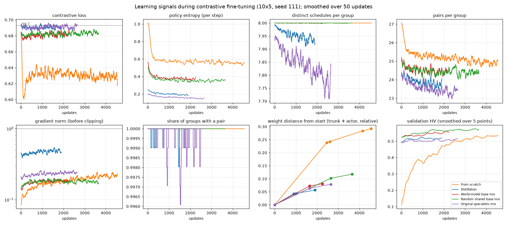
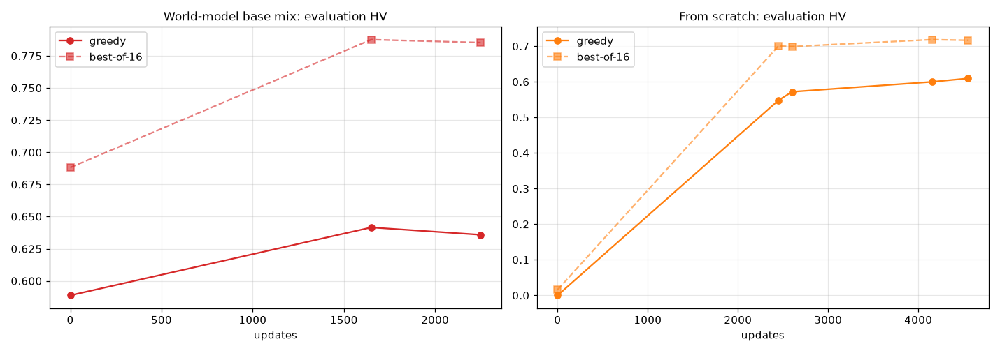
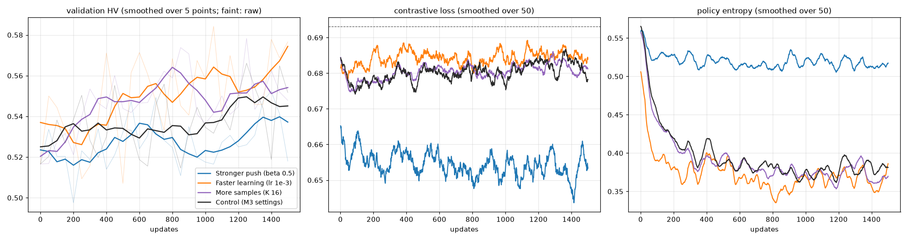

# Plateau diagnosis (10x5, seed 111)

Protocol: `docs/plateau_diagnosis_protocol_v3.md`; settings frozen in `configs/plateau_diagnosis_v3.json`. Single seed: numbers only. No change to the benchmark; the reserved final-test sets are never read.

## Verdict

- **Weak training signal:** no: no stronger push, faster learning or more samples beats the Control by ≥ 0.02 greedy evaluation HV (Control 0.637; Stronger push (beta 0.5) 0.609, Faster learning (lr 1e-3) 0.631, More samples (K 16) 0.636).
- **Greedy decoding:** partly: best-of-16 is 0.107–0.162 HV above greedy at every final checkpoint, so greedy decoding leaves HV unused, but best-of-16 also stops rising, so it does not explain the flat curve.
- **Something shared by all methods:** no: the five final checkpoints span 0.045 greedy and 0.069 best-of-16 evaluation HV (not both within 0.05). On the 20 instances with a CP-SAT front: CP-SAT B2 (waiting allowed) 1.205; all non-delay schedules found here, pooled, 0.894; the best single method's final greedy front 0.666. The pooled non-delay front is only a lower bound on what the no-waiting rule allows. Model size was not varied, so it is not tested.

Rules fixed in the protocol before the run; single seed, numbers only. Details below.

## Part A: no training

### 1. Do the learning signals shrink?

Means over the first 250 updates (early) and the last 500 updates (late) of each run's log. Pairs per group = pairs / 20 groups. Loss at log 2 (0.693) means the policy separates better and worse schedules no more than its frozen start does.

| Run | Updates | Loss early → late | Entropy early → late | Distinct schedules (of K) early → late | Pairs per group early → late | Groups with a pair, late | Gradient norm early → late | Share clipped, late |
|---|---|---|---|---|---|---|---|---|
| From scratch | 4550 | 0.624 → 0.629 | 0.799 → 0.549 | 8.00 → 8.00 (K 8) | 26.2 → 24.9 | 1.00 | 0.111 → 0.217 | 0.00 |
| Distillation | 1900 | 0.692 → 0.690 | 0.229 → 0.190 | 7.98 → 7.93 (K 8) | 24.2 → 23.7 | 1.00 | 0.432 → 0.491 | 0.01 |
| World-model base mix | 2250 | 0.678 → 0.682 | 0.457 → 0.371 | 8.00 → 8.00 (K 8) | 24.8 → 24.5 | 1.00 | 0.156 → 0.186 | 0.00 |
| Random shared base mix | 3650 | 0.681 → 0.684 | 0.430 → 0.358 | 8.00 → 8.00 (K 8) | 24.8 → 24.4 | 1.00 | 0.161 → 0.180 | 0.00 |
| Original specialists mix | 2650 | 0.691 → 0.691 | 0.190 → 0.149 | 7.93 → 7.77 (K 8) | 24.1 → 23.3 | 1.00 | 0.212 → 0.242 | 0.00 |

Rules (protocol): S1 loss stuck near log 2 = late loss > 0.68; S2 entropy collapsing = late < 0.5 × early; S3 fewer valid pairs = late pairs per group < 0.5 × early, or late distinct schedules < K/2.

| Run | S1 loss near log 2 | S2 entropy collapsing | S3 fewer pairs | Signal shrinks |
|---|---|---|---|---|
| From scratch | no | no | no | no |
| Distillation | yes | no | no | no |
| World-model base mix | yes | no | no | no |
| Random shared base mix | yes | no | no | no |
| Original specialists mix | yes | no | no | no |

**Weight distance from the start** (||θ − θ0|| / ||θ0||, trunk + actor; a mix counts all three networks). Only the saved checkpoints exist, so this is not per update.

| Run | Update | Trunk | Actor | Trunk + actor |
|---|---|---|---|---|
| From scratch | 2450 | 0.172 | 0.747 | 0.239 |
| From scratch | 2600 | 0.175 | 0.761 | 0.243 |
| From scratch | 4150 | 0.206 | 0.881 | 0.284 |
| From scratch | 4550 | 0.214 | 0.899 | 0.292 |
| Distillation | 900 | 0.037 | 0.065 | 0.043 |
| Distillation | 1000 | 0.038 | 0.068 | 0.044 |
| Distillation | 1900 | 0.048 | 0.092 | 0.057 |
| World-model base mix | 1650 | 0.053 | 0.250 | 0.072 |
| World-model base mix | 2250 | 0.060 | 0.273 | 0.081 |
| Random shared base mix | 2650 | 0.079 | 0.263 | 0.102 |
| Random shared base mix | 3650 | 0.092 | 0.299 | 0.118 |
| Original specialists mix | 1650 | 0.053 | 0.135 | 0.064 |
| Original specialists mix | 2650 | 0.063 | 0.175 | 0.079 |

### 2. Greedy vs best-of-16 along training

Evaluation split (evaluation), 66 preferences; best-of-16 = per preference the best of 16 sampled schedules by the preference-weighted score (torch seed 50). Contrastive runs saved only start, best and final states, so these are the checkpoints that exist (From scratch also has its first segment's best and final, 2450 and 2600; the World-model base mix has only 3 points).

| Run | Update | Checkpoint | Greedy HV | Best-of-16 HV | Gap | Greedy IGD+ | Best-of-16 IGD+ |
|---|---|---|---|---|---|---|---|
| From scratch | 0 | start | 0.000 | 0.016 | 0.016 | 2.665 | 1.326 |
| From scratch | 2450 | first segment | 0.548 | 0.701 | 0.153 | 0.327 | 0.256 |
| From scratch | 2600 | first segment | 0.572 | 0.699 | 0.127 | 0.312 | 0.243 |
| From scratch | 4150 | best | 0.600 | 0.718 | 0.119 | 0.323 | 0.232 |
| From scratch | 4550 | final | 0.609 | 0.717 | 0.107 | 0.294 | 0.243 |
| Distillation | 0 | start | 0.576 | 0.732 | 0.155 | 0.342 | 0.225 |
| Distillation | 900 | best | 0.609 | 0.745 | 0.135 | 0.309 | 0.223 |
| Distillation | 1000 | first segment | 0.602 | 0.743 | 0.141 | 0.318 | 0.225 |
| Distillation | 1900 | final | 0.605 | 0.750 | 0.145 | 0.317 | 0.222 |
| World-model base mix | 0 | start | 0.589 | 0.688 | 0.099 | 0.316 | 0.273 |
| World-model base mix | 1650 | best | 0.642 | 0.788 | 0.146 | 0.285 | 0.211 |
| World-model base mix | 2250 | final | 0.636 | 0.785 | 0.149 | 0.298 | 0.210 |
| Random shared base mix | 0 | start | 0.584 | 0.694 | 0.110 | 0.326 | 0.257 |
| Random shared base mix | 2650 | best | 0.618 | 0.774 | 0.156 | 0.302 | 0.208 |
| Random shared base mix | 3650 | final | 0.617 | 0.779 | 0.162 | 0.302 | 0.208 |
| Original specialists mix | 0 | start | 0.571 | 0.703 | 0.132 | 0.339 | 0.251 |
| Original specialists mix | 1650 | best | 0.600 | 0.722 | 0.123 | 0.330 | 0.241 |
| Original specialists mix | 2650 | final | 0.591 | 0.720 | 0.129 | 0.324 | 0.234 |

Rule: best-of-16 keeps rising while greedy stays flat = from the best to the final checkpoint, best-of-16 rises by ≥ 0.01 while greedy changes by < 0.01.

| Run | Greedy change best → final | Best-of-16 change best → final | Keeps rising while greedy flat | Gap at final |
|---|---|---|---|---|
| From scratch | +0.010 | -0.002 | no | 0.107 |
| Distillation | -0.004 | +0.005 | no | 0.145 |
| World-model base mix | -0.006 | -0.002 | no | 0.149 |
| Random shared base mix | -0.001 | +0.005 | no | 0.162 |
| Original specialists mix | -0.008 | -0.002 | no | 0.129 |

### 3. Noise: best vs final checkpoint

Difference = best − final. Intervals: paired bootstrap 95% over instances (evaluation 100, validation 18). Validation spread = standard deviation of the raw validation HV over the run's last 1,000 updates.

| Run | Best update | Final update | Validation HV best / final | Validation difference [95%] | Validation spread | Evaluation HV best / final | Evaluation difference [95%] |
|---|---|---|---|---|---|---|---|
| From scratch | 4150 | 4550 | 0.542 / 0.541 | +0.001 [-0.036, +0.043] | 0.010 | 0.600 / 0.609 | -0.010 [-0.024, +0.005] |
| Distillation | 900 | 1900 | 0.540 / 0.525 | +0.016 [-0.017, +0.047] | 0.008 | 0.609 / 0.605 | +0.004 [-0.004, +0.013] |
| World-model base mix | 1650 | 2250 | 0.566 / 0.537 | +0.030 [-0.008, +0.069] | 0.012 | 0.642 / 0.636 | +0.006 [-0.005, +0.017] |
| Random shared base mix | 2650 | 3650 | 0.593 / 0.557 | +0.036 [+0.009, +0.064] | 0.010 | 0.618 / 0.617 | +0.001 [-0.013, +0.015] |
| Original specialists mix | 1650 | 2650 | 0.541 / 0.514 | +0.027 [-0.022, +0.074] | 0.010 | 0.600 / 0.591 | +0.008 [-0.004, +0.020] |

### Context: how far are these fronts from what is reachable?

The 20 evaluation instances with a CP-SAT B2 front (evaluation normalisation, HV per instance, mean). The B2 front may delay operations; every DANIEL schedule is non-delay (no waiting). 'All non-delay schedules' pools every schedule of every Part A checkpoint, greedy and best-of-16.

| Front | HV |
|---|---|
| CP-SAT B2 (waiting allowed) | 1.205 |
| All non-delay schedules of Part A, pooled | 0.894 |
| B2 and pooled non-delay together | 1.206 |
| From scratch, final checkpoint, greedy / best-of-16 | 0.666 / 0.762 |
| Distillation, final checkpoint, greedy / best-of-16 | 0.626 / 0.790 |
| World-model base mix, final checkpoint, greedy / best-of-16 | 0.656 / 0.822 |
| Random shared base mix, final checkpoint, greedy / best-of-16 | 0.653 / 0.819 |
| Original specialists mix, final checkpoint, greedy / best-of-16 | 0.616 / 0.767 |

## Part B: short training runs from the World-model base mix start

One change per arm; otherwise the M3 World-model base mix settings, 1500 updates fixed, validation every 50 updates. Evaluation split (evaluation), 66 preferences; best-of-16 as in Part A.

| Arm | Best validation HV (update) | Final validation HV | Final: greedy / best-of-16 HV | Best checkpoint: greedy / best-of-16 HV | Loss, last 250 | Entropy, last 250 | Distance from start at end | Wall-clock (h) |
|---|---|---|---|---|---|---|---|---|
| More samples (K 16) | 0.578 (1250) | 0.548 | 0.636 / 0.795 | 0.634 / 0.793 | 0.682 | 0.375 | trunk 0.054, actor 0.276 | 1.60 (process 1.60) |
| Stronger push (beta 0.5) | 0.552 (1400) | 0.518 | 0.609 / 0.728 | 0.603 / 0.723 | 0.654 | 0.515 | trunk 0.036, actor 0.114 | 1.40 (process 1.41) |
| Faster learning (lr 1e-3) | 0.584 (1050) | 0.577 | 0.631 / 0.780 | 0.618 / 0.777 | 0.685 | 0.365 | trunk 0.118, actor 0.417 | 1.43 (process 1.43) |
| Control (M3 settings) | 0.566 (1250) | 0.552 | 0.637 / 0.788 | 0.628 / 0.783 | 0.682 | 0.381 | trunk 0.049, actor 0.240 | 1.07 (process 1.08) |

Control vs the M3 World-model base mix run, validation HV at the 31 shared validation points: identical (largest difference 0.000000).

