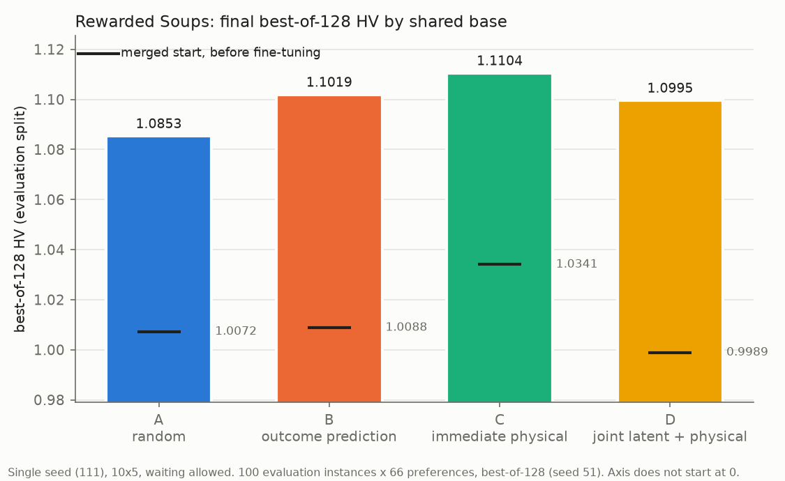
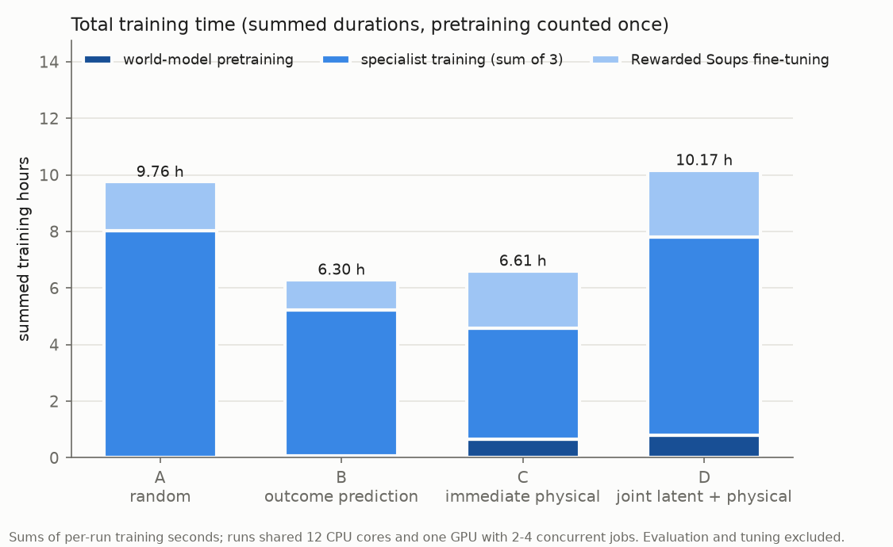
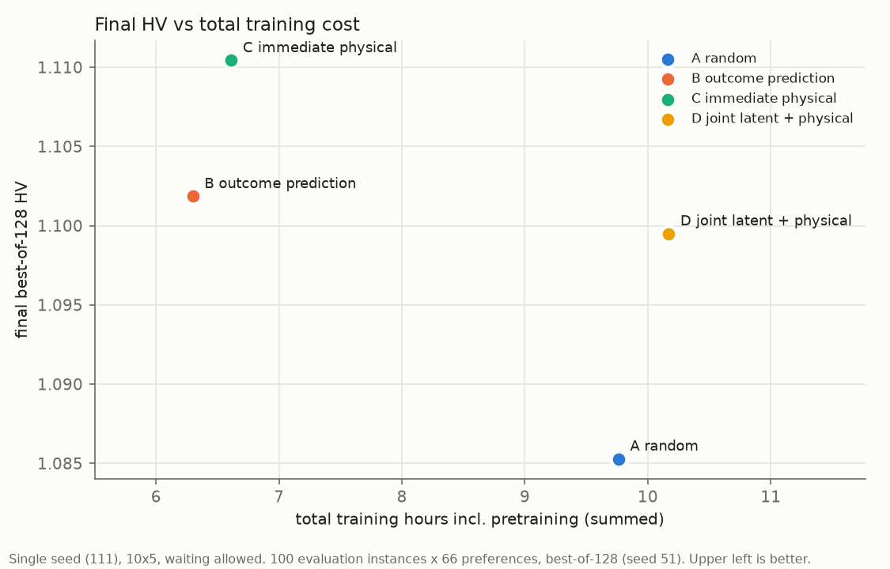

# Rewarded Soups from four shared-base initialisations (10x5, waiting allowed, seed 111)

Exploratory single-seed comparison. Same specialist recipe, stopping rule, merge, Rewarded Soups setting (lr 1e-3, beta 0.1, selected once on the random base and not re-tuned), validation and evaluation for all four; only the shared base's encoder differs. Reserved final-test sets not used.

| config | shared-base encoder | source |
|---|---|---|
| A random | untrained DANIEL (seed 111) | `results/specialist_reuse_v3` (reused) |
| B outcome prediction | final outcomes under heuristic continuation rules (action pilot, pair features, abs+diff) | `results/specialist_reuse_wm_v3` (reused) |
| C immediate physical | immediate physical consequences only (immediate pilot B, epoch 60) | new |
| D joint latent + physical | latent next-state + immediate physical (immediate pilot E, epoch 60) | new |

## Audit and reuse (before training; `rs_four_bases_v3/audit.json`)

- C and D shared bases equal the random base outside the encoder, and their encoders differ from it: True.
- The downstream tardiness runs of A and B reproduce the first 2,000 updates of A's and B's specialist-reuse tardiness specialists exactly: True, True. So the downstream runs are prefixes of what the reuse protocol would train.
- C tardiness: config differs from the reuse specialist only in ['budget_checkpoints', 'converge_window', 'init_from', 'max_updates', 'min_updates', 'model_suffix']; the reuse rule replayed on its validation log stops at update 2000, where the run ended, so the run is the complete specialist (selected checkpoint: its best, update 1000). Not retrained.
- D tardiness: the rule is not met by update 2,000, so the run was continued from its saved resume state (weights, optimiser, RNG states, instance batch, logs) under the reuse rule, as a new run name.
- A and B Rewarded Soups results, and their merged-start (update 0) best-of-128 evaluations from `results/eval_curve_v3`, are reused unchanged (re-runs there reproduced the originals exactly).

Protocol check (saved run configs vs A's): C spec_m: ['init_from', 'model_suffix']; C spec_c: ['init_from', 'model_suffix']; C spec_t: ['budget_checkpoints', 'converge_window', 'init_from', 'max_updates', 'min_updates', 'model_suffix']; C rs: ['budget_checkpoints', 'merge_mix', 'model_suffix']; D spec_m: ['init_from', 'model_suffix']; D spec_c: ['init_from', 'model_suffix']; D spec_t: ['init_from', 'model_suffix', 'resume_from']; D rs: ['budget_checkpoints', 'merge_mix', 'model_suffix']. All within the allowed keys: True.
D tardiness extension reproduced the logged validation value at update 2000 exactly: True; source resume state unchanged: True.

## Comparison

| config | best-of-128 HV before fine-tuning | best-of-128 HV after | best-of-128 IGD+ | pretraining h | makespan spec. h | carbon spec. h | tardiness spec. h | specialists total h | RS fine-tuning h | total h incl. pretraining |
|---|---|---|---|---|---|---|---|---|---|---|
| A random | 1.0072 | **1.0853** | 0.0749 | 0.00 | 2.23 | 1.22 | 4.58 | 8.02 | 1.74 | 9.76 |
| B outcome prediction | 1.0088 | **1.1019** | 0.0679 | 0.08 | 1.95 | 1.20 | 1.98 | 5.13 | 1.09 | 6.30 |
| C immediate physical | 1.0341 | **1.1104** | 0.0637 | 0.67 | 1.13 | 1.36 | 1.44 | 3.93 | 2.02 | 6.61 |
| D joint latent + physical | 0.9989 | **1.0995** | 0.0693 | 0.81 | 1.99 | 1.01 | 3.99 | 6.99 | 2.37 | 10.17 |

IGD+ on the CP-SAT reference subset (20 of the 100 instances); lower is better. HV: frozen normalisation, reference 1.1, 66 grid preferences.

| config | specialist updates m / c / t (status) | RS updates (selected) | RS best validation HV | greedy HV after | IGD+ before | critical path h (specialists in parallel) | evaluation h |
|---|---|---|---|---|---|---|---|
| A random | 3550 / 1950 / 7900 (CONVERGED, CONVERGED, CONVERGED) | 2150 (1150) | 0.9377 | 1.0140 | 0.1091 | 6.32 | 1.08 |
| B outcome prediction | 3350 / 1850 / 3350 (CONVERGED, CONVERGED, CONVERGED) | 1950 (950) | 0.9561 | 1.0267 | 0.1080 | 3.14 | 1.08 |
| C immediate physical | 1850 / 2200 / 2000 (CONVERGED, CONVERGED, CONVERGED) | 2750 (1750) | 0.9816 | 1.0422 | 0.0963 | 4.12 | 0.88 |
| D joint latent + physical | 3250 / 2000 / 6050 (CONVERGED, CONVERGED, CONVERGED) | 3350 (2350) | 0.9673 | 1.0363 | 0.1045 | 7.17 | 0.88 |

Hyperparameter tuning (reported separately, not in the totals): 6 Rewarded Soups trials, 4.85 h, run once on the random base; B, C and D reuse the selected setting.

## Timing: summed durations vs elapsed wall clock, and contention

- Every time above is a **summed training duration** (train.py's in-loop seconds, validation included), pretraining counted once per configuration. The critical-path column assumes the three specialists run in parallel.
- Contention differed between runs. A's specialists ran 3 at a time on 4-core slots with its From-scratch trials; B's specialists ran 3 at a time; C's tardiness specialist (and D's first 2,000 tardiness updates) ran in the downstream experiment with 4 concurrent runs on 3-core slots; C's and D's makespan / carbon specialists and D's tardiness extension ran 3 at a time on 4-core slots; C's and D's Rewarded Soups ran 2 at a time. All shared one GPU. Durations are therefore indicative to perhaps +-20%, not exact.
- Pretraining times are those recorded by the world-model experiments (B: data regeneration + encoder training; C, D: episodes and branching + physical-target extraction + 60 epochs).
- Elapsed wall clock of this invocation (C and D together): specialists 3.01 h, Rewarded Soups 2.38 h, evaluation 1.76 h, total 7.15 h.

## Interpretation

These results come from a single seed, so read them as a ranking from one run, not as established differences. The HV gaps among B, C and D are 0.002–0.011, which is likely within seed-to-seed variation. The gap of each pretrained base to A (0.014–0.025) is larger, but still unreplicated.

- **Does world-model pretraining help compared with random initialisation?** In this run, yes, for all three pretrained bases.
  - **Final HV:** C 1.1104, B 1.1019 and D 1.0995, against A's 1.0853.
  - **IGD+:** C 0.064, B 0.068 and D 0.069, against A's 0.075.
  - **Best validation HV during fine-tuning:** also better than A's, at 0.968–0.982 vs 0.938.
- **Is predicting immediate factory dynamics a better base than predicting final outcomes (C vs B)?** C is ahead on every quality measure, by margins one seed cannot settle.
  - **Final HV:** C is higher by +0.0085.
  - **IGD+:** C is better, 0.064 vs 0.068.
  - **Merged start:** C has the clearest single difference in the experiment, 1.034 vs 1.009 (+0.025). Merging C's specialists gives a better starting policy before any fine-tuning.
  - **Cost:** C is slightly more expensive in total, 6.61 h vs 6.30 h.
    - C's specialists are faster (3.93 h vs 5.13 h).
    - C has more pretraining (0.67 h vs 0.08 h).
    - C's Rewarded Soups fine-tuning runs longer (2.02 h, 2,750 updates, vs 1.09 h, 1,950 updates).
- **Does explicit latent-state supervision add anything (D vs C)?** No.
  - **Results:** D is below C on before-fine-tuning HV (0.999, the lowest of all four, vs 1.034), final HV (1.0995 vs 1.1104) and IGD+ (0.069 vs 0.064).
  - **Cost:** D costs 3.6 h more in total, mostly because its tardiness specialist ran to 6,050 updates and its fine-tuning to 3,350.
  - **Tardiness specialist:** D's has the best tardiness validation value of any configuration (0.1655). After merging, that does not show up as better HV.
  - **Earlier pilots:** this matches both of them. In the immediate-physical world-model experiment, adding the latent term did not improve the pre-registered measures, and in the downstream tardiness experiment D was no better than C.
- **Is the pretraining cost recovered?**
  - **B:** clearly. 0.08 h of pretraining is followed by 2.9 h less specialist training and 0.65 h less fine-tuning than A.
  - **C:** also recovered. 0.67 h of pretraining is followed by 4.1 h less specialist training than A, although fine-tuning takes 0.28 h longer. C's total is 3.15 h below A's.
  - **D:** not recovered. Its total is 0.41 h above A's.
  - **Caveat:** most of these differences come from when the tardiness specialist met the stopping rule. A ran 7,900 updates, D 6,050, B 3,350 and C 2,000. A single stopping event per run is noisy, and durations carry roughly ±20% from differences in hardware contention.
- **Best trade-off:** C has the highest final HV and best IGD+ at 6.61 h, within 0.31 h of the cheapest configuration (B, 6.30 h, second-best HV).
  - With the three specialists run in parallel, B has the shortest elapsed path (3.14 h vs C's 4.12 h).
  - D is the most expensive and is dominated by both B and C.
  - On this seed, C is the best overall and B is a close, cheaper alternative. This would need confirming on further seeds before choosing between them.
- **Learning speed vs final quality:**
  - **Fine-tuning gains:** fine-tuning adds +0.076 (C), +0.078 (A), +0.093 (B) and +0.101 (D) best-of-128 HV. The bases that start lower recover more during fine-tuning.
  - **Ranking:** most of C's final lead comes from its better merged start. B's and D's leads over A come from fine-tuning.

## Limitations

- One seed (111) per configuration: the seed-to-seed spread of Rewarded Soups HV is not measured, so differences of the order of 0.01 HV are not evidence of superiority on their own.
- B's encoder differs from C and D in data, targets and pretraining budget; C and D are matched to each other.
- The Rewarded Soups setting was tuned on the random base only; the pretrained bases might prefer other settings.
- Wall-clock times come from runs under different contention (above).
- 10x5 only; no generalisation or larger instances.

## Recommended next steps (not run)

1. Repeat B and C (and A as the reference) over further seeds with the same protocol. This would show whether C's lead in merged-start HV (+0.025) and final HV (+0.009 over B) holds, and how much of the cost differences comes from the noise in when the stopping rule fires.
2. Only if C's advantage holds: test scaling to larger instances and generalisation to other sizes, using C's base.
3. Drop D (joint latent + physical) from further work unless a later change to the latent objective is planned. It added cost and no benefit here and in both earlier pilots.

## Code change

`daniel/train.py`: the exact-continuation check (`--resume_from`) now also handles single-objective runs, comparing the run's own selection metric instead of the multi-objective HV. Validation was factored into `validate_and_score()` without changing behaviour, and the multi-objective path and its record fields are unchanged.

