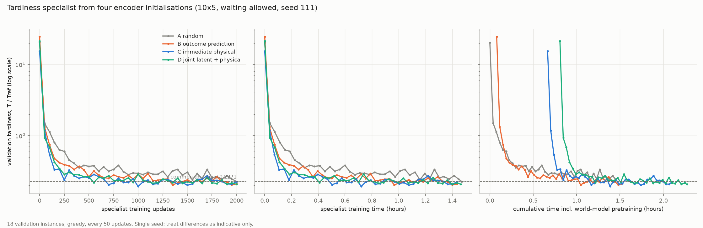
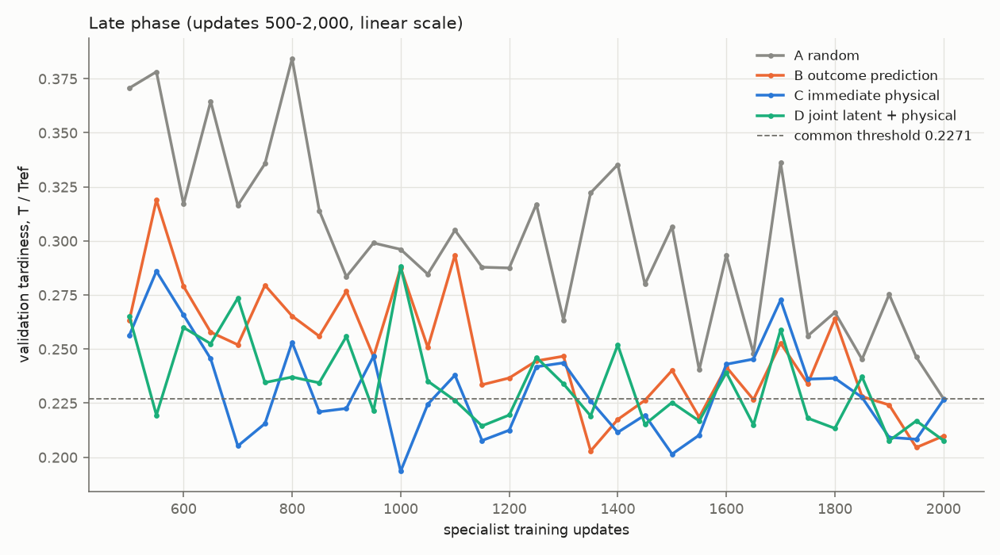

# Downstream tardiness specialist from world-model encoders (10x5, waiting allowed, seed 111)

Exploratory downstream experiment following `results/world_model_joint_pilot_v3.md` and `results/world_model_immediate_pilot_v3.md`; it does not revise either experiment's decision rule. Single seed.

## Arms (identical except the encoder weights of the start bundle)

| arm | encoder | source | pretraining (s) |
|---|---|---|---|
| A random | untrained DANIEL encoder (seed-111 start) | `checkpoints/world_model_m1_v3_tardiness_pilot/start_rnd.pth` | 0 |
| B outcome prediction | revised outcome-prediction world model (action pilot: pair features, abs+diff; final outcomes under continuation rules) | `checkpoints/world_model_m1_v3_tardiness_pilot/start_pre.pth` | 285 |
| C immediate physical | immediate physical prediction only (immediate pilot B, 60 epochs) | `checkpoints/world_model_immediate_pilot_v3/B/epoch60/online_encoder.pth` | 2396 |
| D joint latent + physical | joint latent + immediate physical prediction (immediate pilot E, 60 epochs) | `checkpoints/world_model_immediate_pilot_v3/E/epoch60/online_encoder.pth` | 2907 |

- Recipe: the earlier tardiness pilot's own command (contrastive fine-tuning, cl_k 8, cl_beta 0.1, lr 3e-4, 20 environments, generator training stream, seed 111, `--dispatch_rule semi_active`), 2,000 updates, validation every 50 updates (greedy, 18 validation instances, T / Tref), no early stopping; encoder fine-tuned with the policy; no world-model loss during specialist training. Snapshots every 50 updates.
- Checks: start bundles identical outside the encoder, encoders differ pairwise, C/D encoders equal the epoch-60 checkpoints; commands differ from the earlier random arm only in run name, start file and the snapshot flag; saved run configs differ only in ['budget_checkpoints', 'init_from', 'model_suffix'] with equal data fingerprints: True.
- Reproducibility: A reproduces the earlier random arm's validation curve exactly: True; B reproduces the earlier pretrained arm's curve exactly: True.
- Common threshold (fixed before launch, from existing validation evidence): T / Tref <= 0.2271, the reference tardiness specialist's best validation value within 2,000 updates (same recipe and protocol).
- AUC: mean of log10(validation T / Tref) over updates 0..2000 (trapezoid, divided by 2000); secondary mean of validation T / Tref over updates 50..2000 (trapezoid, divided by 1950; excludes the untrained start, whose value dominates a linear-scale area).
- Pretraining cost: B = data regeneration + encoder training of the action pilot; C, D = the joint pilot's episodes and branching + physical-target extraction + 60 epochs of training (continuation rollouts not needed, excluded).

## Validation (18 instances, greedy; T / Tref, lower is better)

| arm | before training | @250 | @500 | @1000 | @1500 | @2000 (final) | best (update) | AUC log10 | AUC linear (50-2000) |
|---|---|---|---|---|---|---|---|---|---|
| A random | 20.352 | 0.6018 | 0.3706 | 0.2961 | 0.3066 | 0.2271 | 0.2271 (2000) | -0.4316 | 0.3767 |
| B outcome prediction | 24.697 | 0.3916 | 0.2631 | 0.2875 | 0.2401 | 0.2098 | 0.2028 (1350) | -0.5186 | 0.2998 |
| C immediate physical | 15.417 | 0.2377 | 0.2562 | 0.1935 | 0.2014 | 0.2265 | 0.1935 (1000) | -0.5718 | 0.2616 |
| D joint latent + physical | 21.469 | 0.2867 | 0.2653 | 0.2882 | 0.2253 | 0.2077 | 0.2076 (1900) | -0.5586 | 0.2693 |

Actual mean total tardiness on the validation instances (minutes): A random: start 11344, best 126.6, final 126.6; B outcome prediction: start 13767, best 113.1, final 116.9; C immediate physical: start 8594, best 107.9, final 126.3; D joint latent + physical: start 11967, best 115.7, final 115.8.

## Threshold and cost

| arm | threshold reached at update | specialist hours to threshold | incl. pretraining | specialist hours (2,000 updates) | pretraining hours | total hours |
|---|---|---|---|---|---|---|
| A random | 2000 | 1.47 | 1.47 | 1.47 | 0.000 | 1.47 |
| B outcome prediction | 1350 | 0.97 | 1.05 | 1.44 | 0.079 | 1.51 |
| C immediate physical | 700 | 0.50 | 1.17 | 1.44 | 0.665 | 2.10 |
| D joint latent + physical | 550 | 0.41 | 1.22 | 1.46 | 0.808 | 2.27 |

The four arms ran concurrently on the same machine (3 CPU cores each, one shared GPU), so their wall-clock times are comparable with each other, not with the earlier pilot's runs.

## Held-out evaluation (100 instances of the 10x5 evaluation split; reserved final-test sets not used)

| arm | checkpoint | greedy T / Tref | greedy mean tardiness (min) | greedy tardy-job share | best-of-128 T / Tref | best-of-128 mean tardiness (min) | greedy makespan | greedy carbon |
|---|---|---|---|---|---|---|---|---|
| A random | selected (update 2000) | 0.2053 | 114.4 | 0.262 | 0.1897 | 105.7 | 461.8 | 132.96 |
| A random | final (2,000) | 0.2053 | 114.4 | 0.262 | 0.1897 | 105.7 | 461.8 | 132.96 |
| B outcome prediction | selected (update 1350) | 0.1817 | 101.3 | 0.262 | 0.1413 | 78.8 | 461.9 | 134.45 |
| B outcome prediction | final (2,000) | 0.1685 | 93.9 | 0.229 | 0.1178 | 65.6 | 455.3 | 135.06 |
| C immediate physical | selected (update 1000) | 0.1768 | 98.5 | 0.245 | 0.1255 | 70.0 | 459.1 | 134.60 |
| C immediate physical | final (2,000) | 0.1490 | 83.1 | 0.226 | 0.1123 | 62.6 | 452.6 | 135.13 |
| D joint latent + physical | selected (update 1900) | 0.1556 | 86.8 | 0.228 | 0.1173 | 65.4 | 459.8 | 135.58 |
| D joint latent + physical | final (2,000) | 0.1544 | 86.1 | 0.241 | 0.1185 | 66.0 | 447.4 | 134.47 |

## Interpretation

Single seed: every statement below describes one run per arm, and gaps of a few hundredths in T / Tref are within the run-to-run variation one would expect.

- **B vs A (outcome-prediction encoder vs random).** B learns faster: it reaches the threshold at update 1,350 against 2,000 for A, with a lower area under the curve (log10 −0.519 vs −0.432). It also ends better, both on validation (best 0.2028 vs 0.2271) and on held-out instances (selected checkpoint, greedy 0.182 vs 0.205). This matches the earlier tardiness pilot exactly, because both arms reproduce those runs update for update.
- **C vs A (immediate physical encoder vs random).** C has the clearest early advantage. It starts lowest before training (15.4 vs 20.4), is already at 0.238 by update 250 (A: 0.602), reaches the threshold at update 700, and has the lowest area under the curve of all four arms (−0.572). It is also better on held-out instances (selected 0.177, final 0.149 vs A's 0.205).
- **D vs A (joint latent + physical encoder vs random).** D reaches the threshold earliest (update 550). Its area under the curve (−0.559) is close to C's. It ends clearly better than A on held-out instances (selected 0.156, final 0.154).
- **D vs C (does the latent term add anything?).** Neither is consistently ahead:
  - D crosses the threshold 150 updates earlier.
  - C has the lower area under the curve and the lower best validation value (0.1935 vs 0.2076).
  - On held-out instances, D's selected checkpoint is better (0.156 vs 0.177), but C's final checkpoint is better (0.149 vs 0.154).
  - Best-of-128 differs by under 0.01 (0.112–0.126).

  This agrees with the immediate pilot's finding that the latent term did not clearly improve on physical prediction alone (E vs B there). This experiment gives no evidence that the latent term helps the specialist.
- **C and D vs B.** Both learn faster than B in updates: they reach the threshold at 700 and 550 vs 1,350, with lower area under the curve. Their selected checkpoints are better on held-out instances (0.177 and 0.156 vs 0.182). At 2,000 updates the gap is small (final greedy 0.149 and 0.154 vs 0.169; best-of-128 0.112 and 0.119 vs 0.118). Counting pretraining reverses the speed ordering: B reaches the threshold at 1.05 h in total, C at 1.17 h and D at 1.22 h (A: 1.47 h). Over the full 2,000 updates, C and D cost 2.10 h and 2.27 h, against 1.51 h for B and 1.47 h for A.
- **Learning speed vs final performance.**
  - **Learning speed:** most of the benefit of pretraining is here. All three pretrained encoders fall below the random arm within the first 50–250 updates and stay below it for most of training. In specialist updates, the ordering of speed is D ≈ C > B > A.
  - **Final performance:**
    - By 2,000 updates the pretrained arms converge to similar validation values (0.208–0.227).
    - A is only just at the threshold at 2,000 updates and is the worst arm on held-out instances (0.205 greedy, 0.190 best-of-128). Among B, C and D, held-out final performance differs by about 0.02 greedy and 0.006 best-of-128.
    - Validation selection is noisy: C's validation-selected checkpoint (update 1,000) is worse on held-out instances than its final checkpoint (0.177 vs 0.149). With 18 validation instances, the update at which a checkpoint is selected is not reliable at this resolution.
- **Cost.** C and D's pretraining (0.67–0.81 h) is larger than the specialist time it saves for a single tardiness specialist. It would only pay off if one encoder were shared by several specialists (tardiness, makespan, carbon); that is untested here.

## Limitations

- One seed (111) for every arm: run-to-run variation of the specialist is not measured, so gaps of a few hundredths in T / Tref are not evidence on their own.
- 18 validation instances drive selection and the threshold; the held-out evaluation uses the evaluation split.
- Encoders are fine-tuned with the policy, so the comparison is about the starting point, not a frozen representation.
- B's encoder was pretrained with a different (no-delay) rule and a different data set from C and D; pretraining budgets differ between B and C/D (C and D are matched to each other).
- Only the tardiness specialist; makespan and carbon specialists and Rewarded Soups are not tested here.

## Recommended next steps (not run)

1. Repeat A, C and D (and B if affordable) with two or three more seeds under the same protocol. This would show whether the early-learning advantage (threshold at 550–700 vs 2,000 updates) and the held-out gap to random hold up beyond one seed.
2. If they hold, train makespan and carbon specialists from the C encoder (the simplest one; D added no clear benefit). This tests whether one pretrained encoder speeds up all three specialists, which is what would amortise its pretraining cost.
3. Only then run Rewarded Soups on those specialists, comparing against the random shared base.
4. Consider a larger validation set (or best-of-k validation) for checkpoint selection, since the 18-instance greedy selection picked a weaker checkpoint than the final one for C.

