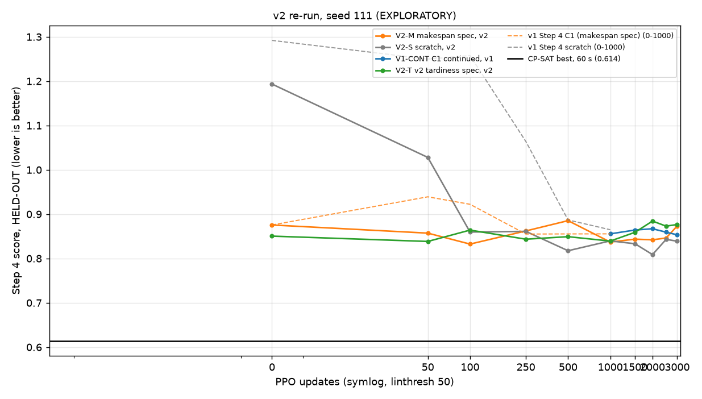

# v2 re-run of the three-objective warm-start comparison, seed 111, to 3,000 updates (EXPLORATORY)

## Pre-registration

Written and committed BEFORE any training for this study (the smoke test and the loop-fidelity check below use
separate scratch outputs and are not results). Never edited afterwards; changes go under "Deviations".

**This is an EXPLORATORY single-seed run (seed 111 only).** Its verdicts guide decisions only and are PROVISIONAL
until a 4-seed confirmation (same code, `--seeds 111 222 333 444`). All confidence intervals below are paired
bootstrap intervals over the 49 HELD-OUT instances: they reflect instance variation only, NOT seed variation.

### Question
v2 (results/v2_fixes.md) makes due dates observable, scales carbon, and makes the training return exactly
-(Step 4 score) with balanced terms. This is the first run where both fixes act together on the three-objective
problem. Does the v1 plateau (0.866-0.90 at update 1,000; best C1 0.8655 pooled, 0.8556 at seed 111; CP-SAT best
0.614 pooled, 0.6144 at seed 111) move, and does the gap to CP-SAT shrink?

### Setup (identical to Step 4 unless stated)
* 10x5; seed 111 only; goal mct, preference (1/3, 1/3, 1/3); training generator = the 10x5 train split, 20
  environments resampled every 20 updates; PPO settings = `params.py` defaults as Step 4 (lr 3e-4, eps_clip 0.2,
  k_epochs 4, minibatch 1024, entloss_coef 0.01, vloss_coef 0.5, gamma 1, gae_lambda 0.98, tau 0); due dates
  k125s060 from the frozen manifest. No hyperparameter is tuned.
* v2 arms: `--obs_version v2 --reward_version v2` (reward references: frozen manifest, seed 111).
  V1-CONT: v1 flags, Step 4's reward weights (carbon_reward_weight 0.002384, tardiness_reward_weight 5.815362).
* Critic as Step 4: warm-start arms load the WHOLE checkpoint (critic included, no rescaling); scratch gets a fresh
  network from the seeded initialisation; no warm-up.
* Implementation: `tools/run_v2_rerun.py` drives Step 4's own `train.Trainer` (environment, instance sampling,
  rollouts from `policy_old`, `PPO.update`) with a copy of `Trainer.train`'s update loop that trains in resumable
  chunks and skips the per-10-update validation pass (validation only selects a "best" checkpoint, which this study
  does not use, and consumes no random numbers). Every checkpoint stores policy, policy_old, the Adam optimiser
  state and all random-number-generator states, so a run can be resumed or extended exactly. Loop fidelity is
  checked before launch: the chunked loop must reproduce `train.py` bit-for-bit (40 updates, v1 and v2), and a
  run interrupted and resumed must equal an uninterrupted one bit-for-bit.
* Snapshots and HELD-OUT evaluation at updates 0, 50, 100, 250, 500, 1000, 1500, 2000, 2500, 3000 (V1-CONT: 1000,
  1500, 2000, 2500, 3000). Evaluation: the 49 HELD-OUT instance IDs (`results/blend_zero_training/split.json`),
  greedy, batching only instances sharing the maximum processing time, unchanged Step 4 score (seed 111 centroid
  references), v2 checkpoints in the v2 environment and v1 in the v1 environment.
* Input checkpoints are hash-checked before training (`results/v2_rerun_seed111/input_hashes.json`).

### Arms (priority order V2-M, V2-S, V1-CONT, V2-T)
* **V2-M** makespan specialist converted to v2 (`m_s111_obsv2`, v2_fixes Part B), fine-tuned in v2, 3,000 updates.
* **V2-S** scratch in v2, 3,000 updates.
* **V1-CONT** control: v1 C1 (`s4t_spec_m_k125s060_s111@u1000`, Step 4 makespan arm) continued in v1 from update
  1,000 to 3,000. Step 4 saved no optimiser or random-number state at update 1,000: a fresh Adam optimiser is created
  and the generators are re-seeded with 111 at the continuation start (so its instance-sampling stream repeats the
  one Step 4 used from update 0). Recorded as a deviation from "exact continuation".
* **V2-T** the v2 tardiness specialist (`t_k125s060_s111_v2ft`, v2_fixes Part C), fine-tuned in v2, 3,000 updates.

### Metrics
* Step 4 score per checkpoint (mean over the 49 instances).
* Gap to CP-SAT per checkpoint: mean over instances of (score - CP-SAT 60 s best) / CP-SAT best, seed 111 solutions
  of ceiling_check, with a bootstrap 95% CI over instances.
* Raw objectives (makespan, carbon, tardiness) at 1,000 and 3,000.
* Due-date behaviour at 1,000 and 3,000, as input_reward_audit: Spearman(d_j/P_j, C_j/P_j) over the 490 HELD-OUT
  jobs (v1 C1 about -0.02; CP-SAT +0.74) and the share of tightest-quartile jobs late (the audit's Q1 job set).
* Comparisons: relative gain of X over Y = (mean score Y - mean score X) / mean score Y (positive = X better), paired
  bootstrap 95% CI over instances, 10,000 resamples, generator 20261001.
* Cost: GPU wall-clock hours per arm.

### Decision rules (computed automatically by `tools/analyze_v2_rerun.py`; exploratory, seed 111)
* **Q1 Does v2 lift the plateau?** LIFTED if V2-M@1000 beats v1 C1@1000 (Step 4 result file, seed 111, re-scored)
  by >= 2% with the CI excluding 0, AND V2-M@3000 beats V1-CONT@3000 by >= 2% with the CI excluding 0. Otherwise
  NOT LIFTED.
* **Q2 Is v2 still budget-limited?** BUDGET-LIMITED if V2-M@3000 beats V2-M@1000 by >= 1% with the CI excluding 0;
  otherwise PLATEAU. The same comparison is reported for V1-CONT (3000 vs 1000).
* **Q3 Is warm-starting still more efficient than scratch in v2?** YES if V2-M beats V2-S by >= 2% with the CI
  excluding 0 at both update 250 and update 500; otherwise NO. Also reported: the first checkpoint at which V2-S's
  mean score <= V2-M@1000's, and whether V2-S@3000 is within +-1% of V2-M@3000 with the CI including 0 ("caught up").
* **Q4 (secondary) Is the due-date-aware tardiness specialist the better start?** V2-T vs V2-M at 1,000 and 3,000:
  BETTER if gain >= 1% with the CI excluding 0; WORSE if gain <= -1% with the CI excluding 0; otherwise TIED.
* If an arm is FAILED or incomplete, every rule that depends on it is NOT DETERMINED; no verdict is computed from
  partial data.

## Deviations

* **V1-CONT is not an exact continuation.** Step 4 saved neither the Adam state nor the random-number-generator
  states at update 1,000, so V1-CONT starts from C1@1000's weights with a fresh Adam optimiser, and its generators
  are re-seeded with 111 (its instance-sampling stream repeats the one Step 4 used from update 0). Stated in the
  pre-registration; recorded here as required.
* **Loop-fidelity check (before launch; scratch outputs, not committed).** 40 updates from a warm start (v1: C1@1000
  with Step 4 weights; v2: `m_s111_obsv2` with v2 flags), seed 111: the chunked runner (2 chunks of 20, resumed from
  the saved checkpoint) and an uninterrupted runner (1 chunk of 40) gave bit-identical policy, policy_old and Adam
  state, and both were bit-identical to `daniel/train.py` run with the same flags (policy at update 40). Measured
  speed 0.77-0.97 s/update.
* **Smoke tests (before launch; scratch outputs, deleted, never committed).** `scripts/overnight_v2_rerun.sh --smoke`
  (2 updates per arm in 2 chunks, 3 instances): all four arms start, checkpoint, evaluate and are analysed; a crash
  injected once is retried from the last checkpoint; the whole script killed mid-step stops its running step and a
  re-run skips completed arms and resumes the interrupted one; an arm failing twice is marked FAILED, the run moves
  on and the dependent rule is NOT DETERMINED; a later re-run retries the FAILED arm from its last checkpoint; a
  second concurrent start is refused. Fixes made from these tests before hand-over: argv reset in the analysis
  script, signal trap and single-instance lock, atomic checkpoint and evaluation writes.
* (Anything that happens during the overnight run is appended below by hand in a later session.)

<!-- BEGIN GENERATED RESULTS (tools/analyze_v2_rerun.py) -->

Seeds: [111]; 49 HELD-OUT instances. EXPLORATORY: confidence intervals are paired bootstrap intervals over instances (10,000 resamples) and reflect instance variation only, not seed variation.

Arm status: V2-M makespan spec, v2: **complete**, V2-S scratch, v2: **complete**, V1-CONT C1 continued, v1: **complete**, V2-T v2 tardiness spec, v2: **complete**.

### Step 4 score per checkpoint (mean over instances; lower is better)

| arm | u0 | u50 | u100 | u250 | u500 | u1000 | u1500 | u2000 | u2500 | u3000 |
|---|---|---|---|---|---|---|---|---|---|---|
| V2-M makespan spec, v2 | 0.8756 | 0.8572 | 0.8325 | 0.8621 | 0.8853 | 0.8370 | 0.8436 | 0.8421 | 0.8462 | 0.8733 |
| V2-S scratch, v2 | 1.1935 | 1.0279 | 0.8596 | 0.8611 | 0.8175 | 0.8397 | 0.8332 | 0.8088 | 0.8430 | 0.8390 |
| V1-CONT C1 continued, v1 | - | - | - | - | - | 0.8556 | 0.8642 | 0.8671 | 0.8593 | 0.8534 |
| V2-T v2 tardiness spec, v2 | 0.8504 | 0.8384 | 0.8640 | 0.8435 | 0.8492 | 0.8393 | 0.8590 | 0.8844 | 0.8729 | 0.8766 |
| v1 Step 4 C1 (makespan spec) (reference) | 0.8756 | 0.9391 | 0.9222 | 0.8551 | 0.8554 | 0.8556 | - | - | - | - |
| v1 Step 4 scratch (reference) | 1.2920 | 1.2499 | 1.2578 | 1.0639 | 0.8869 | 0.8648 | - | - | - | - |
| CP-SAT 60 s best (ceiling_check) | 0.6144 |  |  |  |  |  |  |  |  |  |

### Gap to the CP-SAT best per checkpoint: mean of (score - CP-SAT) / CP-SAT, 95% bootstrap CI

| arm | checkpoint | gap | 95% CI |
|---|---|---|---|
| V2-M makespan spec, v2 | u0 | +42.8% | [+39.2, +46.4] |
| V2-M makespan spec, v2 | u50 | +39.5% | [+35.9, +43.0] |
| V2-M makespan spec, v2 | u100 | +35.6% | [+33.3, +37.8] |
| V2-M makespan spec, v2 | u250 | +40.3% | [+37.1, +43.5] |
| V2-M makespan spec, v2 | u500 | +44.0% | [+40.2, +48.1] |
| V2-M makespan spec, v2 | u1000 | +36.1% | [+32.8, +39.4] |
| V2-M makespan spec, v2 | u1500 | +37.3% | [+33.7, +40.9] |
| V2-M makespan spec, v2 | u2000 | +37.1% | [+33.8, +40.6] |
| V2-M makespan spec, v2 | u2500 | +37.9% | [+34.3, +41.5] |
| V2-M makespan spec, v2 | u3000 | +42.3% | [+38.8, +45.9] |
| V2-S scratch, v2 | u0 | +95.4% | [+89.1, +101.9] |
| V2-S scratch, v2 | u50 | +67.7% | [+63.9, +71.7] |
| V2-S scratch, v2 | u100 | +39.8% | [+36.7, +43.1] |
| V2-S scratch, v2 | u250 | +40.1% | [+37.4, +43.0] |
| V2-S scratch, v2 | u500 | +32.9% | [+30.5, +35.4] |
| V2-S scratch, v2 | u1000 | +36.5% | [+33.2, +40.0] |
| V2-S scratch, v2 | u1500 | +35.5% | [+32.4, +38.7] |
| V2-S scratch, v2 | u2000 | +31.8% | [+28.7, +34.9] |
| V2-S scratch, v2 | u2500 | +37.2% | [+34.2, +40.4] |
| V2-S scratch, v2 | u3000 | +36.7% | [+33.8, +39.7] |
| V1-CONT C1 continued, v1 | u1000 | +39.4% | [+36.7, +42.4] |
| V1-CONT C1 continued, v1 | u1500 | +41.1% | [+38.1, +44.3] |
| V1-CONT C1 continued, v1 | u2000 | +41.4% | [+38.4, +44.6] |
| V1-CONT C1 continued, v1 | u2500 | +40.0% | [+37.0, +43.1] |
| V1-CONT C1 continued, v1 | u3000 | +39.0% | [+35.8, +42.2] |
| V2-T v2 tardiness spec, v2 | u0 | +38.4% | [+35.3, +41.5] |
| V2-T v2 tardiness spec, v2 | u50 | +36.6% | [+33.6, +39.5] |
| V2-T v2 tardiness spec, v2 | u100 | +40.6% | [+37.5, +43.9] |
| V2-T v2 tardiness spec, v2 | u250 | +37.2% | [+35.0, +39.3] |
| V2-T v2 tardiness spec, v2 | u500 | +38.1% | [+35.3, +40.9] |
| V2-T v2 tardiness spec, v2 | u1000 | +36.6% | [+33.6, +39.7] |
| V2-T v2 tardiness spec, v2 | u1500 | +39.9% | [+36.5, +43.4] |
| V2-T v2 tardiness spec, v2 | u2000 | +43.9% | [+40.5, +47.2] |
| V2-T v2 tardiness spec, v2 | u2500 | +42.3% | [+38.5, +46.2] |
| V2-T v2 tardiness spec, v2 | u3000 | +42.7% | [+39.7, +45.5] |
| v1 Step 4 C1 (reference) | u1000 | +39.4% | [+36.7, +42.4] |

### Raw objectives and due-date behaviour at updates 1,000 and 3,000

Spearman = Spearman(d_j/P_j, C_j/P_j) over the HELD-OUT jobs, as input_reward_audit (v1 C1 about -0.02, CP-SAT +0.74); Q1 late = share of the tightest-quartile jobs that are late.

| arm | update | makespan | carbon | tardiness | score | Spearman | Q1 late |
|---|---|---|---|---|---|---|---|
| V2-M makespan spec, v2 | 1000 | 441.1 | 2182.0 | 398.2 | 0.8370 | +0.320 | 91.1% |
| V2-M makespan spec, v2 | 3000 | 431.7 | 2295.5 | 451.6 | 0.8733 | +0.200 | 88.6% |
| V2-S scratch, v2 | 1000 | 446.0 | 2205.3 | 385.9 | 0.8397 | +0.251 | 81.3% |
| V2-S scratch, v2 | 3000 | 433.8 | 2231.3 | 391.1 | 0.8390 | +0.265 | 86.2% |
| V1-CONT C1 continued, v1 | 1000 | 449.8 | 2432.6 | 329.2 | 0.8556 | -0.006 | 84.6% |
| V1-CONT C1 continued, v1 | 3000 | 435.6 | 2490.1 | 323.5 | 0.8534 | -0.118 | 84.6% |
| V2-T v2 tardiness spec, v2 | 1000 | 443.9 | 2281.7 | 357.3 | 0.8393 | +0.358 | 79.7% |
| V2-T v2 tardiness spec, v2 | 3000 | 448.2 | 2199.3 | 470.2 | 0.8766 | +0.268 | 82.9% |
| v1 Step 4 C1 (reference) | 1000 | 449.8 | 2432.6 | 329.2 | 0.8556 | (V1-CONT u1000) | (V1-CONT u1000) |
| CP-SAT 60 s best | - | 375.8 | 2010.3 | 54.6 | 0.6144 | +0.716 | 30.9% |

### Paired comparisons (relative gain of X over Y = (mean Y - mean X) / mean Y; positive = X better)

| rule | X | Y | gain | 95% CI | criterion | met |
|---|---|---|---|---|---|---|
| Q1 | V2-M@1000 | v1 C1 (Step 4)@1000 | +2.17% | [-1.20, +5.38] | gain >= 2%, CI > 0 | no |
| Q1 | V2-M@3000 | V1-CONT@3000 | -2.34% | [-5.74, +0.90] | gain >= 2%, CI > 0 | no |
| Q2 | V2-M@3000 | V2-M@1000 | -4.33% | [-7.32, -1.73] | gain >= 1%, CI > 0 | no |
| Q2 (report) | V1-CONT@3000 | V1-CONT@1000 | +0.26% | [-2.68, +3.06] | gain >= 1%, CI > 0 | no |
| Q3 | V2-M@250 | V2-S@250 | -0.11% | [-2.42, +2.18] | gain >= 2%, CI > 0 | no |
| Q3 | V2-M@500 | V2-S@500 | -8.30% | [-11.61, -5.18] | gain >= 2%, CI > 0 | no |
| Q3 (catch-up, report) | V2-S@3000 | V2-M@3000 | +3.93% | [+1.76, +5.93] | gain >= 0%, CI > 0 | yes |
| Q4 | V2-T@1000 | V2-M@1000 | -0.27% | [-3.00, +2.33] | gain >= 1%, CI > 0 | no |
| Q4 | V2-T@3000 | V2-M@3000 | -0.38% | [-2.90, +2.05] | gain >= 1%, CI > 0 | no |

### Cost (GPU wall-clock of training chunks; evaluation excluded)

| arm | updates trained | hours | s/update |
|---|---|---|---|
| V2-M makespan spec, v2 | 3000 | 0.63 | 0.753 |
| V2-S scratch, v2 | 3000 | 0.65 | 0.777 |
| V1-CONT C1 continued, v1 | 2000 | 0.42 | 0.765 |
| V2-T v2 tardiness spec, v2 | 3000 | 0.62 | 0.748 |

### Verdicts (exploratory, provisional until the 4-seed confirmation)

* **Q1: NOT LIFTED**
* **Q2: PLATEAU**
* **Q2 (V1-CONT, reported): PLATEAU**
* **Q3: NO**
* **Q3 catch-up (V2-S@3000 within +-1% of V2-M@3000, CI includes 0): NOT CAUGHT UP**
* **Q3 first V2-S checkpoint <= V2-M@1000: u500**
* **Q4 @1000: TIED**
* **Q4 @3000: TIED**

*Solid: this study (mean over seeds). Dashed: the existing v1 Step 4 curves (0-1,000) for reference. Black: CP-SAT best (ceiling_check, 60 s).*

<!-- END GENERATED RESULTS -->

## Plain-English summary

_(placeholder: 5-8 sentences, to be written in a later session after reading the results)_
