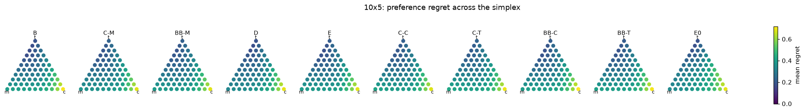
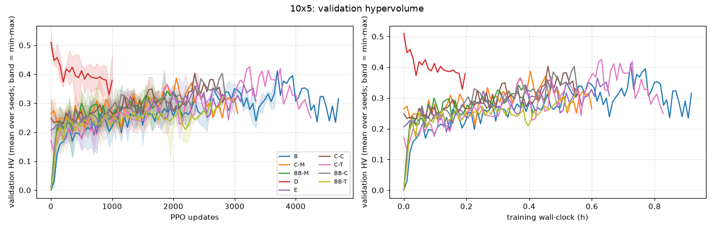
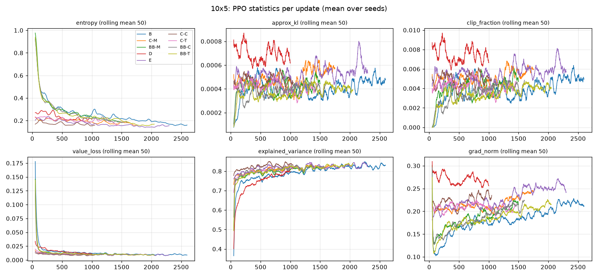
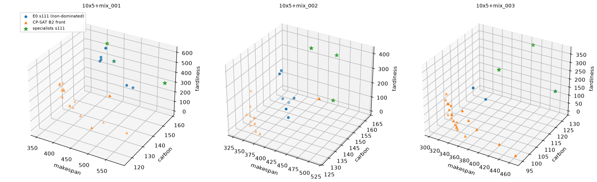

# Warm-start study on benchmark v3: results

Generated by `tools/analyze_warmstart_v3.py` over the units completed so far. Evaluation split: `evaluation`. Higher hypervolume (HV) is better; lower IGD+, regret and objectives are better.

## Plain-English summary

_(placeholder: to be written after the runs complete)_

## 10x5

Hardware and parallelism: NVIDIA L4, 23034 MiB, 595.91.07, 8 logical CPUs, --jobs 2 for every arm. Calibration factor (this machine / local specialist training, DANIEL-M): 0.71

### Quality, 10x5 (greedy, 66 preferences; 100 instances; IGD+ on the 20-instance B2 subset)

ΔHV and ΔIGD+: arm − B, mean over instances of the seed-averaged per-instance difference, with a paired bootstrap 95% CI over instances (10,000 resamples).

| Arm | Seeds | HV | ΔHV vs B [95% CI] | IGD+ | ΔIGD+ vs B [95% CI] | Unique non-dominated | Converged | Degraded |
|---|---|---|---|---|---|---|---|---|
| B (scratch, WI-DAN) | 3 | 0.353 ± 0.055 | - | 0.500 ± 0.040 | - | 1.9 ± 0.5 | 3/3 | 3/3 |
| C-M | 3 | 0.342 ± 0.007 | -0.012 [-0.032, +0.008] | 0.531 ± 0.051 | +0.031 [-0.021, +0.090] | 1.5 ± 0.2 | 3/3 | 3/3 |
| BB-M | 3 | 0.331 ± 0.037 | -0.022 [-0.043, -0.002] | 0.519 ± 0.027 | +0.019 [-0.022, +0.061] | 1.4 ± 0.3 | 3/3 | 3/3 |
| D (vertex distillation) | 3 | 0.575 ± 0.014 | +0.222 [+0.205, +0.239] | 0.342 ± 0.004 | -0.158 [-0.190, -0.126] | 6.4 ± 0.6 | 3/3 | 3/3 |
| E (naive merge of independently trained specialists (no shared base); expected to be weak) | 3 | 0.342 ± 0.034 | -0.012 [-0.030, +0.007] | 0.529 ± 0.050 | +0.029 [-0.006, +0.064] | 1.5 ± 0.3 | 3/3 | 3/3 |
| C-C | 3 | 0.342 ± 0.069 | -0.012 [-0.031, +0.007] | 0.516 ± 0.066 | +0.016 [-0.016, +0.052] | 1.6 ± 0.4 | 3/3 | 3/3 |
| C-T | 3 | 0.287 ± 0.060 | -0.066 [-0.084, -0.048] | 0.551 ± 0.048 | +0.051 [+0.011, +0.093] | 1.3 ± 0.4 | 3/3 | 3/3 |
| BB-C | 3 | 0.316 ± 0.035 | -0.037 [-0.056, -0.020] | 0.555 ± 0.064 | +0.055 [+0.007, +0.109] | 1.6 ± 0.4 | 3/3 | 3/3 |
| BB-T | 3 | 0.306 ± 0.012 | -0.048 [-0.068, -0.027] | 0.554 ± 0.023 | +0.053 [-0.003, +0.119] | 1.4 ± 0.0 | 3/3 | 3/3 |
| E0 (zero-training merge front) | 3 | 0.555 ± 0.036 | +0.201 [+0.184, +0.220] | 0.340 ± 0.020 | -0.160 [-0.191, -0.129] | 6.0 ± 0.2 | - | - |
| Specialists M+C+T, all seeds combined (reference) | - | 0.454 | - | - | - | - | - | - |
| Rules MWKR+ECT, EDD+ECT, min energy combined (reference) | - | 0.359 | - | - | - | - | - | - |
| CP-SAT B1 extreme points (reference) | - | 0.993 | - | - | - | - | - | - |
| CP-SAT B2 reference front (subset only; HV on the subset) | - | 1.205 | - | 0 (by definition) | - | - | - | - |

### Secondary: best-of-K sampling per preference, 10x5

| Arm | K | Instances | HV | IGD+ |
|---|---|---|---|---|
| B (scratch, WI-DAN) | 16 | 100 | 0.642 ± 0.015 | 0.284 ± 0.010 |
| C-M | 16 | 100 | 0.669 ± 0.016 | 0.261 ± 0.014 |
| BB-M | 16 | 100 | 0.697 ± 0.014 | 0.252 ± 0.007 |
| D (vertex distillation) | 16 | 100 | 0.734 ± 0.012 | 0.232 ± 0.007 |
| E (naive merge of independently trained specialists (no shared base); expected to be weak) | 16 | 100 | 0.652 ± 0.033 | 0.282 ± 0.032 |
| C-C | 16 | 100 | 0.666 ± 0.010 | 0.261 ± 0.013 |
| C-T | 16 | 100 | 0.640 ± 0.039 | 0.278 ± 0.028 |
| BB-C | 16 | 100 | 0.673 ± 0.007 | 0.271 ± 0.003 |
| BB-T | 16 | 100 | 0.649 ± 0.009 | 0.279 ± 0.015 |

### Objectives at the corner and equal-weight preferences, 10x5 (greedy; mean ± std over seeds)

| Arm | MK at w=(1,0,0) | C at w=(0,1,0) | T at w=(0,0,1) | MK / C / T at w=(1/3,1/3,1/3) |
|---|---|---|---|---|
| B (scratch, WI-DAN) | 423.5 ± 9.2 | 154.9 ± 1.6 | 248.5 ± 29.3 | 422.8 ± 7.9 / 154.9 ± 0.9 / 260.7 ± 24.8 |
| C-M | 415.1 ± 6.8 | 153.5 ± 0.7 | 293.0 ± 24.6 | 415.5 ± 8.5 / 153.7 ± 0.9 / 291.3 ± 25.5 |
| BB-M | 421.3 ± 2.2 | 153.3 ± 0.6 | 282.6 ± 11.0 | 421.8 ± 2.9 / 153.3 ± 0.8 / 278.2 ± 19.2 |
| D (vertex distillation) | 406.6 ± 5.3 | 153.7 ± 1.8 | 248.6 ± 8.6 | 425.8 ± 4.1 / 153.7 ± 1.1 / 273.5 ± 30.4 |
| E (naive merge of independently trained specialists (no shared base); expected to be weak) | 420.8 ± 7.6 | 153.6 ± 0.6 | 273.3 ± 32.6 | 422.7 ± 5.7 / 153.8 ± 0.6 / 267.7 ± 31.8 |
| C-C | 427.7 ± 7.4 | 153.4 ± 0.5 | 285.7 ± 19.4 | 427.4 ± 7.4 / 153.4 ± 0.6 / 275.6 ± 28.4 |
| C-T | 430.5 ± 11.2 | 154.1 ± 1.3 | 294.4 ± 40.0 | 430.4 ± 12.5 / 153.8 ± 1.2 / 294.8 ± 42.4 |
| BB-C | 422.8 ± 4.2 | 155.0 ± 1.2 | 272.9 ± 16.5 | 425.2 ± 4.0 / 155.0 ± 0.8 / 266.7 ± 23.5 |
| BB-T | 425.5 ± 2.9 | 154.6 ± 0.6 | 274.3 ± 18.5 | 426.4 ± 2.9 / 154.5 ± 0.9 / 276.2 ± 21.5 |
| E0 (zero-training merge front) | 408.5 ± 6.1 | 153.5 ± 1.7 | 244.9 ± 9.5 | 445.8 ± 18.4 / 155.2 ± 2.2 / 345.9 ± 42.1 |

### Efficiency, 10x5 (validation hypervolume, 15 preferences)

B's final validation HV (mean over its seeds of the best value): 0.3602; targets 90% = 0.3242, 95% = 0.3422.

| Arm | AUC [0, 2000] | HV@500 | HV@1000 | HV@2000 | Updates to 90% of B | h to 90% | Updates to 95% of B | h to 95% | ΔHV@500 vs B (validation instances) |
|---|---|---|---|---|---|---|---|---|---|
| B (scratch, WI-DAN) | 0.218 ± 0.026 | 0.183 ± 0.056 | 0.220 ± 0.040 | 0.256 ± 0.033 | 2100 ± 354 (2/3 reached) | 0.41 ± 0.07 | 2350 ± 707 (2/3 reached) | 0.46 ± 0.14 | - |
| C-M | 0.276 ± 0.011 | 0.280 ± 0.062 | 0.251 ± 0.043 | 0.331 (1 seed) | 600 ± 265 (3/3 reached) | 0.12 ± 0.05 | 933 ± 362 (3/3 reached) | 0.18 ± 0.07 | +0.097 [+0.055, +0.144] |
| BB-M | 0.264 ± 0.004 | 0.300 ± 0.048 | 0.256 ± 0.025 | 0.341 (1 seed) | 733 ± 284 (3/3 reached) | 0.14 ± 0.05 | 767 ± 275 (3/3 reached) | 0.15 ± 0.05 | +0.117 [+0.083, +0.153] |
| D (vertex distillation) | 0.392 ± 0.053 | 0.412 ± 0.026 | 0.379 ± 0.096 | - | 0 ± 0 (3/3 reached) | 0.00 ± 0.00 | 0 ± 0 (3/3 reached) | 0.00 ± 0.00 | +0.229 [+0.199, +0.261] |
| E (naive merge of independently trained specialists (no shared base); expected to be weak) | 0.256 ± 0.013 | 0.232 ± 0.039 | 0.241 ± 0.016 | 0.342 ± 0.024 | 1450 ± 354 (2/3 reached) | 0.28 ± 0.06 | 1625 ± 460 (2/3 reached) | 0.32 ± 0.09 | +0.050 [+0.017, +0.082] |
| C-C | 0.257 ± 0.045 | 0.270 ± 0.038 | 0.266 ± 0.018 | 0.272 ± 0.002 | 1100 ± 212 (2/3 reached) | 0.21 ± 0.04 | 1300 (1 seed) (1/3 reached) | 0.25 (1 seed) | +0.087 [+0.053, +0.122] |
| C-T | 0.230 ± 0.018 | 0.175 ± 0.039 | 0.244 ± 0.032 | 0.313 (1 seed) | 1150 (1 seed) (1/3 reached) | 0.22 (1 seed) | 1150 (1 seed) (1/3 reached) | 0.22 (1 seed) | -0.008 [-0.055, +0.042] |
| BB-C | 0.263 ± 0.026 | 0.245 ± 0.029 | 0.287 ± 0.042 | 0.328 ± 0.045 | 983 ± 333 (3/3 reached) | 0.19 ± 0.07 | 1000 ± 350 (3/3 reached) | 0.20 ± 0.07 | +0.062 [+0.015, +0.108] |
| BB-T | 0.231 ± 0.017 | 0.220 ± 0.040 | 0.229 ± 0.024 | 0.251 ± 0.032 | 1550 (1 seed) (1/3 reached) | 0.26 (1 seed) | 1550 (1 seed) (1/3 reached) | 0.26 (1 seed) | +0.038 [+0.005, +0.073] |

### Cost, 10x5

Marginal: the arm's own PPO training (train_seconds), plus D's imitation (state collection + training) and E-shared's base and fine-tunes. Full lifecycle: marginal plus the training of the specialists the arm uses (local train_seconds × the calibration factor).

| Arm | Marginal (h) | of which imitation / shared base (h) | Full lifecycle (h) | Specialists used |
|---|---|---|---|---|
| B (scratch, WI-DAN) | 0.71 ± 0.21 | 0.00 ± 0.00 | 0.71 ± 0.21 | - |
| C-M | 0.43 ± 0.14 | 0.00 ± 0.00 | 0.76 ± 0.08 | DANIEL-M |
| BB-M | 0.35 ± 0.06 | 0.00 ± 0.00 | 0.68 ± 0.04 | DANIEL-M |
| D (vertex distillation) | 0.22 ± 0.00 | 0.03 ± 0.00 | 1.26 ± 0.15 | DANIEL-M, DANIEL-C, DANIEL-T |
| E (naive merge of independently trained specialists (no shared base); expected to be weak) | 0.56 ± 0.11 | 0.00 ± 0.00 | 1.60 ± 0.19 | DANIEL-M, DANIEL-C, DANIEL-T |
| C-C | 0.40 ± 0.18 | 0.00 ± 0.00 | 0.76 ± 0.17 | DANIEL-C |
| C-T | 0.48 ± 0.30 | 0.00 ± 0.00 | 0.82 ± 0.28 | DANIEL-T |
| BB-C | 0.43 ± 0.12 | 0.00 ± 0.00 | 0.79 ± 0.12 | DANIEL-C |
| BB-T | 0.46 ± 0.08 | 0.00 ± 0.00 | 0.80 ± 0.12 | DANIEL-T |

### Preference regret, 10x5

R(λ) = λ·f̂(λ) − min over every arm's and reference's points of λ·f, in the frozen normalised space; mean over instances and seeds. Corner region of x: λ_x ≥ 0.6.

| Arm | Mean R | R near m-corner | R near c-corner | R near t-corner |
|---|---|---|---|---|
| B (scratch, WI-DAN) | 0.3399 | 0.3521 | 0.4921 | 0.2216 |
| C-M | 0.3319 | 0.3315 | 0.4680 | 0.2406 |
| BB-M | 0.3363 | 0.3446 | 0.4717 | 0.2381 |
| D (vertex distillation) | 0.3297 | 0.3160 | 0.4827 | 0.2287 |
| E (naive merge of independently trained specialists (no shared base); expected to be weak) | 0.3333 | 0.3443 | 0.4723 | 0.2291 |
| C-C | 0.3414 | 0.3604 | 0.4698 | 0.2415 |
| C-T | 0.3558 | 0.3742 | 0.4859 | 0.2545 |
| BB-C | 0.3467 | 0.3530 | 0.4957 | 0.2374 |
| BB-T | 0.3467 | 0.3588 | 0.4885 | 0.2383 |
| E0 (zero-training merge front) | 0.3635 | 0.3364 | 0.5131 | 0.2536 |

## Hypothesis verdicts (pre-registered rules, docs/warmstart_protocol_v3.md)

### 10x5

* **C (whole-specialist copy helps early, biased toward its corner): SUPPORTED** — C-M: SUPPORTED (ΔHV@500 +0.097 [+0.055, +0.144]; corner-bias difference vs B -0.0162 [-0.0272, -0.0059]); C-C: SUPPORTED (ΔHV@500 +0.087 [+0.053, +0.122]; corner-bias difference vs B -0.0308 [-0.0428, -0.0194]); C-T: NOT SUPPORTED (ΔHV@500 -0.008 [-0.055, +0.042]; corner-bias difference vs B +0.0219 [+0.0114, +0.0323])
* **BB (scheduling representation transfers): SUPPORTED** — BB-M: SUPPORTED (final ΔHV -0.022 [-0.043, -0.002]; faster to 95% of B on every seed: True); BB-C: SUPPORTED (final ΔHV -0.037 [-0.056, -0.020]; faster to 95% of B on every seed: True); BB-T: NOT SUPPORTED (final ΔHV -0.048 [-0.068, -0.027]; faster to 95% of B on every seed: False)
* **D (specialist behaviour transfers): SUPPORTED** — final ΔHV +0.222 [+0.205, +0.239]; faster to 95% of B on every seed: True
* **E (merging unrelated specialists fails): NOT SUPPORTED** — E vs B ΔHV@500 +0.050 [+0.017, +0.082], final -0.012 [-0.030, +0.007]; E0 − specialists' combined set HV +0.216 [+0.199, +0.234]

## Known limitation

DANIEL's action mask only admits non-delay schedules (results/diagnose_v3.md, Test 2), kept as published; part of every gap to CP-SAT is a gap of the action space.

## Pre-registration (unchanged copy of docs/warmstart_protocol_v3.md)

# Warm-start study on benchmark v3: pre-registered protocol

**Status: PRE-REGISTERED on 2026-10-25, before any run of these arms.** This document is not edited after the full run starts. Later changes are recorded, with date and reason, under **Deviations**.

- **Runner:** `bash scripts/ec2_run_all.sh` (orchestration: `tools/ec2_runner.py`).
- **Analysis:** `tools/analyze_warmstart_v3.py`, which writes `results/warmstart_v3.md` with an unchanged copy of this document.

## 1. Question and scope

Can the trained single-objective specialists (DANIEL-M, -C and -T; `results/baselines_v3.md`) make a preference-conditioned multi-objective DANIEL cheaper to train or better? The baseline is the same model trained from scratch.

- **Benchmark:** `sd2-mo-v3` (`configs/problem_spec_v3.yaml`, frozen).
- **Sizes:** 10x5 by default; 20x10 with `--sizes 20x10`.
- **Seeds:** 111, 222 and 333 for every arm. **Arm seed s uses the specialists of seed s.**
- **Unchanged:**
  - the spec, the manifest, the reward and score definitions;
  - DANIEL's action mask (non-delay; `results/diagnose_v3.md` Test 2; a known limitation, reported, not changed);
  - DANIEL's PPO algorithm and hyperparameters (no gradient clipping, lr 3e-4, 4 epochs, clip 0.2, γ 1, λ 0.98, entropy 0.01, 20 environments).
- **Additions:** only preference conditioning, weight transfer, distillation, merging and logging.
- **Data separation:** selection and convergence use only the validation split. The evaluation split is used once, at the end. The reserved final-test sets are never read.

## 2. The preference-conditioned model (all arms)

The model is the MO-DANIEL of `docs/evaluation_protocol_v3.md`, **Addendum A**: w = (w_m, w_c, w_t) concatenated to the actor's and the critic's inputs; the feature extractor does not see w.

- **WI-DAN.** It corresponds to WI-DAN, the concatenation baseline in Smit et al. (DCAN, ICLR 2026).
- **Reward.** The return is −(w_m·MK/MKref + w_c·C/Cref + w_t·T/Tref).
- **Training preferences.** w ~ Dirichlet(1,1,1) per training instance (environment) and update. Fresh SD2-generator instances; the instance stream is the same as the specialists' for the same seed.
- **Validation.** Mean normalised hypervolume over the 15-preference grid (step 0.25), every 50 updates and at update 0.
- **Validation normalisation points.** Computed on the run machine at the start of the run, by Addendum A2's definition (CP-SAT B1 procedure, the specialists' greedy schedules, MWKR/ECT), frozen in `results/warmstart_v3/norm/`. The file records the CPU model.
- **Convergence and cap.** Addendum A3: the best validation HV improves by < 0.5% over 1,000 updates, after a minimum of 1,000; cap 8,000 updates (NOT CONVERGED if reached). DEGRADED flag: the mean of the last 3 validation HVs is > 5% below the best.
- **Checkpoint:** the best validation HV.
- **Training mechanics.** Chunked training (500 updates at 10x5, 200 at 20x10) with bit-exact resume. Hang guard: a timeout per chunk, retried once, then FAILED, and the run continues.

## 3. Arms

| Arm | Initialisation (`train.py --init_from … --init_mode …`), then PPO exactly as B |
|---|---|
| **B** | Random initialisation (the baseline; MO-DANIEL / WI-DAN). |
| **C-x**, x ∈ {M, C, T} | `--init_mode full`: every tensor of specialist x, its critic included. The three preference-input columns of the first actor layer and the first critic layer are **zero**, so at update 0 the policy and the value equal specialist x's for every w (`tests/test_warmstart_v3.py`: max \|Δπ\| ≤ 1e-6, identical greedy actions along validation rollouts; bitwise equality is not guaranteed because the matrix multiply may sum in a different order). |
| **BB-x** | `--init_mode backbone`: only the dual-attention feature extractor (`feature_exact.*`) of x. The actor, critic and preference weights keep the fresh initialisation, which is identical to B's for the same seed. |
| **D** | Vertex distillation (below), then `--init_mode no_critic`: everything except the critic from the student. The critic is the fresh initialisation, identical to B's. |
| **E** | `--init_mode full` from the uniform average of the three specialists' full state dicts (extractor, actor, critic). Preference columns zero. Label in every output: **"naive merge of independently trained specialists (no shared base); expected to be weak"**. |
| **E0** | No training. θ(λ) = Σ λ_x θ_x (published unconditioned architecture), greedy at each of the 66 grid preferences plus equal weights, evaluated like the arms. Reported only; a Rewarded-Soups-style check. |
| **E-shared** (`--with-shared-base`, off by default) | An unconditioned equal-weight (`mct`) base trained for 500 updates; M, C and T fine-tuned from its best-validation checkpoint for 1,000 updates each (fixed budgets, best-validation checkpoints); merged uniformly; preference columns zero; PPO as B. Extra cost per seed: about 0.9 h at 10x5 (estimated from the measured specialist speed), about 5× at 20x10. Base and fine-tune training count toward its marginal cost. |

**Arm D: distillation** (`daniel/distill_v3.py`).

| Item | Value |
|---|---|
| States | Each specialist x samples its own rollouts on fresh generator instances (forbidden hashes excluded; global numpy stream seeded seed + 7001; torch sampling generator seeded seed + 7001). 400 instances per specialist at 10x5 and 100 at 20x10, about 20k states each, 60k in total. |
| Loss | KL(π_x(·\|s) ‖ π_student(·\|s, e_x)) over the allowed actions, with e_x the corner preference |
| Training | Adam, lr 3e-4, batch 256, **15 epochs** |
| Budget | A hard wall-clock cap of **20 GPU-minutes**, collection included. Measured at full budget (2026-10-26, RTX 5060 Ti): 2.1 min at 10x5 and 2.4 min at 20x10, far under the cap; the budget is kept. |
| Cost | Collection plus training time is reported separately and counted in D's marginal cost |
| Held-out check | KL and greedy-action agreement on the teachers' greedy validation trajectories |

**Run order:**
- Seed 111 for all arms first, in the order B, C-M, BB-M, D, E, C-C, C-T, BB-C, BB-T (then E-shared if enabled).
- Then seeds 222 and 333.
- E0 per size after that size's training runs.
- With `--jobs N`, up to N arms train at the same time on one GPU (CPU cores split evenly). **N is the same for every arm and recorded with each run**, so timing comparisons are within one N.

## 4. Hypotheses and verdict rules

**Notation:**
- **"Paired CI":** the bootstrap 95% CI (10,000 resamples, `default_rng(20261013)`, percentile) of the mean over instances of the seed-averaged per-instance difference, arm − B.
- **Instances:** evaluation instances for final quantities; validation instances for HV@500.

**C. Copying a whole specialist helps early but biases toward its corner.** Per x:
- (i) The paired CI of validation HV at 500 updates (C-x − B) has its lower bound > 0.
- (ii) Corner bias: per instance, mean regret in x's corner region (λ_x ≥ 0.6) minus mean regret elsewhere. The paired CI of (C-x − B) on this quantity has its upper bound < 0.
- **Verdict per x:** SUPPORTED if (i) and (ii) both hold; NOT SUPPORTED if neither holds; otherwise UNCLEAR.
- **Overall:** SUPPORTED or NOT SUPPORTED if at least 2 of the 3 x agree; otherwise UNCLEAR.

**BB. A general scheduling representation transfers.** Per x:
- SUPPORTED if the paired CI of final evaluation HV (BB-x − B) has its lower bound > 0, **or** BB-x reaches 95% of B's final validation HV in fewer updates than B on every seed (seed-paired; reaching it when B does not counts as fewer).
- NOT SUPPORTED if that CI's upper bound is ≤ 0 and it is not faster.
- UNCLEAR otherwise.
- **Overall:** as for C.

**D. Specialist behaviour transfers.** The BB rule applied to D.

**E. Weight merging of unrelated specialists fails.**
- SUPPORTED if all three hold:
  - E is not better than B at 500 updates (paired CI lower bound ≤ 0);
  - E is not better than B at the end (paired CI lower bound ≤ 0);
  - E0's evaluation HV is below the specialists' combined-set HV (seed-paired; paired CI upper bound < 0).
- NOT SUPPORTED if E beats B at either point (lower bound > 0), or E0 beats the specialists (lower bound > 0).
- UNCLEAR otherwise.

Any missing data gives UNCLEAR.

## 5. Metrics

**Evaluation** (the selected checkpoint; evaluation split, 100 instances per size; once):
- Greedy rollouts under the 66 preferences of the step-0.1 simplex grid, plus equal weights (1/3,1/3,1/3), which is reported but not part of the set. The same for every arm, E0 included.
- Every schedule is re-scored independently.
- **Hypervolume** of the per-instance non-dominated set, normalised with the frozen section-6 points (`results/baselines_v3/normalisation_points.json`), reference 1.1.
- **IGD+** against the CP-SAT B2 reference front, on the B2 subset only (20 instances at 10x5, 10 at 20x10; best-known at 20x10).
- The number of unique non-dominated solutions.
- **Each objective** at the three corner preferences and at equal weights.
- **Preference regret** R(λ) = λ·f̂(λ) − min over every arm's and reference's points of λ·f, in the frozen normalised space. "Every point" means every arm's points (all seeds and preferences), the specialists, the rules and CP-SAT B1/B2. Mean over instances and seeds, per λ, shown across the simplex.
- **Secondary:** best-of-16 sampled rollouts per preference (by the preference-weighted score; torch generator seed 50), with the same metrics.
  - At 10x5 on all 100 instances (measured about 3 min per run).
  - At 20x10 on the **first 20** evaluation instances, which contain the 10-instance B2 subset. On all 100 it would cost about 50 min per run.
  - Greedy remains the primary result.

**Efficiency** (validation):
- AUC of validation HV over [0, 2,000] updates (step function, last value carried forward), divided by 2,000.
- HV at 500, 1,000 and 2,000 updates.
- Updates and training wall-clock time until the validation HV first reaches 90% and 95% of B's final validation HV. The target is the mean over B's seeds of their best validation HV, fixed after B finishes.

**Cost, two views:**

| View | Definition |
|---|---|
| Marginal | The arm's own PPO training time, plus D's imitation time and E-shared's base and fine-tune time |
| Full lifecycle | Marginal plus the training time of the specialists the arm uses: x for C-x and BB-x; all three for D and E. Local `train_seconds` are converted to run-machine time with the calibration factor. |

**Calibration.** The calibration run is 200 PPO updates of DANIEL-M at each requested size, with the specialists' flags, on the run machine, timed. factor = run-machine s/update ÷ local s/update, where the local value is the mean over the three DANIEL-M specialists' `train_seconds/update`.

**Statistics.** Mean ± std (ddof 1) over seeds of the per-seed instance means; paired bootstrap CIs versus B.

**Logging per PPO update** (all arms): entropy, approximate KL, clip fraction, policy loss, value loss, explained variance, gradient norm (computed, never clipped) and training return. Observation only; tested to leave the update bit-identical.

## 6. Inputs (committed; hash-verified before every run)

- `checkpoints/specialists_v3/` holds the 18 selected specialist checkpoints. Each hash equals the `checkpoint_sha256` recorded by its reported evaluation.
- `checkpoints/step4_v1/` holds the 4 checkpoints `tests/test_v1_reproduction.py` needs.
- Also committed: the frozen spec and data manifest, the evaluation normalisation points, the CP-SAT B1/B2 results, and the specialists' evaluation schedules and run records.
- `checkpoints/INPUTS.sha256.json` lists them; `tools/ec2_inputs.py verify` is part of the pre-flight.

## 7. Machine, environment and pre-flight

**Environment:**
- Python 3.14.4 venv created by `uv`.
- `requirements-ec2.txt`, pinned from the local environment: torch 2.9.1+cu128, ortools 9.15.6755, numpy 2.5.3, and so on.
- An NVIDIA driver ≥ 570 (CUDA 12.8).

**Pre-flight checks:**
- GPU visible;
- free disk space;
- clean git tree;
- every input hash;
- the v3 manifest;
- the v3, baselines, MO and warm-start test suites (blocking).

**v1 reproduction test.** It is also run. It requires bit-identical objectives versus result files from the reference machine (RTX 5060 Ti), so on a different GPU model a mismatch is **recorded as a warning and does not block** (decision of 2026-10-25). It was verified on the reference machine before hand-over.

**Recorded with every run:** the GPU model, CPU model and count, versions, and `--jobs`.

## 8. Expected runtime (from local measurements; to be confirmed by the calibration run)

**Measured locally** (2026-10-26; RTX 5060 Ti, Ryzen 5 7500F with 12 logical CPUs; MO training with full-size validation): aggregate PPO updates per second with N concurrent arms, CPUs split as the runner does.

| `--jobs` N | 10x5 aggregate (per-run s/update) | 20x10 aggregate (per-run s/update) |
|---|---|---|
| 1 | 1.13 (0.87) | 0.216 (4.59) |
| 2 | 1.68 (1.10) | 0.308 (6.40) |
| 3 | 2.31 (1.21) | 0.383 (7.76) |
| 4 | 2.52 (1.53) | 0.418 (9.42) |

**Estimates.** Each of the 27 runs per size stops between about 2,000 updates (earliest realistic convergence) and 8,000 (the cap), so 54k–216k updates in total per size:

| Size | `--jobs 1` | `--jobs 3` | `--jobs 4` |
|---|---|---|---|
| 10x5 | 13–52 h | 6.5–26 h | 6.0–24 h |
| 20x10 | 69–275 h | 39–157 h | 36–144 h |

**Added overheads:**
- calibration: about 3 min at 10x5 and 15 min at 20x10;
- validation points: about 5 min at 10x5; up to about 1 h at 20x10, overlapping training;
- distillation: about 2.5 min per seed;
- evaluation: greedy about 15 s (10x5) and 3 min (20x10) per run; sampling about 3 min (10x5) and 10 min (20x10) per run;
- E0: a few minutes per seed.

The run machine's CPU sets the speed (the environment is CPU-bound), so the calibration factor in `results/warmstart_v3/calibration_<size>.json` scales these numbers.

## 9. Smoke-test evidence and measured throughput (before launch)

**From fresh clones of the committed repository** (2026-10-26), so nothing needed is git-ignored, using `bash scripts/ec2_run_all.sh` itself:
- **Smoke isolation.** Smoke runs use their own run names (`bv3_wss_*`) and outputs (`results/warmstart_v3_smoke/`, `results/warmstart_v3_smoke.md`). Running `--smoke` before the full run therefore never pre-fills or skips any full-run unit, and never reuses its tiny normalisation points.
- **Default smoke** (`--smoke`: seed 111, all 9 arms and E0, `--jobs 1`):
  - setup: uv venv with Python 3.14.4 and `requirements-ec2.txt`;
  - pre-flight: GPU, disk, clean tree, 345 input hashes, the v3 manifest, the v3/baselines/MO/warm-start test suites; the v1 reproduction test passed;
  - self-detach, calibration, development and validation points, distillation, merge, 9 training runs (40 updates, 20-update chunks), evaluation (greedy and best-of-2), E0, analysis and local commits;
  - 8.6 min end to end, no failures, clean tree at the end.
- **Kill and resume** (`--smoke --jobs 2 --with-shared-base --shutdown`, three seeds, shutdown replaced by a stub):
  - SIGTERM to the detached worker during two parallel training chunks stopped every child, wrote no FAILED marker and did not shut down;
  - re-running the same command resumed B at update 20 from its resume state and finished all 45 units, E-shared included;
  - the analysis and final commit followed, and the shutdown stub was called only after the final commit.
- **Hang guard:** with a 5 s chunk timeout the chunk timed out twice, the run was marked FAILED and committed, and the runner continued and finished. A plain re-run retried and completed it.
- **Fixed during the smoke tests:**
  - distillation logs next to checkpoints made the tree dirty (now git-ignored);
  - the final commit now includes every run log;
  - the smoke check defaults to one seed;
  - E0 is selectable with `--arms`.
- **Equivalence and determinism:**
  - C-x at update 0 matches specialist x within 1e-6, with identical greedy actions on validation rollouts (`tests/test_warmstart_v3.py`);
  - default v1 and v3-specialist training are bit-identical to before (20 updates each);
  - chunked MO training resumes bit-exactly (Addendum A7).
- **Tests:** all 48 tests (v1, v3, baselines, MO, warm-start) pass locally in one process, with the v1 test hard.

## Deviations

(none)

