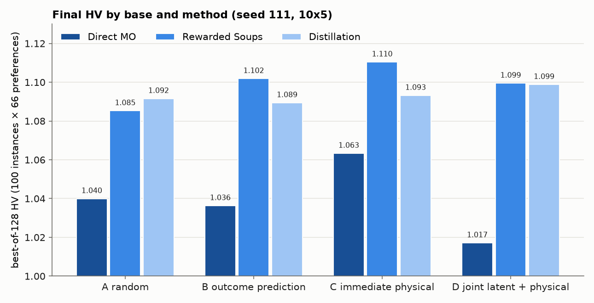
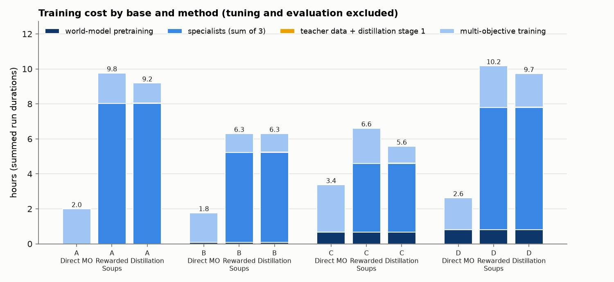
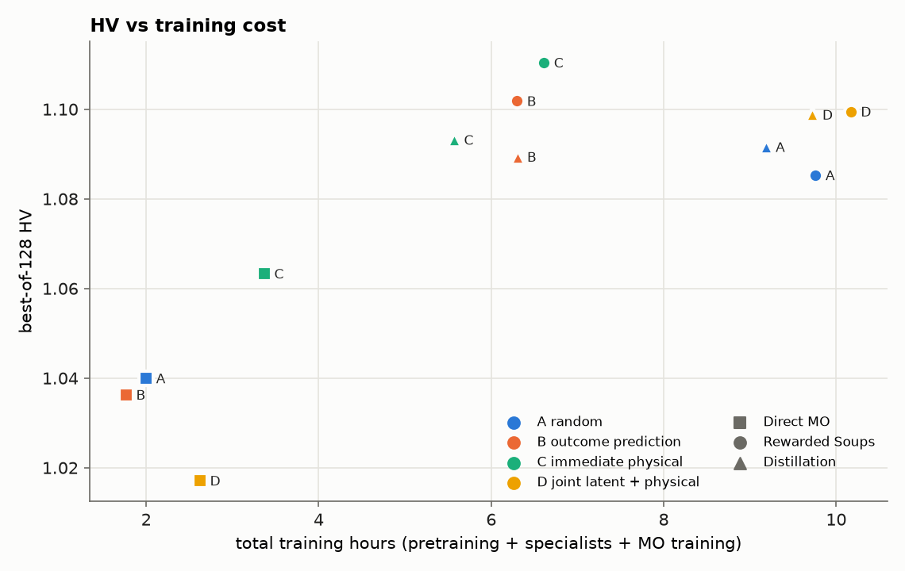
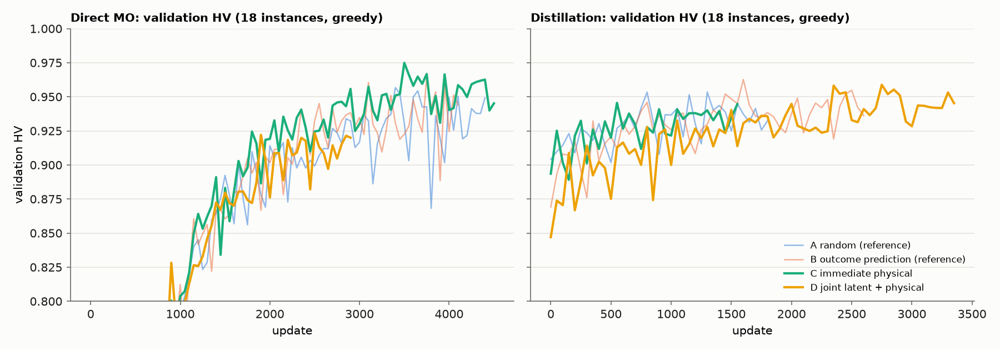
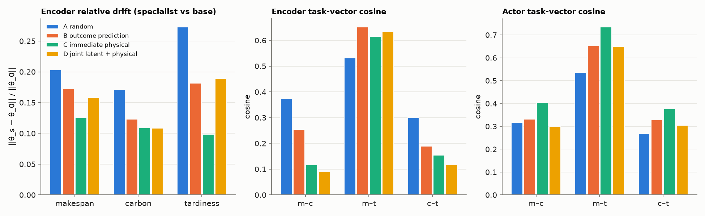
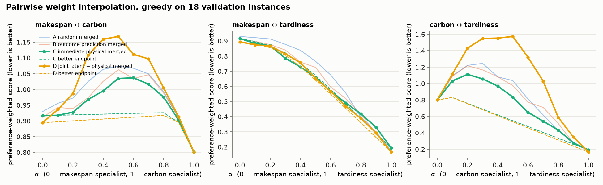
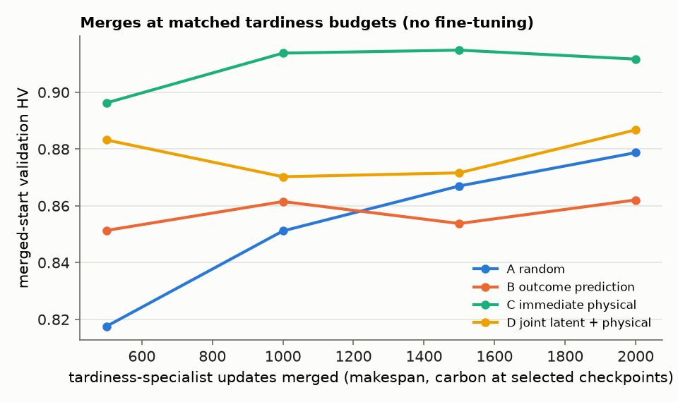

# Why did D not beat C? Merge diagnostics, distillation and direct MO from four shared bases

10×5, waiting allowed, seed 111, single run per arm. **Exploratory.**

## Setup

**Bases.** All four configurations share the same specialist architecture, environment and benchmark:

| Base | Encoder |
|---|---|
| A random | Random encoder |
| B outcome prediction | Outcome-prediction world model |
| C immediate physical | Immediate-physical-consequence world model, epoch 60 (pilot model "B") |
| D joint latent + physical | Joint latent + immediate-physical world model, epoch 60 (pilot model "E") |

**Evaluation.**
- Best-of-128 sampling on 100 instances × 66 preferences, evaluation seed 51, with frozen HV normalisation.
- IGD+ is computed on the 20-instance CP-SAT subset.
- Validation selection uses 18 instances, greedy.
- The reserved final-test sets were not touched.

**Code and outputs.**

| Script | What it does | Outputs |
|---|---|---|
| `tools/wm_merge_diagnosis_v3.py` | Experiment 1 | `results/wm_merge_diagnosis_v3/` |
| `tools/wm_distill_direct_v3.py` | Experiments 2 and 3 | `results/wm_distill_direct_v3/`; checkpoints under `checkpoints/wm_distill_direct_v3/` |
| `tools/wm_diagnosis_summary_v3.py` | Consolidation | `results/wm_diagnosis_summary_v3/` (`summary.json` and plots) |

**Checks that passed.**
- **Audit:** every specialist was initialised from its own base, and every merged start was built from exactly those specialists.
- **Experiment 2/3 commands:** each differs from the historical A distillation / from-scratch command only in `--model_suffix` and `--init_from` (and `--init_mode exact` for direct).
- **Direct-MO starts:** each start has the exact epoch-60 encoder. All non-encoder weights are identical to the historical scratch initialisation, which matches its reference hash.
- **Distillation inputs:** the teachers are the existing `rs_four_bases_v3` specialists, and the student is **not** initialised from any world-model encoder.
- **Data fingerprints:** equal across arms.
- **Exactness of the matched merge:** the matched merge C@t1000 reproduces the existing C merged start bit-for-bit (best-of-128 1.0341).

## 1. Consolidated results

### Best-of-128 HV (higher is better) and IGD+ (lower is better)

| Base | Direct MO HV | Rewarded Soups HV | Distillation HV | Direct MO IGD+ | Rewarded Soups IGD+ | Distillation IGD+ |
|---|---|---|---|---|---|---|
| A random | 1.0400 | 1.0853 | 1.0916 | 0.0956 | 0.0749 | 0.0690 |
| B outcome prediction | 1.0363 | 1.1019 | 1.0894 | 0.0970 | 0.0679 | 0.0687 |
| C immediate physical | **1.0633** | **1.1104** | 1.0932 | **0.0850** | **0.0637** | 0.0707 |
| D joint latent + physical | 1.0171 | 1.0995 | **1.0988** | 0.1018 | 0.0693 | 0.0688 |

**Where each number comes from.**
- **New runs:** C and D Direct MO, and C and D Distillation.
- **Earlier experiments, reused:**
  - A Direct MO is the historical from-scratch run.
  - B Direct MO is `daniel_wm_direct_v3`.
  - A/B Distillation are the historical runs from `specialist_reuse_v3` and `specialist_reuse_wm_td_v3`.
  - All Rewarded Soups numbers are from `rs_four_bases_v3`.

**Before fine-tuning (best-of-128 HV).**

| Base | Rewarded Soups merged start | Distillation student after stage 1 |
|---|---|---|
| A | 1.0072 | 0.9874 |
| B | 1.0088 | 1.0028 |
| C | 1.0341 | 0.9991 |
| D | 0.9989 | 0.9961 |

### Training cost (hours; summed run durations; tuning and evaluation excluded)

| Base | Pretraining | Specialists (sum of 3) | Direct MO training | Rewarded Soups fine-tuning | Distillation (teacher data + stage 1) | Distillation fine-tuning | Total: Direct | Total: Rewarded Soups | Total: Distillation | Additional if specialists exist: Rewarded Soups | Additional if specialists exist: Distillation |
|---|---|---|---|---|---|---|---|---|---|---|---|
| A | 0 | 8.02 | 2.00 | 1.74 | 0.025 | 1.14 | 2.00 | 9.76 | 9.18 | 1.74 | 1.16 |
| B | 0.079 | 5.13 | 1.69 | 1.09 | 0.025 | 1.06 | 1.77 | 6.30 | 6.30 | 1.09 | 1.09 |
| C | 0.665 | 3.93 | 2.70 | 2.02 | 0.026 | 0.95 | 3.37 | 6.61 | **5.57** | 2.02 | **0.98** |
| D | 0.808 | 6.99 | 1.82 | 2.37 | 0.026 | 1.90 | 2.62 | 10.17 | 9.73 | 2.37 | 1.93 |

**How the costs are counted.**
- Pretraining is counted once per base.
- Direct MO does not use specialists, so its additional cost equals its own training time.

**Tuning, reported separately.** Tuning was done once, on the random base (6 trials per method), and reused unchanged by all bases:

| Method | Tuning hours |
|---|---|
| Rewarded Soups | 4.85 |
| Distillation | 3.76 |
| From scratch / Direct MO | 3.81 |

**Evaluation, reported separately.**
- Each best-of-128 + greedy evaluation takes about 25 min.
- The Experiment 2/3 evaluations took 3.33 h of elapsed time in total.

**Summed durations vs elapsed wall clock.**
- The four Experiment 2/3 training runs sum to **7.43 h**, but took **2.86 h** elapsed (plus 0.05 h for the two distillation stage-1 runs).
- The four runs shared 3 CPU slots (4 cores each) and one GPU.

**Hardware contention.** All per-run durations were measured under contention:
- Experiment 2/3 ran 4 runs on 3 slots.
- In Experiment 1, the probes overlapped with the matched-merge evaluations.
- The historical A/B runs ran under their own (different) concurrency.

Treat cost differences below about 20% as noise.

**Run details (new runs; all stopped by the frozen rule: less than 0.5% improvement over 1,000 updates).**

| Run | Stop update | Selected update | Best validation HV | Hours |
|---|---|---|---|---|
| C Direct MO | 4500 | 3500 | 0.9749 | 2.70 |
| D Direct MO | 2900 | 2500 | 0.9232 | 1.82 |
| C Distillation | 1550 | 550 | 0.9455 | 0.95 |
| D Distillation | 3350 | 2750 | 0.9588 | 1.90 |

## 2. Experiment 1: diagnostics on the existing checkpoints

### A. Parameter and representation drift (specialist vs its base)

**Parameter drift.** Relative ‖θ_s − θ_0‖ / ‖θ_0‖. The critic does not move in specialist training, so its drift is 0.

| Base | Encoder drift: makespan | Encoder drift: carbon | Encoder drift: tardiness | Actor drift: makespan | Actor drift: carbon | Actor drift: tardiness |
|---|---|---|---|---|---|---|
| A | 0.203 | 0.171 | 0.273 | 0.80 | 1.28 | 1.07 |
| B | 0.172 | 0.123 | 0.182 | 0.85 | 1.11 | 0.83 |
| C | 0.125 | 0.109 | **0.098** | 0.69 | 1.16 | 0.60 |
| D | 0.158 | 0.109 | 0.189 | 0.83 | 1.34 | 1.01 |

**Representation similarity.** Linear CKA to the base on a fixed set of fresh-factory test states (operation tokens / machine tokens / globals; 1 = unchanged):

| Base | Makespan specialist | Carbon specialist | Tardiness specialist |
|---|---|---|---|
| A | 0.56 / 0.06 / 0.10 | 0.45 / 0.11 / 0.20 | 0.60 / 0.03 / 0.07 |
| B | 0.56 / 0.07 / 0.49 | 0.41 / 0.53 / 0.47 | 0.48 / 0.05 / 0.48 |
| C | **0.83 / 0.87 / 0.76** | 0.55 / 0.81 / 0.87 | **0.80 / 0.91 / 0.86** |
| D | 0.68 / 0.67 / 0.40 | 0.38 / 0.73 / 0.64 | 0.73 / 0.65 / 0.47 |

**CKA between specialists of the same base** (operation / machine / globals):

| Base | Makespan–carbon | Makespan–tardiness | Carbon–tardiness |
|---|---|---|---|
| A | 0.73 / 0.09 / 0.20 | 0.64 / 0.29 / 0.32 | 0.35 / 0.09 / 0.17 |
| B | 0.49 / 0.05 / 0.38 | 0.80 / 0.73 / 0.59 | 0.21 / 0.05 / 0.37 |
| C | 0.48 / 0.76 / 0.67 | **0.93 / 0.96 / 0.88** | 0.42 / 0.76 / 0.72 |
| D | 0.63 / 0.46 / 0.35 | 0.76 / 0.81 / 0.52 | 0.42 / 0.41 / 0.37 |

### B. Retention probes (frozen encoders, fresh-factory test split)

**Columns.**
- **Relational mean:** mean of earliest-start R², best-machine accuracy and machine earliest-start R².
- **Availability:** next-state machine availability, as R² and as sign accuracy of same-operation branch differences.
- **Refit physical head:** a new physical head trained for 20 epochs on the frozen fine-tuned encoder. The Δ-MAE is over changed entities.
- **Original physical head:** the world model's own head applied to the fine-tuned encoder.

| Encoder | Relational mean | Availability R² | Availability sign accuracy | Refit head: Δ-MAE (min) | Refit head: F/R/T R² | Original head: Δ-MAE | Original head: F R² |
|---|---|---|---|---|---|---|---|
| A base | 0.309 | 0.001 | 0.515 | 25.2 | 0.29 / 0.76 / 0.18 | – | – |
| A m / c / t | 0.557 / 0.445 / 0.641 | 0.19 / 0.21 / 0.30 | 0.84 / 0.84 / 0.85 | 18.7 / 20.7 / 17.9 | – | – | – |
| B base | 0.520 | 0.006 | 0.585 | 21.5 | 0.52 / 0.85 / 0.33 | – | – |
| B m / c / t | 0.638 / 0.412 / 0.628 | 0.42 / 0.00 / 0.44 | 0.91 / 0.55 / 0.92 | 17.6 / 23.8 / 17.4 | – | – | – |
| **C base** | 0.801 | 0.468 | 0.912 | 12.7 | 0.91 / 0.97 / 0.81 | 12.4 | 0.90 |
| C m | 0.789 | 0.468 | 0.916 | 13.7 | 0.89 / 0.96 / 0.74 | 43.2 | −2.13 |
| C c | 0.776 | 0.456 | 0.898 | 14.5 | 0.88 / 0.95 / 0.73 | 25.3 | 0.47 |
| C t | 0.788 | 0.465 | 0.917 | 13.3 | 0.90 / 0.96 / 0.75 | 45.5 | −2.83 |
| **D base** | 0.801 | 0.495 | 0.903 | 13.2 | 0.91 / 0.95 / 0.80 | 15.3 | 0.80 |
| D m | 0.741 | 0.457 | 0.910 | 15.5 | 0.82 / 0.94 / 0.68 | 244.6 | −39.2 |
| D c | 0.727 | 0.401 | 0.871 | 16.7 | 0.73 / 0.89 / 0.68 | 47.6 | −0.62 |
| D t | 0.752 | 0.484 | 0.917 | 17.4 | 0.78 / 0.87 / 0.69 | 199.6 | −31.6 |

**D's original latent predictor applied to the fine-tuned encoders.**

| Encoder | Change explained | Overall discrimination | Same-operation / other-machine discrimination |
|---|---|---|---|
| Base | 0.95 | 0.98 | 0.91 |
| m | −1.00 | 0.67 | 0.58 |
| c | 0.43 | 0.91 | 0.69 |
| t | −0.76 | 0.64 | 0.58 |

Current-state readouts (machine free time and job ready time now) are in `probes.json`. They follow the same ordering and are omitted here.

### C. Task vectors and pairwise interpolation

**Task-vector cosine** (encoder / actor):

| Base | Makespan–carbon | Makespan–tardiness | Carbon–tardiness |
|---|---|---|---|
| A | 0.37 / 0.32 | 0.53 / 0.54 | 0.30 / 0.27 |
| B | 0.25 / 0.33 | 0.65 / 0.65 | 0.19 / 0.33 |
| C | 0.12 / 0.40 | 0.62 / 0.74 | 0.15 / 0.38 |
| D | 0.09 / 0.30 | 0.63 / 0.65 | 0.12 / 0.31 |

**Sign agreement and magnitude.**
- Encoder sign agreement for C and D is 0.52–0.71, against 0.55–0.70 for A and B.
- Total task-vector norms (m / c / t):

| Base | Makespan | Carbon | Tardiness |
|---|---|---|---|
| A | 7.8 | 9.7 | 10.5 |
| B | 7.5 | 8.1 | 7.6 |
| C | 6.6 | 8.7 | **5.4** |
| D | 7.7 | 9.6 | 9.3 |

**Pairwise interpolation.**
- **Merge:** the exact Rewarded Soups merge θ(w) = Σ w_x θ_x at the 11 edge preferences of each pair.
- **Score:** greedy on the 18 validation instances, with the preference-weighted score w·(mk/mk_ref, cb/cb_ref, T/T_ref). Lower is better.
- **Gap:** merged score minus the better of the two specialists at the same preference.

| Base | Makespan–carbon: mean / max interior gap | Makespan–tardiness | Carbon–tardiness |
|---|---|---|---|
| A | 0.100 / 0.159 | 0.060 / 0.110 | 0.323 / 0.551 |
| B | 0.079 / 0.149 | 0.035 / 0.079 | 0.320 / 0.478 |
| C | **0.056 / 0.113** | **−0.002 / 0.039** | **0.221 / 0.368** |
| D | 0.148 / 0.259 | 0.016 / 0.030 | **0.633 / 1.039** |

### D. Matched-budget merging (no fine-tuning)

**What could be matched.** Only the tardiness specialist's budget could be matched. Its downstream runs saved snapshots at 500, 1,000, 1,500 and 2,000 updates for every base.

**Not available.** The makespan and carbon specialists kept only their selected checkpoints:

| Base | Makespan specialist (selected update) | Carbon specialist (selected update) |
|---|---|---|
| A | 3050 | 1950 |
| B | 2350 | 1700 |
| C | 1700 | 2100 |
| D | 2250 | 2000 |

Matched makespan and carbon budgets are therefore **not available** and were not recreated by retraining. Best-of-128 was run at tardiness updates 1,000 and 2,000; validation HV is available at all four.

| Base | Validation HV at t500 / t1000 / t1500 / t2000 | Best-of-128 HV at t1000 | Best-of-128 HV at t2000 | Best-of-128 HV of the actual merge (selected tardiness) |
|---|---|---|---|---|
| A | 0.818 / 0.851 / 0.867 / 0.879 | 0.9687 | 0.9780 | 1.0072 (t6900) |
| B | 0.851 / 0.862 / 0.854 / 0.862 | 0.9923 | 1.0047 | 1.0088 (t2350) |
| C | **0.896 / 0.914 / 0.915 / 0.912** | **1.0341** | **1.0413** | 1.0341 (t1000) |
| D | 0.883 / 0.870 / 0.872 / 0.887 | 0.9873 | 0.9905 | 0.9989 (t5050) |

## 3. Research questions

### Q1. Is D's Rewarded Soups result worse than C's because D's specialists are worse?

**Observations.**
- With the same three teachers, distillation gives D 1.0988 and C 1.0932.
- The students after stage 1 are essentially tied (0.9961 vs 0.9991).
- D's individual specialists are comparable or better on their own objective. Validation scores (lower is better), D vs C: makespan 0.894 vs 0.917, carbon 0.801 vs 0.801, tardiness 0.166 vs 0.194. D's tardiness specialist trained 5× longer (5,050 vs 1,000 updates).

**Explanation.** The evidence does not support "D's specialists are worse". When their behaviour is combined through the policy output (distillation) rather than through the weights, D is at least as good as C.

### Q2. Is the gap caused by merging (weight compatibility)?

**Observations.**
- **Merged start.** D's merged start is 0.035 below C's (0.9989 vs 1.0341).
- **Matched tardiness budgets.** The gap is *larger*, not smaller (t1000: 0.9873 vs 1.0341; t2000: 0.9905 vs 1.0413). D's merge improves monotonically as its tardiness specialist trains longer. So the 5× longer tardiness training does not explain the gap, though makespan and carbon budgets remain unmatched.
- **Function-space interpolation.** D has the largest interior losses of all four bases on carbon–tardiness (mean gap 0.633 vs 0.221 for C, and 0.32 for A and B) and on makespan–carbon (0.148 vs 0.056).
- **Representation geometry.**
  - D's specialists are less similar to each other in representation than C's. For example, makespan–tardiness CKA is 0.76 / 0.81 / 0.52 for D against 0.93 / 0.96 / 0.88 for C.
  - D's specialists also moved further from their base (CKA 0.38–0.73 vs 0.55–0.91).
  - D's encoder parameter drift is about twice C's for the tardiness specialist (0.189 vs 0.098).
- **Rewarded Soups fine-tuning** closes most of the gap: 1.0995 vs 1.1104, a residual of 0.011.

**Explanation.**
- These diagnostics point to poorer weight compatibility of D's specialists. The specialist policies are fine, but their weight-space average works worse than C's.
- The cosine numbers alone would not show this. D's encoder cosines are only slightly lower than C's, and A has the *highest* cosines yet merges worse than C. The supporting evidence is the function-space interpolation, together with the matched merges and the between-specialist CKA.
- The remaining 0.011 after fine-tuning is within what a single seed can resolve, so it should not be read as a real difference.

### Q3. Does specialist training degrade the world-model representation?

**Observations.**
- **Information is largely retained in both bases.** Relational probes drop from 0.801 to:
  - C: 0.776–0.789, a loss of 0.01–0.03.
  - D: 0.727–0.752, a loss of 0.05–0.07.
- **Refit physical heads stay close to the base.**
  - C: 12.7 → 13.3–14.5 minutes Δ-MAE.
  - D: 13.2 → 15.5–17.4 minutes.
- **Availability sign accuracy is unchanged** at about 0.87–0.92.
- **The original heads, by contrast, break.**
  - Physical heads go to F R² −2.8 to +0.5 for C, and −39 to −0.6 for D.
  - D's latent predictor drops from 0.95 change explained to between −1.0 and 0.43.

**Explanation.**
- Most of the measured physical information survives in both encoders; the original heads are *incompatible* with the moved coordinates rather than the information being lost.
- D loses somewhat more than C on every probe. This is consistent with D's larger drift, but the loss is modest: D's specialists still sit far above the A and B bases on every probe.
- These diagnostics do **not** support large representation degradation as the main cause.

### Q4. Do C and D also help without specialists, through Direct MO with encoder transfer?

**Observations.**
- C's encoder gives the best Direct MO result: 1.0633, against 1.0400 for A and 1.0363 for B, and IGD+ 0.085 against 0.096–0.097.
- D's encoder gives the worst: 1.0171, IGD+ 0.102.
- D's run stopped earlier (2,900 updates, best validation 0.923) than C's (4,500; 0.975).

**Explanation.**
- On this seed, D's encoder is a worse starting point for plain RL than C's, and even than random. One possible reason is that its joint latent features need larger updates before they serve the policy. This would also fit D's larger specialist drift and its slower tardiness specialist.
- This is a hypothesis, not tested here. Direct MO validation curves are noisy (±0.03), D's run may have been cut by the stopping rule while still rising, and there is one seed only.

### Q5. Which pipeline is most cost-effective?

**Observations.**
- **Highest HV:** C + Rewarded Soups, 1.1104 at 6.61 h.
- **Cheaper alternatives:**
  - C + Distillation: 1.0932 at 5.57 h.
  - Direct MO: 1.77–3.37 h, but 0.03–0.08 lower HV.
- **D costs the most** in the specialist-based pipelines (9.7–10.2 h), mainly because its tardiness specialist took 5,050 updates. That buys no HV advantage over C.
- **If specialists already exist:** C distillation costs 0.98 h, C Rewarded Soups 2.02 h, and D Rewarded Soups 2.37 h.

### Q6. Is latent (self-predictive) learning unsuitable for this purpose?

Not established.
- D's base probes equal C's (relational mean 0.801 for both; availability slightly higher for D).
- D distils as well as or better than C.

What is observed is narrower: specialists trained from D's encoder interpolate worse, and D's encoder was a worse direct-MO initialisation on this seed. Whether that comes from the latent objective itself, from its interaction with the physical loss, or from seed noise cannot be separated with one seed.

## 4. Limitations

- **Single seed (111), 10×5 only.** HV differences of about 0.01 between pipelines are within plausible seed variance. Direct MO and distillation validation curves fluctuate by ±0.03.
- **Matched budgets are partial.** Only the tardiness budget was controlled; makespan and carbon checkpoints were kept only at the selected update.
- **Interpolation** used greedy decoding on 18 validation instances, on simplex edges only. It is a diagnostic proxy, not the best-of-128 protocol.
- **Probes are linear or small and frozen.** They measure accessible information, not what the policy uses.
- **Costs are run durations under shared hardware.** They are not isolated benchmarks.
- **Hyperparameters were tuned once, on the random base,** and reused for every base, which may disadvantage the world-model bases differently.
- **The A/B distillation and direct references come from earlier experiments** under a different concurrency. The protocol is identical, but timing is not directly comparable.

## 5. Recommended next steps

1. **Seeds first.** Repeat C/D Rewarded Soups, Distillation and Direct MO on 2–3 more seeds before drawing conclusions about the 0.01-level differences. Direct MO with D's encoder (1.017) is the result most in need of confirmation.
2. **If D is pursued, prefer distillation over Rewarded Soups** for combining its specialists, or test merge-alignment remedies aimed at the observed carbon–tardiness barrier. This would be new work, not run here.
3. **Keep intermediate specialist checkpoints** in future runs (e.g. every 500 updates), so that fully matched-budget merges are possible.
4. **Use C as the default shared base.** It is the best or tied-best base in all three pipelines, has the lowest specialist drift, and is the cheapest pipeline to the top HV.
