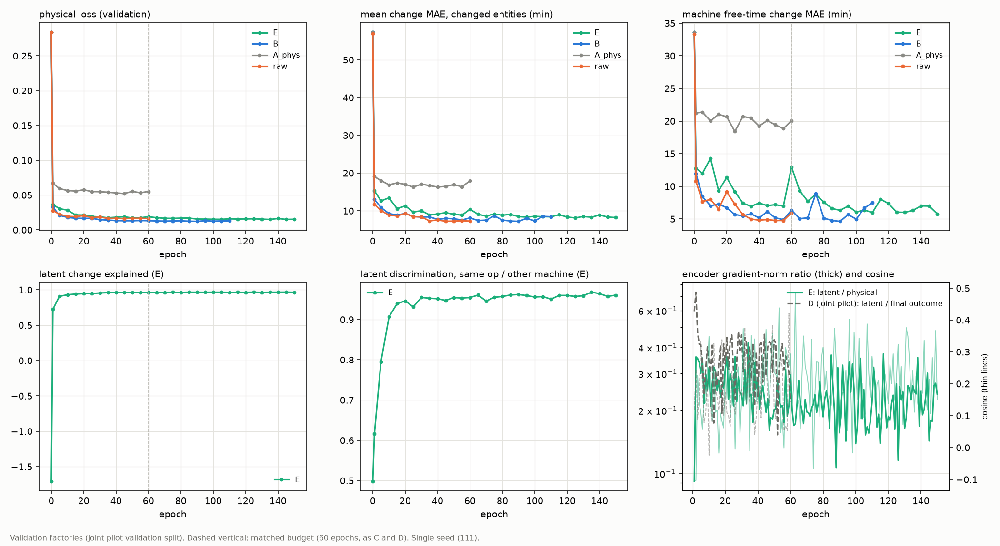

# Immediate-physical-consequence joint world model (10x5, waiting allowed, seed 111)

Follow-up to `results/world_model_joint_pilot_v3.md` (whose decision rule and verdict are unchanged). Single seed. Settings and the decision rule were frozen in `results/world_model_immediate_pilot_v3/settings.json` before any training (sha256 760b64ce71f3…).

## Why

The joint pilot's outcome head predicted final schedule outcomes under fixed continuation heuristics, so part of what it learned was the heuristics' behaviour. Here the world model only learns what the factory looks like one decision later; whether that is good is left to the specialists.

## Architecture (E)

`S_t -> DANIEL encoder -> action-conditioned latent predictor -> predicted S_t+1 tokens -> physical head`.
- Physical head reads ONLY the predicted tokens: per machine (predicted machine token + predicted globals) -> free time, cumulative processing; per job (mean + max of its predicted operation tokens + predicted globals) -> ready time, remaining workload; globals -> decision-time advance. No continuation rule, no S_t, no raw action features.
- Latent target: EMA copy of the online encoder (tau 0.996), stop-gradient, on the actual S_t+1; variance hinge.
- Loss: L_lat/L_lat0 + variance hinge + lambda_phys x L_phys/L_phys0; L_phys = mean over the 5 target groups of Huber(after-value) + Huber(sibling difference). One-off calibration after epoch 1: {"median_ratio_epoch1": 0.0917610302567482, "rescaled": true, "lam_phys": 0.0917610302567482}.
- Checks before training: perturbing every S_t+1 array and every target leaves all physical predictions bit-identical (True); both terms reach the encoder (True); predicted latent not detached (True).
- B: identical encoder + predictor + physical head with the physical loss only. A_phys: same, encoder frozen at the random start. raw: linear token maps of the raw operation/machine features instead of the encoder. C, D: the joint pilot's checkpoints (latent only; joint with final outcomes), not retrained.

## Immediate physical targets

From the semi-active simulator step: start = max(job ready, machine free); completion = start + p; the chosen machine's free time and the chosen job's ready time become the completion; operation completion lower bounds of the job shift; the decision time advances to the earliest pair start. Carbon is processing energy only (no time-of-use term).

| group | level | target (minutes) |
|---|---|---|
| F | machine | machine free time relative to t_t |
| B | machine | machine cumulative processing |
| R | job | job ready time relative to t_t |
| W | job | job remaining workload |
| T | global | decision-time advance |

Dropped as redundant (identities checked on every extracted transition):

- machine energy / carbon: gamma * P_m * B_m / 60 (carbon is processing energy only; checked)
- job completion lower bound: R_j + W_j (checked against op_ct_lb of the job's last operation)
- operation completion lower bounds: R_j + cumulative minimum processing times (static)
- machine idle time: F_m - B_m (definition)
- current makespan: max_m F_m (definition)
- remaining operation count: same information as W_j (which operations are scheduled)

Max identity / cross-check errors (minutes) over all extracted transitions: analytic_F 2.3e-13, analytic_R 2.3e-13, analytic_W 1.4e-14, true_free_time_vs_scaled 4.5e-13, true_job_ready_vs_scaled 4.5e-13, job_completion_lb_eq_R_plus_W 4.5e-13, decision_time_never_decreases 0.0e+00, carbon_per_minute_constant_per_machine 5.6e-17; stored S_t/S_t+1 arrays reproduced exactly (mismatches: 0).
The change of every target is therefore elementary simulator arithmetic given the raw physical state (exact analytic baseline: error 0); the question is what the ENCODER learns from predicting it through the latent.

## Data and splits

| split | factories | states | transitions | branches/state | same-op group | other-op same-machine | waiting | early/mid/late |
|---|---|---|---|---|---|---|---|---|
| train | 948 | 37,735 | 186,554 | 4.94 | 0.521 | 0.635 | 0.672 | 0.35/0.33/0.32 |
| validation | 201 | 7,995 | 39,516 | 4.94 | 0.522 | 0.638 | 0.676 | 0.35/0.32/0.33 |
| fresh test | 300 | 11,953 | 59,037 | 4.94 | 0.522 | 0.638 | 0.672 | 0.35/0.33/0.33 |

- Train and validation: the joint pilot's collection (re-used; physical targets extracted by replay in 19 s). The joint pilot's test factories are not used.
- Fresh test: 300 new generator factories (seed 6111), none duplicating any joint-pilot factory; collected with the joint pilot's routine (replay and decoder checks passed); extraction 5 s.
- Selection and monitoring on validation only; every number below is on the fresh test unless stated.

## Training and convergence

| config | lr | epochs run | seconds | peak GPU GB | at 60 epochs | at stop | still improving at stop |
|---|---|---|---|---|---|---|---|
| E | 0.001 | 150 | 7078 | 0.208 | would benefit from more training | would benefit from more training | val_delta_mae_mean, val_lat, val_phys |
| B | 0.001 | 110 | 4329 | 0.118 | would benefit from more training | converged | - |
| A_phys | 0.001 | 60 | 1427 | 0.119 | would benefit from more training | would benefit from more training | val_phys |
| raw | 0.001 | 60 | 1004 | 0.091 | would benefit from more training | would benefit from more training | val_delta_mae_mean, val_phys |

Gradient balance on the encoder (median over 5 monitor batches; ratio = latent / measurable term):

| model | epoch 1 ratio | epoch 1 cosine | epoch 30 ratio | epoch 60 ratio | epoch 60 cosine | last epoch ratio | last cosine |
|---|---|---|---|---|---|---|---|
| E (immediate physical) | 0.09 | -0.11 | 0.24 | 0.30 | 0.29 | 0.24 | 0.15 |
| D (final outcome, joint pilot) | 0.59 | 0.12 | 0.46 | 0.22 | 0.19 | 0.22 | 0.19 |

Per-group validation physical loss of E at epoch 60: F 0.0161, B 0.0240, R 0.0105, W 0.0119, T 0.0323.



## Results (fresh test factories, matched 60-epoch budget)

### Immediate physical prediction

Change MAE / R^2 on the entities the action changes (chosen machine for F and B, chosen job for R and W, the clock for T); copy-current = predicting no change.

| model | F change MAE / R^2 | B change MAE / R^2 | R change MAE / R^2 | W change MAE / R^2 | T change MAE / R^2 | mean change MAE |
|---|---|---|---|---|---|---|
| E | 17.13 / 0.800 | 36.39 / -2.948 | 12.23 / 0.953 | 6.50 / 0.834 | 4.09 / 0.790 | 15.27 |
| B | 10.10 / 0.904 | 31.39 / -2.380 | 10.68 / 0.966 | 6.22 / 0.851 | 3.76 / 0.800 | 12.43 |
| A_phys | 31.05 / 0.246 | 45.05 / -4.191 | 29.80 / 0.824 | 10.68 / 0.576 | 10.88 / 0.188 | 25.49 |
| raw | 9.13 / 0.924 | 29.90 / -2.185 | 8.72 / 0.976 | 4.02 / 0.937 | 6.10 / 0.630 | 11.57 |
| E (converged) | 9.61 / 0.910 | 32.44 / -2.482 | 12.20 / 0.956 | 5.75 / 0.864 | 3.94 / 0.806 | 12.79 |
| B (converged) | 10.51 / 0.913 | 32.09 / -2.431 | 10.65 / 0.968 | 5.94 / 0.857 | 3.67 / 0.807 | 12.57 |
| copy current (no change) | 65.39 / - | 50.09 / - | 100.56 / - | 27.46 / - | 9.96 / - | 50.69 |
| analytic simulator arithmetic | 0 / 1 | 0 / 1 | 0 / 1 | 0 / 1 | 0 / 1 | 0 |

After-value MAE (minutes) / R^2 over all entities, and error on entities the action does not change:

| model | F after MAE / R^2 | B after MAE / R^2 | R after MAE / R^2 | W after MAE / R^2 | T after MAE / R^2 | unchanged-entity MAE (F, R) |
|---|---|---|---|---|---|---|
| E | 14.10 / 0.898 | 35.79 / 0.858 | 15.83 / 0.904 | 7.28 / 0.975 | 4.09 / 0.790 | 13.34, 16.23 |
| B | 9.53 / 0.932 | 32.61 / 0.875 | 13.19 / 0.920 | 6.21 / 0.982 | 3.76 / 0.800 | 9.38, 13.47 |
| A_phys | 35.67 / 0.482 | 46.21 / 0.802 | 23.88 / 0.861 | 10.99 / 0.945 | 10.88 / 0.188 | 36.83, 23.22 |
| raw | 8.42 / 0.958 | 30.33 / 0.883 | 12.92 / 0.924 | 4.57 / 0.990 | 6.10 / 0.630 | 8.24, 13.39 |
| E (converged) | 9.95 / 0.936 | 32.98 / 0.872 | 14.67 / 0.914 | 6.18 / 0.982 | 3.94 / 0.806 | 10.03, 14.94 |
| B (converged) | 9.88 / 0.939 | 31.89 / 0.876 | 13.38 / 0.922 | 5.80 / 0.983 | 3.67 / 0.807 | 9.72, 13.69 |
| copy current | 13.08 / 0.780 | 10.02 / 0.971 | 10.06 / 0.835 | 2.75 / 0.970 | 9.96 / -0.116 | 0, 0 |

### Differences between alternative actions from the same state

Sign accuracy of the predicted per-entity difference (where the true difference is non-zero) and difference MAE vs the zero-difference baseline (minutes).

| model | pair type | F sign acc / MAE (zero) | B sign acc / MAE (zero) | R sign acc / MAE (zero) | W sign acc / MAE (zero) | T sign acc / MAE (zero) |
|---|---|---|---|---|---|---|
| E | all | 0.992 / 6.45 (22.51) | 0.972 / 7.40 (17.30) | 0.992 / 5.74 (17.70) | 0.954 / 2.38 (4.72) | 0.975 / 5.83 (13.10) |
| E | same operation other machine | 0.995 / 7.00 (26.77) | 0.977 / 6.66 (19.73) | 0.941 / 4.80 (5.38) | - / 1.37 (0.00) | 0.953 / 7.03 (14.02) |
| E | other operation same machine | 0.961 / 4.99 (9.71) | 0.933 / 6.38 (6.64) | 0.995 / 5.43 (18.98) | 0.954 / 2.36 (5.64) | 0.903 / 4.63 (6.58) |
| E | immediate vs waiting | 0.997 / 6.49 (23.70) | 0.979 / 8.10 (20.22) | 0.997 / 6.34 (20.60) | 0.954 / 2.77 (5.88) | 0.992 / 6.80 (18.41) |
| B | all | 0.991 / 3.91 (22.51) | 0.965 / 6.10 (17.30) | 0.991 / 3.47 (17.70) | 0.985 / 1.73 (4.72) | 0.979 / 5.50 (13.10) |
| B | same operation other machine | 0.994 / 4.57 (26.77) | 0.968 / 5.48 (19.73) | 0.953 / 2.68 (5.38) | - / 0.86 (0.00) | 0.957 / 6.85 (14.02) |
| B | other operation same machine | 0.973 / 2.65 (9.71) | 0.948 / 4.97 (6.64) | 0.994 / 3.35 (18.98) | 0.986 / 1.83 (5.64) | 0.908 / 4.27 (6.58) |
| B | immediate vs waiting | 0.995 / 4.10 (23.70) | 0.968 / 6.81 (20.22) | 0.996 / 3.75 (20.60) | 0.985 / 1.94 (5.88) | 0.996 / 6.42 (18.41) |
| A_phys | all | 0.956 / 8.75 (22.51) | 0.917 / 8.47 (17.30) | 0.979 / 8.75 (17.70) | 0.987 / 3.73 (4.72) | 0.650 / 13.86 (13.10) |
| A_phys | same operation other machine | 0.964 / 8.99 (26.77) | 0.916 / 7.57 (19.73) | 0.839 / 5.96 (5.38) | - / 1.60 (0.00) | 0.626 / 15.11 (14.02) |
| A_phys | other operation same machine | 0.900 / 6.79 (9.71) | 0.912 / 7.23 (6.64) | 0.992 / 9.04 (18.98) | 0.988 / 4.10 (5.64) | 0.585 / 9.70 (6.58) |
| A_phys | immediate vs waiting | 0.949 / 8.65 (23.70) | 0.910 / 9.50 (20.22) | 0.995 / 10.07 (20.60) | 0.987 / 4.17 (5.88) | 0.712 / 16.23 (18.41) |
| raw | all | 0.994 / 3.87 (22.51) | 0.968 / 5.93 (17.30) | 0.994 / 3.60 (17.70) | 0.987 / 1.32 (4.72) | 0.953 / 8.36 (13.10) |
| raw | same operation other machine | 0.998 / 4.13 (26.77) | 0.974 / 5.05 (19.73) | 0.964 / 2.90 (5.38) | - / 0.82 (0.00) | 0.935 / 10.08 (14.02) |
| raw | other operation same machine | 0.970 / 3.11 (9.71) | 0.942 / 5.40 (6.64) | 0.997 / 3.42 (18.98) | 0.989 / 1.32 (5.64) | 0.804 / 7.05 (6.58) |
| raw | immediate vs waiting | 0.997 / 3.92 (23.70) | 0.971 / 6.53 (20.22) | 0.998 / 3.93 (20.60) | 0.987 / 1.48 (5.88) | 0.985 / 8.77 (18.41) |

### Latent transition prediction (own target space; scale-free)

| config | change explained (changed tokens) | shuffle worse share | discrimination overall | same op / other machine | other op / same machine | immediate vs waiting |
|---|---|---|---|---|---|---|
| A | 0.812 | 0.995 | 0.880 | 0.587 | 0.952 | 0.931 |
| C | 0.889 | 0.997 | 0.909 | 0.534 | 0.992 | 0.980 |
| D | 0.898 | 0.996 | 0.965 | 0.820 | 0.989 | 0.995 |
| E | 0.949 | 0.996 | 0.984 | 0.908 | 0.998 | 0.999 |
| E (converged) | 0.952 | 0.998 | 0.984 | 0.914 | 0.998 | 0.998 |

Copy-current-latent baseline = change explained 0 by definition. A = the joint pilot's predictor on the frozen random encoder.

### Machine availability readouts (linear OLS; fitted on train transitions, scored on fresh)

From the ACTUAL next-state embedding (encoder of S_t+1):

| representation | absolute R^2 | absolute MAE (min) | same-op difference sign accuracy | difference MAE (min) | zero-baseline MAE |
|---|---|---|---|---|---|
| A | 0.001 | 39.34 | 0.515 | 66.70 | 66.94 |
| B_final_outcome (joint pilot) | 0.467 | 26.19 | 0.926 | 39.38 | 66.94 |
| C | -0.000 | 39.36 | 0.511 | 66.69 | 66.94 |
| D | 0.395 | 28.22 | 0.939 | 39.04 | 66.94 |
| B | 0.468 | 25.66 | 0.912 | 38.97 | 66.94 |
| E | 0.495 | 25.64 | 0.903 | 39.95 | 66.94 |
| B (converged) | 0.469 | 25.47 | 0.916 | 38.71 | 66.94 |
| E (converged) | 0.500 | 25.36 | 0.915 | 39.30 | 66.94 |
| raw | 0.589 | 22.04 | 0.955 | 34.19 | 66.94 |

From the PREDICTED next latent (predictor output from S_t and the action):

| representation | absolute R^2 | absolute MAE (min) | same-op difference sign accuracy | difference MAE (min) | zero-baseline MAE |
|---|---|---|---|---|---|
| A | 0.001 | 39.33 | 0.606 | 65.51 | 66.94 |
| C | -0.000 | 39.36 | 0.658 | 65.57 | 66.94 |
| D | 0.424 | 27.63 | 0.993 | 36.26 | 66.94 |
| E | 0.567 | 24.19 | 0.972 | 30.30 | 66.94 |
| B | 0.676 | 21.03 | 0.985 | 14.74 | 66.94 |
| A_phys | 0.173 | 33.76 | 0.998 | 25.57 | 66.94 |
| raw | 0.676 | 21.97 | 0.964 | 18.65 | 66.94 |
| E (converged) | 0.579 | 23.67 | 0.973 | 29.17 | 66.94 |
| B (converged) | 0.674 | 21.53 | 0.988 | 14.73 | 66.94 |

### Arithmetic or relational understanding? (frozen encoders of S_t, identical small MLP probes)

None of these targets is given by the action: each combines a job's readiness with a machine's availability across the state. (i) earliest start of every eligible candidate job-machine pair; (ii) the machine giving the earliest completion for each candidate job; (iii) each machine's earliest start over candidate jobs.

| encoder | pair earliest start R^2 (MAE min) | best machine accuracy (chance) | machine earliest start R^2 (MAE min) | mean |
|---|---|---|---|---|
| A | 0.324 (34.98) | 0.358 (0.336) | 0.245 (38.14) | 0.309 |
| B_final_outcome (joint pilot) | 0.885 (14.83) | 0.543 (0.336) | 0.864 (14.06) | 0.764 |
| C | 0.430 (33.33) | 0.357 (0.336) | 0.358 (35.83) | 0.381 |
| D | 0.877 (15.21) | 0.547 (0.336) | 0.854 (14.60) | 0.759 |
| B | 0.938 (10.30) | 0.547 (0.336) | 0.919 (10.18) | 0.801 |
| E | 0.935 (10.76) | 0.554 (0.336) | 0.913 (10.97) | 0.801 |
| B (converged) | 0.944 (9.69) | 0.547 (0.336) | 0.925 (9.59) | 0.805 |
| E (converged) | 0.941 (10.25) | 0.554 (0.336) | 0.922 (10.18) | 0.806 |
| raw | 0.633 (23.18) | 0.563 (0.336) | 0.665 (19.50) | 0.620 |

### Secondary: final-outcome frozen probes (the joint pilot's protocol; not part of the decision)

| encoder | ranking accuracy | same op / other machine | difference MAE | zero-difference MAE |
|---|---|---|---|---|
| A | 0.550 | 0.588 | 95.69 | 64.49 |
| B | 0.572 | 0.618 | 76.43 | 64.49 |
| C | 0.552 | 0.594 | 105.15 | 64.49 |
| D | 0.565 | 0.605 | 78.47 | 64.49 |
| E | 0.568 | 0.613 | 77.04 | 64.49 |
| raw | 0.556 | 0.584 | 88.51 | 64.49 |

Simple pair rule on same-operation pairs: makespan 0.608, carbon 0.677, tardiness 0.500.

### Collapse diagnostics (target / online encoder on fresh next states)

| config | effective rank | mean std | min std |
|---|---|---|---|
| C | 5.63 | 0.3308 | 0.2454 |
| D | 5.65 | 0.2631 | 0.2309 |
| E | 6.00 | 0.3342 | 0.2181 |

E at the start: effective rank 5.04, mean std 0.4219; flagged collapsed: False.

## Pre-registered decision

E (immediate-physical joint world model) is recommended as the shared encoder for specialist / Rewarded Soups training only if, on the FRESH test factories at the matched 60-epoch budget, ALL hold: (1) vs C: latent change explained (changed tokens) >= C - 0.02, same-operation/other-machine discrimination >= C + 0.10, actual-state availability same-operation difference sign accuracy >= C + 0.10; (2) vs D: same-operation/other-machine discrimination, overall discrimination and availability sign accuracy each >= D - 0.02, and the relational-probe mean (pair earliest start R^2, best-machine accuracy, machine earliest start R^2) >= D's; (3) vs B: relational-probe mean >= B + 0.02 and E's mean changed-entity change MAE <= 1.10 x B's; (4) physical quality: E's sibling-difference MAE below the zero-difference baseline in every target group, and changed-entity change R^2 >= 0.5 for machine free time, job ready time and decision-time advance; (5) E not collapsed. Final-outcome probes are reported but are not part of the rule.

```
{
 "1_vs_C_transition_learning": {
  "change_explained_E_minus_C": 0.05975893610505689,
  "same_op_disc_E_minus_C": 0.3742558368276647,
  "availability_sign_E_minus_C": 0.3921104130188484,
  "pass": true
 },
 "2_vs_D_continuation_dependency": {
  "same_op_disc_E_minus_D": 0.08810891960449341,
  "overall_disc_E_minus_D": 0.01909330323551539,
  "availability_sign_E_minus_D": -0.0356370377999794,
  "relational_mean_E": 0.8006985140496713,
  "relational_mean_D": 0.7594725150443183,
  "pass": false
 },
 "3_vs_B_value_of_latent": {
  "relational_mean_E_minus_B": -0.0005449466724620766,
  "change_mae_E": 15.265532700590665,
  "change_mae_B": 12.4299538758243,
  "pass": false
 },
 "4_physical_quality": {
  "sibling_diff_mae_vs_zero": {
   "F": [
    6.45288324290005,
    22.51130835931827
   ],
   "B": [
    7.395253164499869,
    17.299696723762334
   ],
   "R": [
    5.736314805486742,
    17.69884071590278
   ],
   "W": [
    2.3756978453977173,
    4.720413480842339
   ],
   "T": [
    5.825993452475024,
    13.099500234932297
   ]
  },
  "change_r2": {
   "F": 0.8002209469671815,
   "R": 0.9525626654007936,
   "T": 0.7903752405374032
  },
  "pass": true
 },
 "5_no_collapse": {
  "collapsed": false,
  "pass": true
 },
 "recommend_E_for_specialist_training": false
}
```

**Verdict: E is not (yet) recommended as the shared encoder for specialist training.**

## Resources

- Physical-target extraction: 19 s (train+validation), 5 s (fresh); fresh collection 27 s.
- Training: E 118 min (150 epochs), peak GPU 0.208 GB; B 72 min (110 epochs), peak GPU 0.118 GB; A_phys 24 min (60 epochs), peak GPU 0.119 GB; raw 17 min (60 epochs), peak GPU 0.091 GB.
- Evaluation 1 min; peak RAM 5.3 GB.

## Limitations

- One seed, pilot scale; differences of a few hundredths are within run-to-run noise not measured here.
- The immediate targets are deterministic arithmetic of the raw physical state; a good fit says the representation carries the needed quantities, not that it learned anything beyond them. The relational probes and the A_phys / raw controls are the evidence on that question.
- DANIEL's observations are z-scored per step, so absolute times are only partly recoverable from S_t by any encoder.
- C and D were trained for 60 epochs and not continued; the matched-budget comparison is at 60 epochs.
- The predictor uses the observed pair features of S_t; multi-step rollouts on imagined states would need them predicted.

