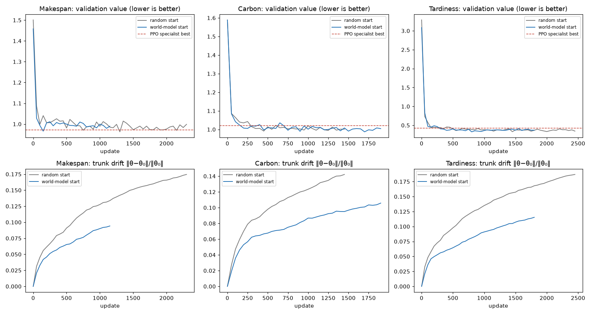
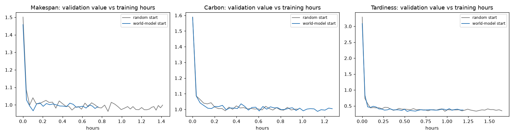

# World-model M2: objective-specific specialisation from the world-model trunk (10x5)

Protocol: `docs/world_model_m2_protocol_v3.md`. Generated by `tools/analyze_world_model_m2_v3.py`.
- **Seeds:** 111. Single seed: numbers only, no significance claims.
- **Method:** single-objective contrastive fine-tuning in both arms.
- **Scope:** no merging. The evaluation split is used for final values only; the reserved final-test sets were never loaded.

## Setup

**What every specialist shares:** each is DANIEL trained with single-objective contrastive fine-tuning:
- per instance, K = 8 sampled schedules;
- pairs = better on the specialist's own objective (normalised per instance) by more than 0.01;
- DPO-style loss against the frozen start network;
- β 0.1, gradient clip 1.0, learning rate 3e-4, 20 instances per update, resampled every 20 updates;
- the SD2 generator stream (the same instance stream as the committed PPO specialists for the same seed).

**The only difference between the arms is the starting network:**
- **Random start:** DANIEL after `setup_seed(seed)`. All three objectives start from copies of the same file.
- **World-model start:** the same network with its trunk (`feature_exact`) replaced by the M1 world-model trunk. Actor and critic are identical to the random start.

**Training details:**
- The trunk is trainable in both arms, with the same learning rate.
- Validation every 50 updates on the 18 v3 validation instances. The validation value is the specialist's objective divided by its reference (MK/MKref, C/Cref, T/Tref), lower is better, the same value the PPO specialists were selected on.
- **Stopping rule:** stop once the best validation value has improved by less than 0.5% over the last 1,000 updates, after at least 1,000 updates; hard cap 8,000 updates, reported as 'capped'.

## Answers to the pre-registered questions

| Objective | Faster? (world-model updates to reach the random start's best, as a share of the random start's updates to its best; yes if ≤ 70%) | Better? (final evaluation value, improvement over the random start; yes if ≥ 5%) |
|---|---|---|
| Makespan | not reached | -1.4% → no |
| Carbon | 200% → no | +1.7% → no |
| Tardiness | 55% → yes | -4.8% → no |

- **Faster** (on at least 2 of 3 objectives): **NO** (1 of 3: Tardiness).
- **Better** (on at least 2 of 3 objectives): **NO** (0 of 3: none).
- **Does the benefit generalise across objectives?** The per-objective rows above answer this directly.

## Training

| Specialist | Validation value at update 0 | Best validation value | Update of best | Stop update | Hours to best | Hours to stop | Environment steps |
|---|---|---|---|---|---|---|---|
| Makespan specialist, random start | 1.5012 | 0.9627 | 1300 | 2300 | 0.86 | 1.41 | 18,400,000 |
| Makespan specialist, world-model start | 1.4583 | 0.9660 | 150 | 1150 | 0.10 | 0.76 | 9,200,000 |
| *Makespan PPO specialist, committed (reference)* | - | 0.9715 | 2200 | 2300 | - | 0.54 | - |
| Carbon specialist, random start | 1.5892 | 0.9913 | 450 | 1450 | 0.30 | 0.96 | 11,600,000 |
| Carbon specialist, world-model start | 1.5882 | 0.9872 | 1700 | 1900 | 1.14 | 1.27 | 15,200,000 |
| *Carbon PPO specialist, committed (reference)* | - | 1.0209 | 1150 | 1550 | - | 0.35 | - |
| Tardiness specialist, random start | 3.2889 | 0.3306 | 1450 | 2450 | 0.97 | 1.65 | 19,600,000 |
| Tardiness specialist, world-model start | 3.0852 | 0.3271 | 800 | 1800 | 0.53 | 1.19 | 14,400,000 |
| *Tardiness PPO specialist, committed (reference)* | - | 0.4242 | 800 | 1800 | - | 0.41 | - |

### Time to comparable performance (validation)

Updates (and training hours) until the first validation value at or below the target; "not reached" if never.

| Objective | Random start reaches world-model start's best | World-model start reaches random start's best | Random start reaches the PPO specialist's best | World-model start reaches the PPO specialist's best |
|---|---|---|---|---|
| Makespan | 1300 (0.86 h) | not reached | 750 (0.50 h) | 150 (0.10 h) |
| Carbon | not reached | 900 (0.61 h) | 300 (0.20 h) | 200 (0.14 h) |
| Tardiness | not reached | 800 (0.53 h) | 350 (0.23 h) | 300 (0.20 h) |

### How far the trunk moved

Relative distance from the starting weights, ‖θ − θ₀‖ / ‖θ₀‖, at the best checkpoint and at the stop.

| Specialist | Trunk at best | Trunk at stop | Actor at stop |
|---|---|---|---|
| Makespan specialist, random start | 0.142 | 0.175 | 0.650 |
| Makespan specialist, world-model start | 0.042 | 0.094 | 0.582 |
| Carbon specialist, random start | 0.094 | 0.142 | 0.595 |
| Carbon specialist, world-model start | 0.101 | 0.106 | 0.653 |
| Tardiness specialist, random start | 0.156 | 0.187 | 0.674 |
| Tardiness specialist, world-model start | 0.081 | 0.115 | 0.628 |

## Final evaluation (evaluation split, 100 instances, best checkpoint)

Raw means over instances; lower is better. Greedy is the primary value; best of 100 samples is shown for context.

### Makespan (min)

| Specialist | Greedy: makespan | Greedy: carbon | Greedy: tardiness | Greedy: jobs late | Best of 100: own objective | Own objective vs PPO specialist (s111) |
|---|---|---|---|---|---|---|
| Makespan specialist, random start | 403.1 | 154.4 | 417.9 | 48% | 368.9 | -0.1% |
| Makespan specialist, world-model start | 408.8 | 156.7 | 451.3 | 50% | 381.0 | +1.3% |
| *PPO specialist, committed (s111)* | 403.6 | 154.5 | 444.4 | 49% | 360.0 | - |
| *PPO specialist, committed (mean of s111/222/333)* | 408.5 | 154.8 | 414.5 | 48% | 361.7 | - |
| *CP-SAT single-objective (B1, 100 instances)* | | | | | | own objective 323.7 |
| *MWKR+ECT reference rule* | | | | | | own objective 410.2 |

### Carbon (kg CO2e)

| Specialist | Greedy: makespan | Greedy: carbon | Greedy: tardiness | Greedy: jobs late | Best of 100: own objective | Own objective vs PPO specialist (s111) |
|---|---|---|---|---|---|---|
| Carbon specialist, random start | 453.4 | 151.8 | 333.9 | 39% | 140.5 | -2.4% |
| Carbon specialist, world-model start | 457.6 | 149.2 | 326.6 | 38% | 137.9 | -4.1% |
| *PPO specialist, committed (s111)* | 449.4 | 155.5 | 416.8 | 43% | 142.3 | - |
| *PPO specialist, committed (mean of s111/222/333)* | 450.2 | 153.5 | 359.8 | 40% | 140.7 | - |
| *CP-SAT single-objective (B1, 100 instances)* | | | | | | own objective 118.8 |
| *MWKR+ECT reference rule* | | | | | | own objective 149.7 |

### Tardiness (min)

| Specialist | Greedy: makespan | Greedy: carbon | Greedy: tardiness | Greedy: jobs late | Best of 100: own objective | Own objective vs PPO specialist (s111) |
|---|---|---|---|---|---|---|
| Tardiness specialist, random start | 447.8 | 154.2 | 202.8 | 37% | 99.0 | -13.8% |
| Tardiness specialist, world-model start | 458.9 | 156.1 | 212.6 | 38% | 96.6 | -9.6% |
| *PPO specialist, committed (s111)* | 476.3 | 161.0 | 235.3 | 42% | 108.1 | - |
| *PPO specialist, committed (mean of s111/222/333)* | 463.3 | 160.2 | 244.9 | 43% | 108.1 | - |
| *CP-SAT single-objective (B1, 100 instances)* | | | | | | own objective 17.0 |
| *MWKR+ECT reference rule* | | | | | | own objective 570.1 |

## Curves

## Costs

- **Specialist training, all objectives and seeds:** random start 4.02 h, world-model start 3.22 h. Runs shared one GPU, 6 runs in up to 3 parallel slots, so wall-clock is approximate and updates are the primary measure.
- **World-model pretraining, reported separately (M1, paid once for all objectives):** 0.22 h data generation (CPU) + 1.05 h pretraining (GPU).

## Files

- **Checkpoints** (`checkpoints/world_model_m2_v3/`, SHA-256 in `SHA256SUMS.json`): the two starting bases per seed, and the start and best checkpoints of every specialist, ready for later merging:
  - `10x5+mix+bv3_wm2_ctrl_c_s111.pth`: `b59b673aa0d12253…`
  - `10x5+mix+bv3_wm2_ctrl_c_s111_start.pth`: `ed70a3f5a2bc94da…`
  - `10x5+mix+bv3_wm2_ctrl_m_s111.pth`: `11ee83bada3bb3bf…`
  - `10x5+mix+bv3_wm2_ctrl_m_s111_start.pth`: `7f30090965c108e9…`
  - `10x5+mix+bv3_wm2_ctrl_t_s111.pth`: `ebb4d0d968ca1fe7…`
  - `10x5+mix+bv3_wm2_ctrl_t_s111_start.pth`: `a168b8d06cd46ca4…`
  - `10x5+mix+bv3_wm2_wm_c_s111.pth`: `c81c200eeb451e89…`
  - `10x5+mix+bv3_wm2_wm_c_s111_start.pth`: `55edd2ece8d3a476…`
  - `10x5+mix+bv3_wm2_wm_m_s111.pth`: `66de613016a7f759…`
  - `10x5+mix+bv3_wm2_wm_m_s111_start.pth`: `c1e5260b31faf33f…`
  - `10x5+mix+bv3_wm2_wm_t_s111.pth`: `7a44eb37d5a32dab…`
  - `10x5+mix+bv3_wm2_wm_t_s111_start.pth`: `620a7a32c868ba9f…`
  - `bases/shared_random_base_s111.pth`: `51dd57d1a92134c9…`
  - `bases/world_model_base_s111.pth`: `231a1806b548e3da…`
- **Runs:** `results/world_model_m2_v3/runs/`; **evaluations:** `results/world_model_m2_v3/eval/`.
- **World-model trunk:** `checkpoints/world_model_m1_v3/world_model_trunk.pth` (`8b5b85c289cec662…`).
