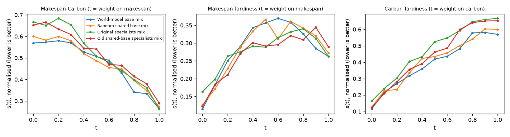
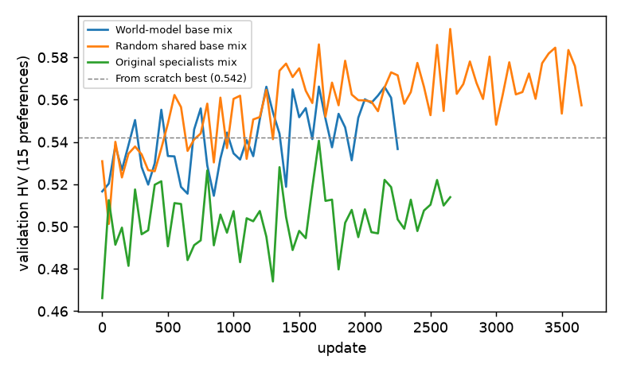

# World-model M3: preference-weighted merging (10x5, seed 111)

Protocol: `docs/world_model_m3_protocol_v3.md`. Generated by `tools/analyze_world_model_m3_v3.py`.
- **Single seed (111):** numbers only, no significance claims.
- **Direction:** higher HV is better; lower IGD+, regret and barrier are better.
- **Data:** the reserved final-test sets were never loaded.

## Merge method (identical for every set)

- **Merge:** for preference w = (w_M, w_C, w_T): theta(w) = w_M theta_M + w_C theta_C + w_T theta_T, a separate mix for every preference (every sample in Part B).
- **Trunk and actor:** mixed per preference; trainable in Part B (theta_x receives w_x * dL/dtheta(w)).
- **Critic:** mixed the same way and kept in the checkpoints; never read by the contrastive loss, so it receives no gradient.
- **Preference columns:** every specialist is copied into a preference-conditioned DANIEL with its three w-input columns (first actor and critic layers) at zero, so the mixed columns start at zero and the update-0 network is the plain weight mix for every w; trainable in Part B; w is fed both as mixing weights and as the preference input.

**Specialist sets** (seed 111; makespan, carbon and tardiness specialists each):

- **World-model base mix:** `checkpoints/world_model_m2_v3/10x5+mix+bv3_wm2_wm_{m,c,t}_s111.pth`
- **Random shared base mix:** `checkpoints/world_model_m2_v3/10x5+mix+bv3_wm2_ctrl_{m,c,t}_s111.pth`
- **Original specialists mix:** `checkpoints/specialists_v3/10x5+mix+bv3_spec_{m,c,t}_s111.pth`
- **Old shared-base specialists mix:** `checkpoints/merge_categories_v3/10x5+mix+bv3_mcft_{m,c,t}_s111.pth` (Part A only)

## Part A: merging without training

**Rollouts:** greedy, one merged network per preference: the 66-point grid (step 0.1) plus equal weights.
- **Evaluation split:** 100 instances. IGD+ uses the CP-SAT B2 subset (20 instances).
- **Validation split:** 18 instances, with the frozen validation normalisation. There are no B2 fronts on validation, so validation IGD+ is n/a.
- **'Validation HV, 15 preferences'** is measured on the training validation grid (step 0.25). It is directly comparable with the best validation HVs from training: From scratch 0.542, Distillation 0.540.

### Fronts

| Merge | Validation HV, 15 preferences | Validation HV, 66 | Validation unique non-dominated | Evaluation HV | Evaluation IGD+ (B2) | Evaluation unique non-dominated |
|---|---|---|---|---|---|---|
| World-model base mix | 0.517 | 0.563 | 7.0 | 0.589 | 0.316 | 6.4 |
| Random shared base mix | 0.531 | 0.571 | 7.0 | 0.584 | 0.326 | 6.0 |
| Original specialists mix | 0.466 | 0.585 | 6.9 | 0.571 | 0.339 | 6.2 |
| Old shared-base specialists mix | 0.476 | 0.558 | 8.1 | 0.567 | 0.350 | 6.2 |
| *From scratch, converged contrastive (reference)* | 0.542 (best) | - | - | 0.600 | 0.323 | 5.1 |
| *Distillation, converged contrastive (reference)* | 0.540 (best) | - | - | 0.609 | 0.309 | 6.5 |

**Original specialists vs the earlier zero-training interpolation (E0):**
- **Reproduction:** the Original specialists mix gives evaluation HV **0.5705**. Its objectives are bit-identical to the committed E0 seed-111 front (`results/warmstart_v3/eval/evaluation_10x5/10x5+mix+bv3_ws_E0_s111.npz`). On the same 100 instances, E0's HV is 0.5705; on all 100 it is 0.5705.
- **Why it differs from 0.555:** 0.555 is the **mean over seeds 111, 222 and 333** (0.571 / 0.580 / 0.514, mean 0.555). M3 uses seed 111 only, so the right comparison is seed 111's 0.571. The method, grid, normalisation and code path are the same.

### Per-preference quality: corner vs in-between

- **Corner:** any weight ≥ 0.8 (18 of 66 preferences). **In-between:** the other 48.
- **Mean regret:** λ·f − min over the pool of λ·z, in normalised space, averaged over instances and preferences.
  - **Pool:** per split and instance: the references of analyze_warmstart_v3.reference_points (specialists of all seeds, rules, CP-SAT B1), the CP-SAT B2 front where it exists, converged From scratch and Distillation (evaluation split only) and the 66-point fronts of all four sets; Part B arms are scored against this pool plus their own points.
- **Share non-dominated:** per preference, the share of instances whose schedule is not strictly dominated by another schedule of the same set's 66-point front.

| Merge | Split | Mean regret, corner | Mean regret, in-between | Mean regret, all | Share non-dominated, corner | Share non-dominated, in-between |
|---|---|---|---|---|---|---|
| World-model base mix | evaluation | 0.3372 | 0.3037 | 0.3129 | 0.21 | 0.20 |
| Random shared base mix | evaluation | 0.3417 | 0.3130 | 0.3208 | 0.21 | 0.18 |
| Original specialists mix | evaluation | 0.3851 | 0.3476 | 0.3579 | 0.16 | 0.13 |
| Old shared-base specialists mix | evaluation | 0.3911 | 0.3266 | 0.3442 | 0.12 | 0.17 |
| World-model base mix | validation | 0.2396 | 0.1908 | 0.2041 | 0.27 | 0.23 |
| Random shared base mix | validation | 0.2461 | 0.1928 | 0.2073 | 0.25 | 0.25 |
| Original specialists mix | validation | 0.2837 | 0.2165 | 0.2348 | 0.13 | 0.13 |
| Old shared-base specialists mix | validation | 0.2729 | 0.2000 | 0.2199 | 0.19 | 0.21 |

### Ridge test (validation)

- **Path:** θ_t = t·θ_a + (1−t)·θ_b for t = 0, 0.1, …, 1. These are the simplex-edge points of the 66-point grid, the same rollouts as above.
- **Score:** s(t) = t·f_a + (1−t)·f_b, where f is the normalised objective (validation ideal/nadir) averaged over instances. Lower is better.
- **Barrier:** max_t [s(t) − straight line between s(0) and s(1)].
  - **> 0:** there is a ridge (the path is worse than the line).
  - **≤ 0:** no ridge.
- **Dip a / dip b:** the same measure for each objective on its own.

| Merge | Makespan-Carbon: barrier (dip a / dip b) | Makespan-Tardiness: barrier (dip a / dip b) | Carbon-Tardiness: barrier (dip a / dip b) |
|---|---|---|---|
| World-model base mix | +0.1031 (+0.0000 / +0.0600) | +0.1694 (+0.1461 / +0.0073) | +0.1001 (+0.0810 / +0.0313) |
| Random shared base mix | +0.0778 (+0.0018 / +0.0380) | +0.1674 (+0.1002 / +0.0594) | +0.1074 (+0.1013 / +0.0350) |
| Original specialists mix | +0.1082 (+0.0335 / +0.0580) | +0.0990 (+0.0406 / +0.0383) | +0.1094 (+0.0280 / +0.0598) |
| Old shared-base specialists mix | +0.0701 (+0.0309 / +0.0244) | +0.1121 (+0.0543 / +0.0027) | +0.1059 (+0.1048 / +0.0269) |

## Part B: merge fine-tuning

Sets 1–3 only. Three trainable specialist networks; for each training sample with preference w, the policy is the mix for that w, and gradients update all three networks.
- **Settings:** the multi-objective contrastive settings, unchanged: Dirichlet(1,1,1) preferences per environment, K 8, β 0.1, margin 0.01, lr 3e-4, clip 1.0 on the joint gradient norm, 20 instances resampled every 20 updates.
- **Reference:** the frozen starting mix for the same w.
- **Stopping rule:** stop once the best validation HV has improved by less than 0.5% over the last 1,000 updates, after at least 1,000 updates; hard cap 8,000 updates, reported as 'capped'.

| Arm | HV at update 0 | Best validation HV | Update of best | Stop update | Evaluation HV | IGD+ | Unique non-dominated | Mean regret |
|---|---|---|---|---|---|---|---|---|
| World-model base mix | 0.517 | 0.566 | 1650 | 2250 (converged) | 0.642 | 0.285 | 6.2 | 0.2878 |
| Random shared base mix | 0.531 | 0.593 | 2650 | 3650 (converged) | 0.618 | 0.302 | 6.1 | 0.2861 |
| Original specialists mix | 0.466 | 0.541 | 1650 | 2650 (converged) | 0.600 | 0.330 | 6.3 | 0.3278 |
| *From scratch, converged (reference)* | 0.000 | 0.542 | 4150 | 4550 (converged) | 0.600 | 0.323 | 5.1 | 0.2918 |
| *Distillation, converged (reference)* | 0.494 | 0.540 | 900 | 1900 (converged) | 0.609 | 0.309 | 6.5 | 0.3142 |

Mean regret uses the frozen Part A evaluation pool, plus the arm's own points.

### Cost

- **Merge fine-tuning:** this Part B run.
- **+ specialists:** the three specialists' training. For the Old shared-base specialists, their shared PPO base as well.
- **+ world model:** M1 pretraining, 1.27 h (0.22 h data + 1.05 h GPU). It applies to the world-model set only and is paid once for all objectives.
- **Parallel:** wall-clock if the three specialists train in parallel (the longest one, plus a shared base where there is one).

| Arm | Merge fine-tuning (h) | + specialist training (h) | + world-model pretraining (h) | Same, specialists in parallel (h) |
|---|---|---|---|---|
| World-model base mix | 1.94 | 5.16 | 6.43 | 4.48 |
| Random shared base mix | 2.90 | 6.93 | 6.93 | 4.55 |
| Original specialists mix | 2.27 | 3.57 | 3.57 | 2.81 |
| *From scratch, converged (reference)* | 2.70 | - | - | - |
| *Distillation, converged (reference)* | 1.15 | - | - | - |

Runs shared one GPU in up to 3 parallel slots, so hours are approximate; updates are the primary measure.

## Verdicts (H2: world-model base vs random shared base)

- **Mergeable: NO.**
  - **(a)** In-between mean regret (evaluation): 0.3037 vs 0.3130, ratio 0.970. Needs ≤ 0.90 → no.
  - **(b)** Smaller barrier on 1 of 3 pairs (Carbon-Tardiness). Needs ≥ 2 → no.
- **Better after merging: NO.** Evaluation HV 0.642 vs 0.618, ratio 1.038. Needs ≥ 1.05.
- **Faster after merging: YES.** Updates to reach validation HV 0.542: world-model mix 250, random shared base mix 500. Needs ≤ 70%.

Single seed: numbers only.
